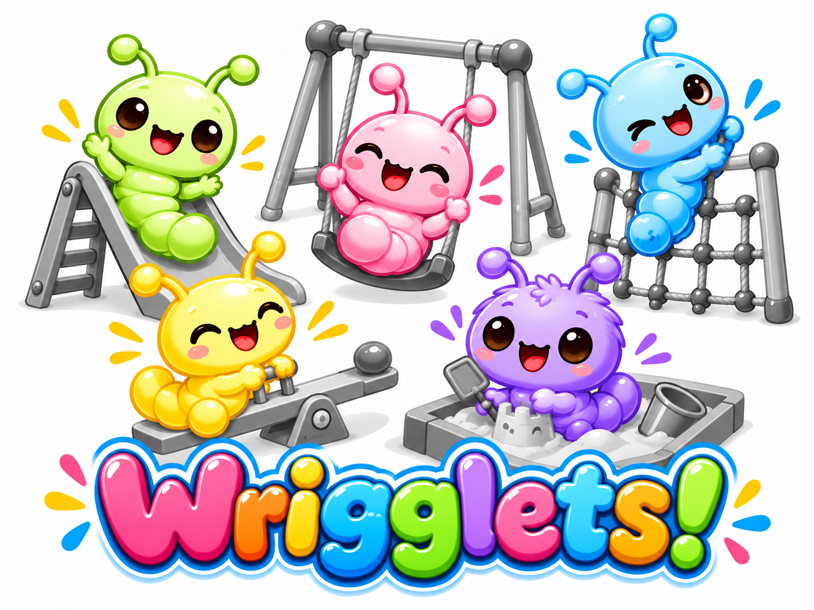
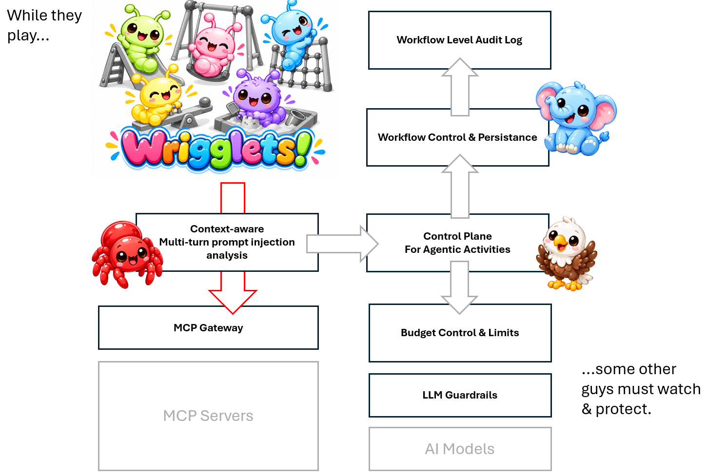
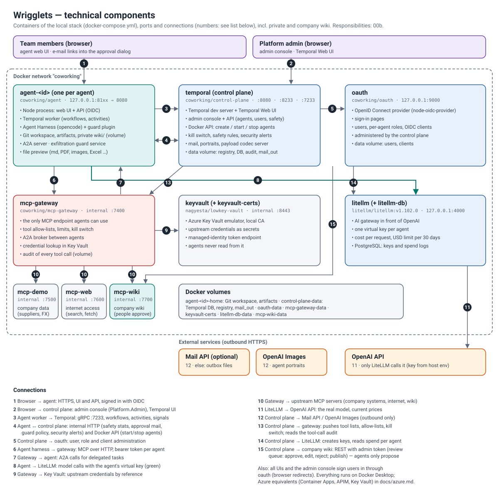
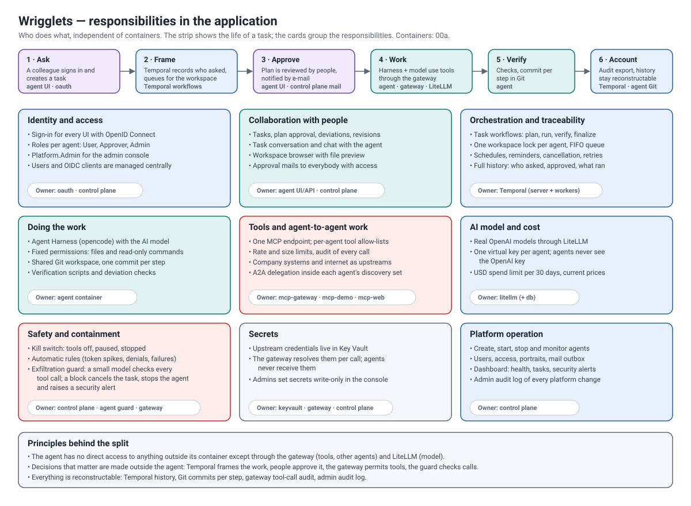

<p align="center"></p>

# Wrigglets

**AI colleagues that work on your tasks for hours or days, on a schedule if you like, while you stay in control.**

You give an agent a task through a web page, for example "write the monthly sales report and update it every Monday".
The agent works in its own workspace, drafts the document, comes back to refine it, and asks you for a decision by
e-mail when one is due. You can see what it did, ask it questions, approve or reject its work, and stop it at any time.

## Two ideas behind it

**1. Put the human in the loop for approval.** Autonomous agents are only useful if people can trust them with long
tasks. Because an agent keeps working for hours or days, people must be reached when a decision is due, be able to
approve or reject, and keep control over what the agent does in the meantime. *For you:* you delegate real work without
handing over the keys.

**2. Keep agents away from your internal data and systems.** Agents never reach internal data (for example SharePoint
documents) or services (like business master data in SAP) directly. They get only what a governed gateway exposes to
them. *For you:* if an agent makes a mistake, is tricked by a malicious text or is compromised, the damage stays small
(a small "blast radius").

## How a task flows

1. **You ask.** You create an agent (or pick an existing one) and describe the task, once or on a schedule.
2. **The agent works.** It uses its AI model and approved tools in a private, versioned workspace and writes its
   results there, for example a report draft.
3. **You decide.** When the agent needs a decision, everybody with access gets an e-mail with a link straight to the
   approve/reject dialog. A rejected change is rolled back.
4. **It continues and repeats.** The agent refines the document, and runs again at the scheduled times.
5. **Everything is recorded.** Who requested what, who approved it, what was done and what is scheduled can always be
   reconstructed.

Under the hood the **Agent Harness** (opencode) does the work with the model of the AI gateway, and **Temporal** frames
all work as durable workflows. This repository implements [`agent-implementation-spec.md`](agent-implementation-spec.md)
for a **local Docker Desktop** environment, extended to a small platform.



## What you get

Each building block is described by what it gives you first, then by where it lives in this project.

- **Reliable, traceable work** (workflow engine, `temporal` container)
  Long tasks survive restarts, can be replayed, and always show who requested what, who approved it and what is
  scheduled. A *workflow engine* is the software that records and drives each step of such work.
  *In the project:* Temporal server (dev server) + Temporal Web UI; every agent runs its tasks as workflows in its own
  namespace ([`packages/workflows`](packages/workflows),
  [ADR-0002](docs/adr/0002-temporal-in-control-plane-container.md),
  [ADR-0005](docs/adr/0005-multi-agent-namespacing.md)).
- **One place to run all agents** (control plane)
  Administrators create, configure and watch agents and manage users and access in one console, instead of handling each
  agent by hand.
  *In the project:* the **admin console**, which runs in the `temporal` container
  ([`apps/admin-server`](apps/admin-server), [`apps/admin-web`](apps/admin-web)).
- **One sign-in, clear roles** (identity provider, `oauth` container)
  People and agents sign in the same standard way (OpenID Connect), and who may do what is decided in one place instead
  of passwords or keys scattered across services.
  *In the project:* node-oidc-provider, administered by the admin console with per-agent roles
  ([`apps/oauth-server`](apps/oauth-server), [ADR-0004](docs/adr/0004-oidc-server-and-per-agent-roles.md)).
- **Every agent in its own space** (agent containers)
  A problem in one agent cannot spill over into another, and agents can be added or removed on demand.
  *In the project:* API + Temporal worker + Agent Harness per agent, created on demand
  ([`apps/agent-server`](apps/agent-server), [`apps/agent-web`](apps/agent-web), [`infra/docker`](infra/docker)).
- **A workspace you can roll back** (Git)
  Every change an agent makes to your documents is a versioned step. If you reject a change, it is undone with ordinary
  Git mechanics, so nothing is lost or silently overwritten.
  *In the project:* one shared Git-versioned workspace per agent
  ([ADR-0015](docs/adr/0015-deviation-rejection-reverts.md)).
- **Safe access to data and tools** (tool gateway, `mcp-gateway` container)
  Agents reach your systems only through one gateway (speaking MCP, the standard way agents call tools). Your data
  sources stay out of direct reach, access is limited per agent and logged, and agents can hand work to each other
  (agent-to-agent, A2A) in a controlled way.
  *In the project:* the only MCP endpoint agents see; it holds the per-agent tool allow-lists and the kill switch, and
  brokers A2A delegation inside each agent's discovery set ([`apps/mcp-gateway`](apps/mcp-gateway),
  [ADR-0021](docs/adr/0021-mcp-gateway.md), [ADR-0023](docs/adr/0023-a2a-between-agents.md)).
- **Current information without open doors** (internet access, `mcp-web` container)
  Agents can search the web and read public pages, but only if you allow it for that agent, and never internal or
  private addresses.
  *In the project:* web search and page reading as gateway tools ([`apps/mcp-web`](apps/mcp-web),
  [ADR-0031](docs/adr/0031-internet-access-via-mcp.md)).
- **Credentials kept out of agents** (secret store, `keyvault` container)
  Passwords and keys for your systems are not in code, images or agents, and can be rotated and audited in one place.
  *In the project:* Azure Key Vault emulator (Lowkey Vault), with the same client code working against Azure
  ([`packages/secrets`](packages/secrets), [`infra/keyvault`](infra/keyvault),
  [ADR-0024](docs/adr/0024-key-vault-emulation.md)).
- **An emergency stop** (kill switch)
  If an agent misbehaves, you can stop it quickly, without relying on the agent's cooperation. Graded levels allow a
  proportionate response.
  *In the project:* per agent and global, with the levels tools off, paused and stopped, plus automatic triggers
  ([ADR-0022](docs/adr/0022-kill-switch.md), enforced in the gateway).
- **Predictable costs** (AI gateway, LiteLLM)
  Each agent has its own budget in money, not a shared pool of tokens, so one runaway agent cannot use up everybody's
  allowance, and nobody gets direct access to the AI model.
  *In the project:* LiteLLM 1.102.0 → OpenAI with `OPENAI_API_KEY` from your environment, a virtual key per agent, a
  **spend limit in USD per 30 days** and current token prices. If no model is available, the UIs say what to configure
  ([ADR-0029](docs/adr/0029-litellm-ai-gateway-and-spend-limits.md), [`docker-compose.yml`](docker-compose.yml)).
- **Decisions by e-mail** (human in the loop)
  You do not have to watch the agent. When a decision is due, you get a mail with a direct link to the decision dialog,
  and the agent continues once you have answered.
  *In the project:* mails go to everybody with access to the task, via a configurable mail API or the outbox
  (`mail_out`); admins can review them in the console ([ADR-0026](docs/adr/0026-human-in-the-loop-email.md)).
- **A readable history and a chat** (task conversation)
  Each task has a plain history (request, agent reports, decisions, results), and you can simply ask the agent about the
  task, its files and images instead of digging through logs.
  *In the project:* a Markdown history per task; the agent answers with its model
  ([ADR-0028](docs/adr/0028-task-conversation.md), [ADR-0030](docs/adr/0030-chat-with-the-agent.md)).
- **See results right away** (file preview)
  You can judge an agent's output without downloading it or opening other tools.
  *In the project:* Markdown, Mermaid diagrams, PDF, text, CSV, images and Excel in the agent UI
  ([ADR-0027](docs/adr/0027-workspace-file-preview.md)).
- **Colleagues with a face** (agent portraits)
  A portrait and a mood make agents recognizable and show their state at a glance.
  *In the project:* portraits in four moods, generated from a guiding image with an OpenAI image model
  ([ADR-0025](docs/adr/0025-agent-portraits.md), default image in [`assets`](assets)).
- **Built with:** TypeScript/Node.js throughout, React + Material UI with one shared theme
  ([`packages/*`](packages)), prepared for Azure (private ACR, APIM, Key Vault; [docs/azure.md](docs/azure.md)).

## Quick start

```bash
node scripts/stack.mjs up
```

Then open http://localhost:8080, sign in with the printed admin credentials and create an agent.
Details: [docs/getting-started.md](docs/getting-started.md). New here? Follow the **[guided tour](guided-tour.md)**.

## Architecture

**a) Technical components:** the containers of the local stack, their ports and connections.



**b) Responsibilities:** who does what in the application, along the life of a task.



More detail: [docs/architecture.md](docs/architecture.md); safety, gateway and A2A in
[diagram 10](docs/diagrams/10-killswitch-gateway.svg).

## Safety in layers

No single protection is perfect, so Wrigglets stacks several: the agent can only use the tools its **allow-list**
permits, reaches data only through the **gateway**, can only spend its **budget**, only writes in a **rollbackable
workspace**, is watched by the **exfiltration guard** (below) and can be stopped by the **kill switch**. Optionally,
data access follows the signed-in **user's own rights** (next section).

### Optional: access with the user's own rights (Microsoft Entra On-Behalf-Of)

*For you:* an agent sees only the data you are allowed to see, and your company's audit logs show both the agent and
the person it worked for.

Technically, MCP servers can receive a **Microsoft Entra token that carries two identities**: the **agent** (`azp`) and
the **user** it works for (`oid`, `upn`). This is the identity model of Microsoft Foundry, obtained through the Entra
*On-Behalf-Of* flow. It is off by default; the local stack keeps working with static upstream credentials.

- Each agent can have its own **Entra identity** (app registration with a secret, certificate or federated credential),
  set in the admin console on the agent's **Identity** tab. The agent signs users in and keeps their tokens encrypted.
- An upstream MCP server is switched to **Entra On-Behalf-Of** in the gateway settings. For every tool call the gateway gets a
  short-lived token from the agent and uses it for that call only; user tokens never leave the agent.
- **Fail closed**: no valid user sign-in means no call, and an OBO upstream never falls back to static credentials.
  Scheduled and agent-to-agent tasks have no user; they are denied, or, if explicitly allowed per upstream and agent,
  use the agent's own token without a user identity.
- Agents have **no access to Key Vault**; the control plane hands them their credential.

Needs a real Entra tenant (`ENTRA_TENANT_ID`). Model, set-up, rules and operations: **[docs/entra-obo.md](docs/entra-obo.md)**
([ADR-0032](docs/adr/0032-entra-obo-for-mcp.md)).

### Exfiltration guard

*For you:* a malicious text that an agent happens to read cannot quietly make it leak your data.

Background agents read untrusted text, so a **multi-turn prompt injection** (a hidden instruction planted early in
the conversation) can plant a goal and let a later call of an allowed tool (for example an e-mail tool) carry data out.
The guard checks every tool call before it runs:

1. **Pre-tool hook:** an opencode plugin (`tool.execute.before`) sends every tool call of the Agent Harness to the
   agent server, which asks an **evaluation agent**. If that cannot be reached, the call is refused.
2. **Evaluation agent:** a nano-class model (default `gpt-5.4-nano`, on the agent's own LiteLLM key). It sees the **last
   5 model round-trips** of the task conversation (prompts, tool calls, tool results) and the pending call, and
   answers `allow` or `block` with a category and a reason.
3. **On a block:** the tool never runs, the user's task is **cancelled**, the harness is aborted, and a **warning goes
   to Temporal** (the agent's `AgentWorkflow`). It stops the agent at once and delivers a **security alert** to the
   control plane, which stops all tasks of the agent (kill switch) and shows the alert on the **admin dashboard**.
4. **Tailored, editable policy:** the system prompt of the evaluation agent targets multi-turn injection and data
   extraction and is edited in the admin console under *Safety & tools → Exfiltration guard*, together with model,
   context size, halt level and fail mode.

The guard is one layer next to tool allow-lists, the MCP gateway and the kill switch; it is probabilistic and does not
cover what happens with the agent's output afterwards.

Details, sequence diagram, configuration and limits: **[docs/exfiltration-guard.md](docs/exfiltration-guard.md)**
([ADR-0033](docs/adr/0033-exfiltration-guard.md)). A runnable attack suite with a mock MCP server:
[docs/red-teaming.md](docs/red-teaming.md).

## An operating system for agents, in small

Think of what an operating system does for programs: it keeps track of them, gives each its own memory, controls what
they may touch, limits their resources and logs what happens. Wrigglets does the same for AI agents, which is why the
table below uses that vocabulary. *For you:* the safety, cost and audit rules apply to every agent automatically; nobody
has to remember to build them in.

**How it compares to OpenAI.** OpenAI's closest equivalent of an enterprise agent control plane is **OpenAI
Frontier** (announced 5 February 2026, sales-led access): agent lifecycle, dedicated agent identities with enterprise
IAM, explicit permissions, observability and audit logs, evaluation, governance and shared business context, for
agents built in-house or by third parties [[1]](#sources-agentic-os)[[2]](#sources-agentic-os). Beneath it sit the
**Agents API** (managed execution with durable sessions and subagents; public beta since 10 September 2026,
[[3]](#sources-agentic-os)) and the **Agents SDK** (a developer library for orchestration, tools and handoffs).
Frontier is a governance and operations layer for *agents*; OpenAI's public descriptions do not establish that it is an
infrastructure control plane for independently deployed, containerized agents (provisioning and scheduling, third-party
frameworks, replayable histories, cross-agent discovery, programmatic lifecycle management). That is the gap Wrigglets
fills. The Frontier column describes *advertised platform capabilities*, not necessarily public APIs; "not described"
means that nothing was found in the public material, not that the feature is absent.

| What an agent platform must do (OS analogy) | Wrigglets | OpenAI Frontier and Agents API |
|---|---|---|
| **Keep track of agents** (process table) | The **control plane** starts agent containers on demand and tracks state, tasks, schedules and alerts; the admin console configures, starts and stops them via API. | Agent lifecycle (build, deploy, operate, improve) as a managed offering; the Agents API runs agents on OpenAI's harness. Provisioning of arbitrary, independently deployed containers is not described. |
| **Run work reliably and on schedule** (scheduler, journal) | **Temporal** frames every task as a durable workflow: who requested, who approved, what ran, what is scheduled. Replayable execution history. | Durable *sessions* (saved configuration, turns and items, resumable) and parallel agent execution [[3]](#sources-agentic-os). A replayable workflow history comparable to Temporal is not described. |
| **Control access to data and tools** (system calls) | The **MCP gateway** is the only MCP endpoint agents see: per-agent allow-lists, no direct access to upstream data sources, kill switch. | Explicit permissions and controlled access to tools and data; integrations with CRM, databases and warehouses [[1]](#sources-agentic-os). Whether agents are blocked from reaching sources directly is not stated. |
| **Let agents cooperate** (inter-process communication) | **A2A delegation** inside each agent's discovery set, brokered by the gateway. | Coordinated workflows and subagents inside the Agents API [[3]](#sources-agentic-os); discovery across independently deployed agents is not described. |
| **Detect attacks** (intrusion detection) | The **exfiltration guard** checks every tool call against the last 5 model round-trips for hidden, multi-turn injection and data extraction. A block cancels the task and halts the agent. | Guardrails and "enterprise security and compliance controls" [[1]](#sources-agentic-os); a cross-turn monitor of tool calls is not described. |
| **Limit costs** (resource quotas) | **Money, not tokens**: a LiteLLM virtual key and a spend limit per agent. No shared token pool, no direct model access. | Token-based API billing; a per-agent monetary cap is not described. |
| **Keep work safe and reversible** (filesystem, snapshots) | Each agent works in an **isolated, Git-versioned workspace**; every change is a commit and a rejected change is reverted with ordinary Git ([ADR-0015](docs/adr/0015-deviation-rejection-reverts.md)). | Agents API execution runs with no environment, an OpenAI-hosted sandbox or a self-hosted sandbox [[3]](#sources-agentic-os); workspace versioning with rollback is not described. |
| **Run the agent's thinking loop** (kernel) | **opencode**, a vendor- and model-neutral harness, protected by the gateway and the guard. | The managed Codex harness [[3]](#sources-agentic-os); Frontier is said to manage third-party agents too [[2]](#sources-agentic-os). |
| **Know who is acting** (user identity) | **Entra On-Behalf-Of** at the gateway: agent and user identity on every upstream call, fail closed. | Dedicated agent identities integrated with enterprise IAM [[1]](#sources-agentic-os). Per-user delegation to upstream tools is not described. |
| **Prove what happened** (audit log) | Workflow history, task conversations, gateway decisions, alerts and mails for compliance audits. | Monitoring, logs and auditable agent actions; continuous evaluation [[1]](#sources-agentic-os)[[2]](#sources-agentic-os). |
| **Share knowledge** (shared context) | Shared Git workspace and task history per agent. | Shared organizational knowledge and persistent context across agents (Frontier's emphasis). |

**What this means in practice**

- **Containment instead of trust.** Safety does not rely on the model behaving. The agent can only reach what the
  gateway exposes, only spend what its budget allows, and only write inside a workspace that can be rolled back.
- **Rules in one place.** Provisioning, durable workflows, A2A, identity, cost and audit are properties of the
  platform, not code each agent author must remember to write.
- **Open and self-hosted.** It runs on your Docker or Azure estate, with a model-neutral harness behind a gateway, so
  the model vendor can change without changing the control.

**What it is not.** Frontier is a vendor-operated enterprise product with business-context integration, evaluation and
OpenAI's scale behind it; Wrigglets is a small platform you operate yourself, and its guard is probabilistic. Frontier
and the Agents API are complements rather than rivals: an agent built on either could, in principle, sit behind this
gateway and be governed by its quotas and guard, and the Agents SDK remains the lighter choice for a single agent in one
application.

<a id="sources-agentic-os"></a>
<sub>Retrieved 2026-10-27. Frontier is described mostly by secondary sources and the product is sales-led; verify against
OpenAI's own materials before relying on details.
[1] [OpenAI launches platform to manage AI agents (Axios, 5 Feb 2026)](https://axios.com/2026/02/05/openai-platform-ai-agents) ·
[2] [OpenAI Frontier: enterprise agents, features and pricing (The Rundown)](https://www.therundown.ai/tools/openai-frontier) and [OpenAI Frontier platform guide (ALM Corp)](https://almcorp.com/blog/openai-frontier-enterprise-ai-agent-platform-guide/) ·
[3] [OpenAI launches managed Agents API in public beta (Data Phoenix)](https://dataphoenix.info/news/openai-agents-api-public-beta) and [The Agents API: the Codex harness behind one API call](https://kdpisda.in/openai-agents-api-public-beta-codex-harness/).</sub>

## LiteLLM version (supply chain)

> [!IMPORTANT]
> LiteLLM was recently the target of a supply-chain attack. This repository therefore uses **exactly LiteLLM 1.102.0**,
> pinned by image digest in [`docker-compose.yml`](docker-compose.yml):
>
> ```text
> litellm/litellm:v1.102.0@sha256:32cfd7a427f6470033b4dcc9e75dfbea2aa32dbc298b0b511a40e962ce818362
> ```
>
> - Docker refuses to start a different image under this name, because the digest must match.
> - The image is identical to `ghcr.io/berriai/litellm:v1.102.0`; the linux/amd64 manifest digest is
>   `sha256:9d60771c86a42ced1b918f23dd940a1ac9905ddb02a4fae779cfe1937477c9a0` in both registries.
> - The image is not built here and no LiteLLM Python package is installed anywhere else in the stack.
> - LiteLLM only sees the OpenAI key and the agents' virtual keys; agents never see the OpenAI key.
> - **Before upgrading:** check the LiteLLM security advisories, compare the digest published by the maintainers, and
>   change the tag *and* digest together.
>
> Verify the running image: `docker inspect cw-litellm --format '{{.Image}}'` and
> `docker run --rm --entrypoint python litellm/litellm:v1.102.0 -c "import importlib.metadata as m; print(m.version('litellm'))"`
> (prints `1.102.0`).

## Documentation

- [Guided tour](guided-tour.md): set up an agent and work with it, step by step with screenshots
- [Technical documentation](docs/architecture.md) (architecture, diagrams, APIs, configuration, verification)
- [Exfiltration guard](docs/exfiltration-guard.md): protection against multi-turn prompt injection
- [Azure target and resource types](docs/azure.md)
- [Runbook](docs/runbook.md)
- [Architecture Decision Records](docs/adr/README.md)

## Repository

| Path | |
|---|---|
| `apps/agent-server`, `apps/agent-web` | the agent (API/BFF, worker, harness supervisor; UI) |
| `apps/admin-server`, `apps/admin-web` | control plane and admin console (runs in the temporal container) |
| `apps/oauth-server`, `apps/oauth-web` | OpenID Connect server and sign-in pages |
| `apps/mcp-gateway`, `apps/mcp-demo`, `apps/mcp-web` | MCP gateway (tools, kill switch, A2A broker), example upstream and internet access (search, fetch) |
| `packages/secrets` | Key Vault access (`@azure/keyvault-secrets`), works against the emulator and Azure |
| `packages/*` | shared DTOs, workflows, codec, harness config, OIDC RP, MUI theme/components |
| `infra/docker` | multi-target Dockerfile and agent entrypoint |
| `infra/keyvault` | local CA and TLS certificate for the Key Vault emulator |
| `assets` | default guiding image for agent portraits |
| `infra/temporal` | namespace bootstrap script for self-hosted Temporal (Azure) |
| `docker-compose.yml`, `scripts/stack.mjs` | local stack |

## Tests

```bash
corepack pnpm install && corepack pnpm -r build && corepack pnpm test
```

88 tests: workflow behaviour against a local Temporal test server (approvals, lock, cancellation, budget,
continue-as-new, kill-switch suspend/resume, delegation wait), replay of recorded histories, timeline mapping, Git
conventions, path safety, OIDC roles, codec, gateway policy, safety rules, approval mails, LiteLLM spend and status.
