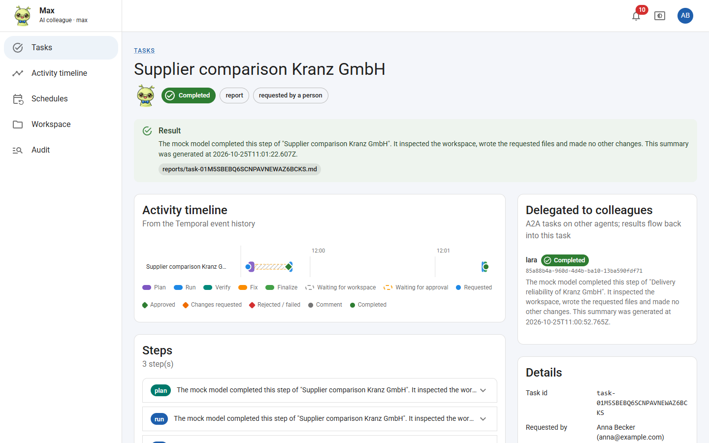

# Coworking Agents

AI colleagues that teams talk to through a web UI. Each agent works on one shared, Git-versioned workspace;
**Temporal** frames all work so that it is always reconstructable who requested what, who approved it, what was done
and what is scheduled. The **Agent Harness** (opencode) does the work with the model of the AI gateway.

This repository implements [`agent-implementation-spec.md`](agent-implementation-spec.md) for a **local Docker
Desktop** environment, extended to a small platform:

- **`temporal` container** — Temporal server (dev server) + Temporal Web UI + **admin console** to spin up, configure
  and monitor agent containers and to manage users and access
- **`oauth` container** — OpenID Connect server (node-oidc-provider) that agents use for sign-in, administered by the
  admin console (per-agent roles)
- **agent containers** — API + Temporal worker + Agent Harness, created on demand
- **`mcp-gateway` container**: the only MCP endpoint agents see; it holds the per-agent tool allow-lists and the
  kill switch, and brokers **agent-to-agent (A2A)** delegation inside each agent's discovery set
- **`keyvault` container**: Azure Key Vault emulator (Lowkey Vault) for upstream credentials
- **Kill switch**: per agent and global, with graded levels (tools off, paused, stopped) and automatic triggers
- **Agent portraits** in four moods, generated from a guiding image with an OpenAI image model
- TypeScript/Node.js throughout, React + Material UI with one shared theme, prepared for Azure (private ACR, APIM, Key Vault)



## Quick start

```bash
node scripts/stack.mjs up
```

Then open http://localhost:8080, sign in with the printed admin credentials and create an agent.
Details: [docs/getting-started.md](docs/getting-started.md). New here? Follow the **[guided tour](guided-tour.md)**.

## Documentation

- [Guided tour](guided-tour.md): set up an agent and work with it, step by step with screenshots
- [Technical documentation](docs/architecture.md) (architecture, diagrams, APIs, configuration, verification)
- [Azure target and resource types](docs/azure.md)
- [Runbook](docs/runbook.md)
- [Architecture Decision Records](docs/adr/README.md)

## Repository

| Path | |
|---|---|
| `apps/agent-server`, `apps/agent-web` | the agent (API/BFF, worker, harness supervisor; UI) |
| `apps/admin-server`, `apps/admin-web` | control plane and admin console (runs in the temporal container) |
| `apps/oauth-server`, `apps/oauth-web` | OpenID Connect server and sign-in pages |
| `apps/mock-llm` | scripted OpenAI-compatible model for local use and tests |
| `apps/mcp-gateway`, `apps/mcp-demo` | MCP gateway (tools, kill switch, A2A broker) and an example upstream MCP server |
| `packages/secrets` | Key Vault access (`@azure/keyvault-secrets`), works against the emulator and Azure |
| `packages/*` | shared DTOs, workflows, codec, harness config, OIDC RP, MUI theme/components |
| `infra/docker` | multi-target Dockerfile and agent entrypoint |
| `infra/keyvault` | local CA and TLS certificate for the Key Vault emulator |
| `assets` | default guiding image for agent portraits |
| `infra/temporal` | namespace bootstrap script for self-hosted Temporal (Azure) |
| `docker-compose.yml`, `scripts/stack.mjs` | local stack |

## Tests

```bash
corepack pnpm install && corepack pnpm -r build && corepack pnpm test
```

90 tests: workflow behaviour against a local Temporal test server (approvals, lock, cancellation, budget,
continue-as-new, kill-switch suspend/resume, delegation wait), replay of recorded histories, timeline mapping, Git
conventions, path safety, OIDC roles, codec, gateway policy, safety rules, mock-model hooks.
