# Coworking Agents — Technical Documentation

> **Scope:** the local implementation on Docker Desktop of the specification `agent-implementation-spec.md`
> ("AI Colleague", v1.0), extended to a multi-agent platform with an admin console and an own OpenID Connect server.
> **Status:** 2026-10-25 · implementation verified end-to-end locally (see [§16 Verification](#16-verification)).
> **Azure:** target design and resource types in [azure.md](azure.md). Decisions in [adr/](adr/README.md).

---

## Contents

1. [Purpose and goals](#1-purpose-and-goals)
2. [System context](#2-system-context)
3. [Local deployment](#3-local-deployment-docker-desktop)
4. [The agent container](#4-the-agent-container)
5. [Temporal design](#5-temporal-design)
6. [Workspace, Git and audit](#6-workspace-git-and-audit)
7. [Agent Harness integration](#7-agent-harness-integration)
8. [Identity and access](#8-identity-and-access)
9. [Control plane (admin console)](#9-control-plane-admin-console)
10. [User interfaces](#10-user-interfaces)
11. [APIs](#11-apis)
12. [Configuration reference](#12-configuration-reference)
13. [Security](#13-security)
14. [Observability](#14-observability)
15. [Repository layout and build](#15-repository-layout-and-build)
16. [Verification](#16-verification)
17. [Spec conformance](#17-spec-conformance)
18. [Known limitations and next steps](#18-known-limitations-and-next-steps)
19. [Safety, tools and collaboration](#19-safety-tools-and-collaboration)

A hands-on walkthrough with screenshots is in the [guided tour](../guided-tour.md).

---

## 1. Purpose and goals

An **agent** is an AI colleague that several people talk to through a web UI. It works on **one shared data set**
(a Git repository, the *workspace*). **Temporal** frames all work so that it is always reconstructable *who requested
what, when, how it was done, who approved it, and what is scheduled*. The **Agent Harness** (opencode, unmodified)
performs the actual work with the model of the **AI gateway**.

This implementation adds what the request asked for on top of the spec:

| Requirement | Implementation |
|---|---|
| Local only, Docker Desktop, Temporal in a container | `docker-compose.yml` with the `temporal` container (Temporal dev server + Web UI) — [ADR-0002](adr/0002-temporal-in-control-plane-container.md) |
| Admin UI *in the temporal container* to spin up and monitor agent containers | admin server + admin console inside the same container, Docker Engine API via socket — [ADR-0003](adr/0003-agent-runtime-abstraction.md) |
| OAuth server container administered by the admin UI; authentication instance for the agents | `oauth` container (node-oidc-provider), management API, per-agent OIDC clients and roles — [ADR-0004](adr/0004-oidc-server-and-per-agent-roles.md) |
| TypeScript/Node.js wherever possible | every component except the unmodified Temporal binary and the opencode binary |
| Consistent Material Design look | React 19 + MUI 9, one shared theme package for all three UIs — [ADR-0011](adr/0011-material-ui.md) |
| Kill switch with MCP gateway; A2A between agents; Key Vault simulation; agent portraits | [§19](#19-safety-tools-and-collaboration), ADR-0021…0025 |
| Prepare for Azure with a private ACR | runtime abstraction, image references as configuration, [azure.md](azure.md), [ADR-0019](adr/0019-temporal-on-azure.md), [ADR-0020](adr/0020-container-registry.md) |

## 2. System context

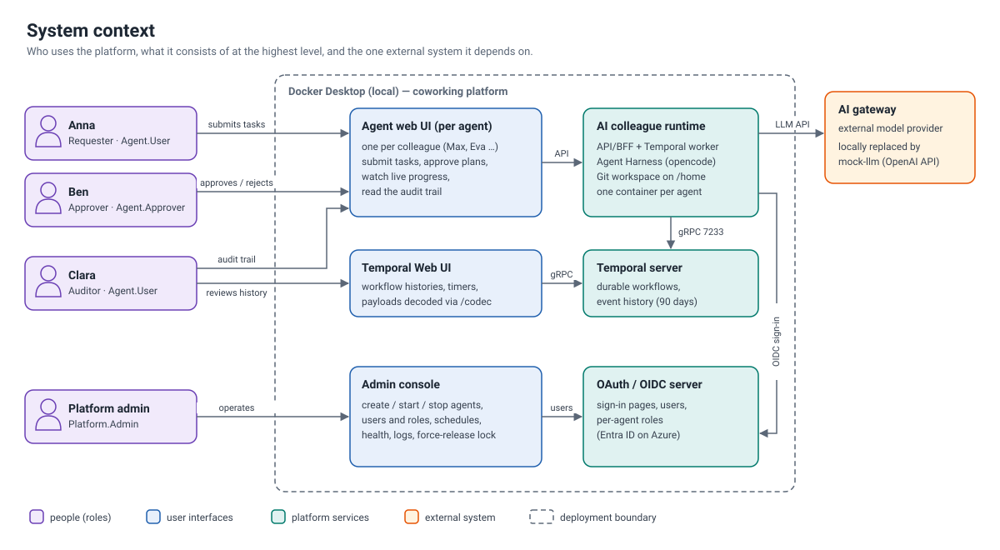

| Actor | Uses | Typical actions |
|---|---|---|
| Requester (e.g. Anna, `Agent.User`) | agent UI | submit tasks, approve own plans, schedules, uploads |
| Approver (e.g. Ben, `Agent.Approver`) | agent UI | decide on plans/deviations of others |
| Auditor (e.g. Clara, `Agent.User`) | agent UI → Audit, Timeline, Workspace | find who requested/approved/changed what |
| Platform admin (`Platform.Admin`) | admin console | create/upgrade/stop agents, monitor, manage users and access |
| AI gateway | called by the harness | model inference (locally replaced by `mock-llm`) |

## 3. Local deployment (Docker Desktop)

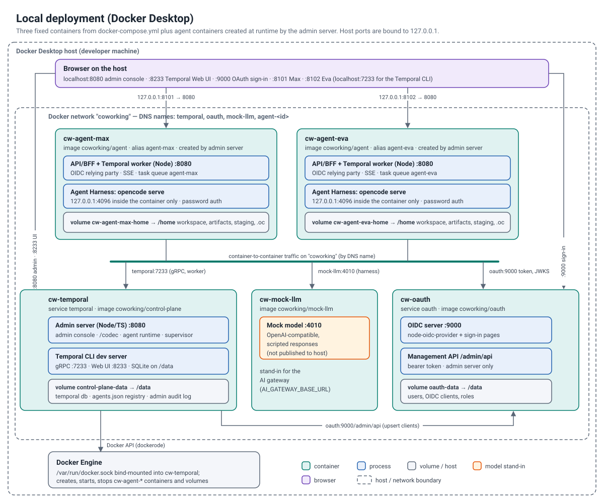

| Container | Image | Ports (host, loopback only) | Volume | Role |
|---|---|---|---|---|
| `cw-temporal` (service `temporal`) | `coworking/control-plane:local` | 8080 admin console, 8233 Temporal Web UI, 7233 gRPC | `control-plane-data:/data`, `/var/run/docker.sock` | Temporal dev server (SQLite) + admin server |
| `cw-oauth` | `coworking/oauth:local` | 9000 | `oauth-data:/data` | OpenID Connect provider + sign-in pages + management API |
| `cw-mock-llm` | `coworking/mock-llm:local` | – | – | OpenAI-compatible scripted model ([ADR-0013](adr/0013-mock-llm.md)) |
| `cw-mcp-gateway` | `coworking/mcp-gateway:local` | – (7400 internal) | `mcp-gateway-data:/data`, `keyvault-certs` (ro) | MCP gateway: tools, allow-lists, kill switch, A2A broker, audit ([ADR-0021](adr/0021-mcp-gateway.md)) |
| `cw-mcp-demo` | `coworking/mcp-demo:local` | – (7500 internal) | – | example upstream MCP server (supplier lookup, FX rates) |
| `cw-keyvault` (+ init `cw-keyvault-certs`) | `nagyesta/lowkey-vault:7.3.127` | – (8443 TLS, 8080 token endpoint) | `keyvault-certs` | Azure Key Vault emulator ([ADR-0024](adr/0024-key-vault-emulation.md)) |
| `cw-agent-<id>` (created at runtime) | `coworking/agent:<tag>` | 8101–8199 → 8080 | `cw-agent-<id>-home:/home` | one agent: API/BFF + worker + harness |

All containers share the Docker network `coworking`. Inside it the DNS names `temporal`, `oauth`, `mock-llm` and
`agent-<id>` are used; browsers use `http://<PUBLIC_HOST>:<port>` (default `localhost`). Because the OAuth issuer
must be the URL the *browser* sees, back-channel calls of agents are rewritten to `http://oauth:9000`
(split horizon, [ADR-0009](adr/0009-sessions-and-split-horizon-oidc.md)).

Start, stop and reset: see [getting-started.md](getting-started.md).

## 4. The agent container

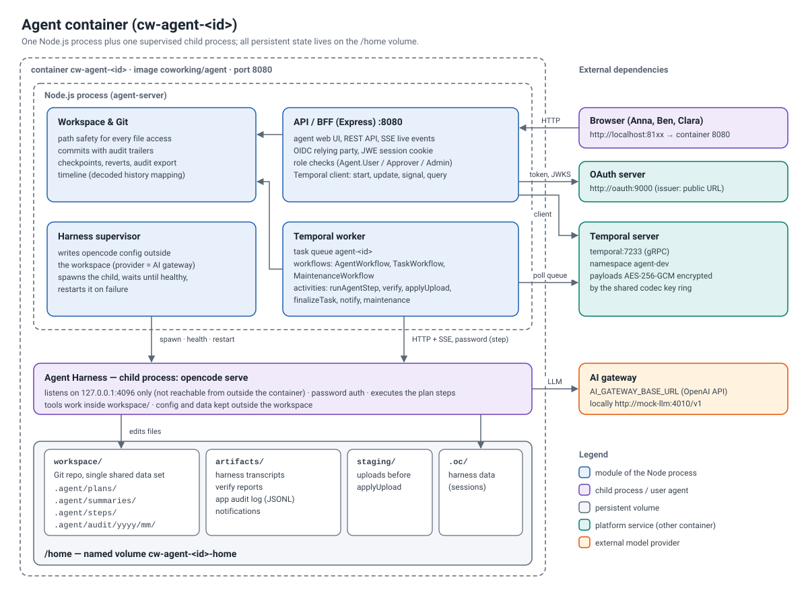

One container, **one Node.js process** (`apps/agent-server`) plus the **Agent Harness** as supervised child process
(spec §5). The process contains:

| Module | Path | Responsibility |
|---|---|---|
| Boot sequence | `src/main.ts` | spec §5.2 steps 1–10, graceful shutdown (§5.3) |
| Config | `src/config.ts` | zod-validated environment, fail fast |
| Workspace | `src/workspace/*` | prepare `/home`, `git init`, Git helper (trailers, idempotency lookups), path safety |
| Harness | `src/harness/*` | supervisor (spawn, health, restart back-off 1→30 s), SDK wrapper, event bus (SSE fan-out) |
| Temporal | `src/temporal/*` | client + worker connection (mTLS optional, payload codec), AgentWorkflow and system schedules at boot, worker with pre-built workflow bundle |
| Activities | `src/activities/*` | `runAgentStep`, `verify`, `applyUpload`, `finalizeTask`, `notify`, maintenance, `isWorkflowRunning` (local) |
| Timeline | `src/timeline/*` | history decoding (codec) and the pure `mapHistory` (spec §10) |
| API | `src/api/*` | Express routers, identity (OIDC/EasyAuth/dev), rate limit, SSE, codec server, static SPA |

The container's entrypoint (`infra/docker/agent/startup.sh`) prepares `/home` as root and drops to the `node` user
(`setpriv`). Nothing from the application lives in `/home` (spec §5.1).

### 4.1 Boot sequence (verified log of a real start)

```
booting agent                       agentId=max taskQueue=agent-max namespace=agent-dev authMode=oidc
initializing workspace repository   dir=/home/workspace                      (first start only)
harness config written              /tmp/harness/opencode.json
agent harness is up                 version=1.19.4                           (~4.5 s, prewarmed)
agent workflow ensured              workflowId=agent-max (USE_EXISTING)
system schedule created             sched-sys-max-git-maintenance | -backup | -artifact-cleanup
creating worker                     source=/app/dist/workflow-bundle.js
http server listening               port=8080 url=http://127.0.0.1:8101
Worker state changed                RUNNING  taskQueue=agent-max
```

A redeploy (new container, same volume) skips the workspace initialisation and re-attaches to the running
lock-manager workflow; it took ~1.5 s.

## 5. Temporal design

### 5.1 Workflows and identifiers

| Workflow | Id | Purpose |
|---|---|---|
| `agentWorkflow` | `agent-<agentId>` | singleton FIFO lock manager for the workspace (spec §7.4) |
| `taskWorkflow` | `task-<ULID>` or `task-sched-<agentId>-<slug>-<timestamp>` | one task (spec §7.5) |
| `maintenanceWorkflow` | `maint-<agentId>-<kind>-<timestamp>` | git gc/fsck, backup bundle, transcript cleanup (spec §7.8) |

Task queue per agent: `agent-<agentId>` ([ADR-0005](adr/0005-multi-agent-namespacing.md)). Namespace `agent-dev`
(retention 90 days, set by the admin server). Custom search attributes: `AgentId`, `RequestedBy`, `TaskType`,
`TaskStatus`, `TaskTitle`, `Trigger`, `ScheduleId`, `ApprovedBy` (registered at server start and idempotently via
the operator API).

### 5.2 Task lifecycle

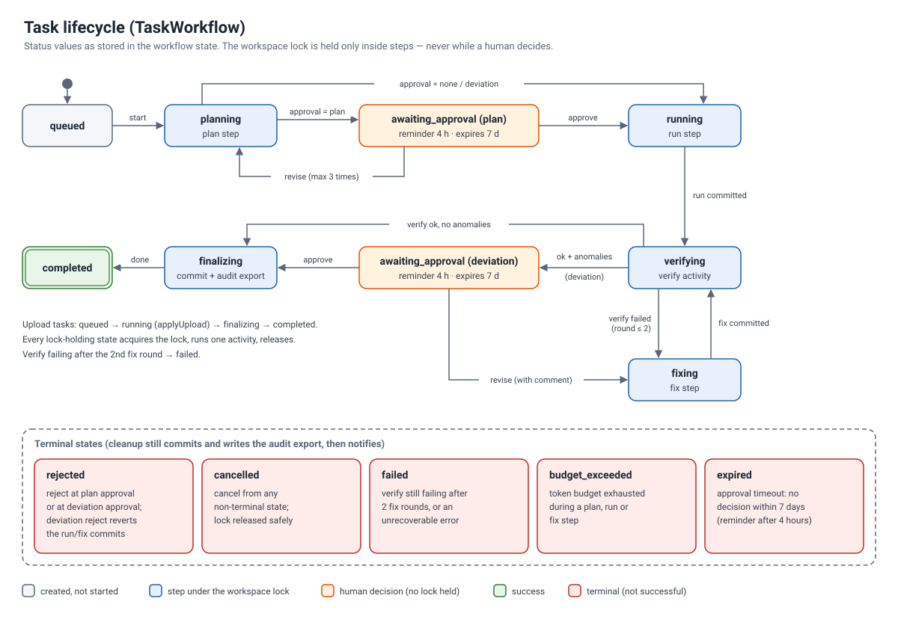

Rules worth knowing:

- `approval: plan` → plan is shown to approvers; *Request changes* re-plans with the comment (max. 3 revisions);
  *Reject* ends the task (audit export written).
- `approval: deviation` → runs without plan approval; if verification passes **with anomalies** the task waits for
  a decision; rejection reverts the task's run/fix commits ([ADR-0015](adr/0015-deviation-rejection-reverts.md)).
- Verification failures trigger up to `TASK_MAX_FIX_ROUNDS` (2) fix steps, then `failed`.
- Approval reminder after 4 h, expiry after 7 d (configurable; timers are durable).
- Budget: a step is not started below 5 % remaining budget; a step that exceeds it is committed and the task ends
  `budget_exceeded`.
- Cancel (update) aborts the running harness turn **before** the lock is released ([ADR-0018](adr/0018-cancellation-semantics.md)).
- Who may decide: approver or requester (schedule owner for scheduled runs), enforced in the update validator
  ([ADR-0014](adr/0014-approval-rules-in-workflow.md)).

### 5.3 Workspace lock

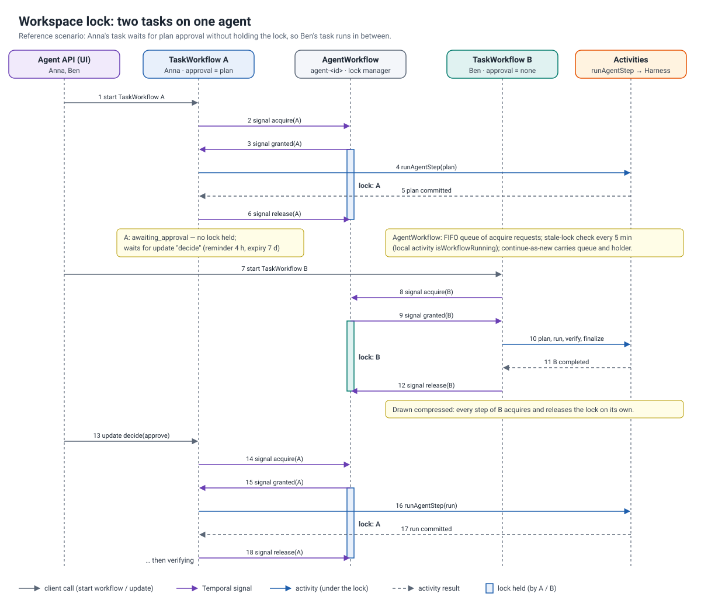

The lock is held only while a step, a verification, an upload or the finalization runs — **never while waiting for a
human**. This is why a second task can complete while the first waits for approval (spec §19 step 3; covered by an
automated test). Stale locks (holder terminated) are cleared after the next check (5 min); `continueAsNew` keeps
holder and queue.

### 5.4 Activities

| Activity | Timeouts / retry | Notes |
|---|---|---|
| `runAgentStep` | 60 min, heartbeat 2 min, 3 attempts (30 s ×2), non-retryable `BudgetExceeded`, `PermissionDenied`, `HarnessConfigError`; `WAIT_CANCELLATION_COMPLETED` | idempotent via `Step-Id` trailer; resets dirty tree; recreates lost sessions with a context preamble; exports transcript; commits |
| `verify` | 10 min, 2 attempts | path policy per type, summaries, plug-in script `scripts/verify/<type>.py|.mjs|.js` ([ADR-0016](adr/0016-verification-path-policy.md)) |
| `applyUpload` | 5 min, 3 attempts | copies staged files, commit authored by the human |
| `finalizeTask` | 5 min, 5 attempts | optional revert, permanent audit export, final commit |
| `notify` | 1 min, 5 attempts, failures ignored | inbox (JSONL) + optional Teams webhook |
| `isWorkflowRunning` (local) | 10 s | stale-lock detection |
| maintenance | 30 min | `git gc --prune=30.days.ago` + `fsck`, `git bundle` backup (local dir or Azure Blob), transcript cleanup |

Activity calls carry a **summary** (Temporal user metadata) — visible in the Temporal Web UI and used as span label
in the timeline.

### 5.5 Payload encryption

All payloads (workflow inputs, activity inputs/results, update arguments, query results) are encrypted with
AES-256-GCM (`packages/codec`, key rotation by key id). The Temporal Web UI decodes through the codec endpoint of the
admin console ([ADR-0008](adr/0008-payload-codec-and-codec-server.md)). Search attributes are not encrypted.

## 6. Workspace, Git and audit

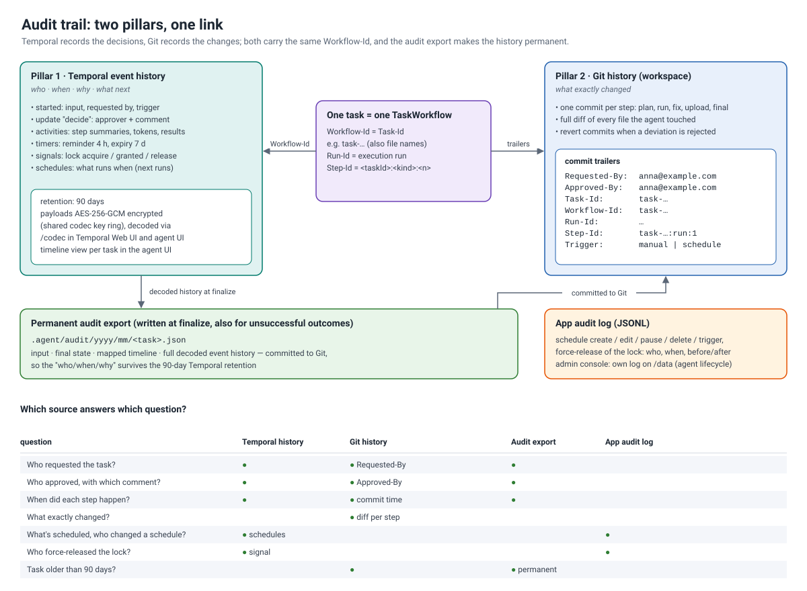

```
/home/workspace/                 Git repository — the single shared data set
├─ AGENTS.md                     standing instructions (referenced by the harness config)
├─ .gitignore
├─ .agent/
│  ├─ plans/<task>.md            plan of each task
│  ├─ summaries/<step>.md        3–6 sentence summary per step
│  ├─ steps/<step>.json          stored step result (idempotency)
│  └─ audit/<yyyy>/<mm>/<task>.json   permanent audit export (input, state, timeline, decoded history)
├─ reports/                      results of report/analysis tasks
├─ scripts/verify/<type>.py      optional verification plug-ins
└─ … team data
/home/artifacts/<task>/          transcripts (*-transcript.json), verify reports
/home/artifacts/audit-log/       application audit log (JSONL)
/home/artifacts/notifications/   notification inbox (JSONL)
/home/staging/                   uploads before they become a task
/home/.oc/                       harness data (sessions)
```

Paths derived from ids are file-system safe (`:` → `_`, [ADR-0012](adr/0012-task-ids-and-file-safe-paths.md)).
Only activities commit; the harness has read-only git permissions. Every commit has trailers:

```
report(task-01M5R7Z0Z3BKF2Y9YBAWE6X0QJ): run — The plan was executed …

Requested-By: anna@example.com
Approved-By: anna@example.com
Task-Id: task-01M5R7Z0Z3BKF2Y9YBAWE6X0QJ
Workflow-Id: task-01M5R7Z0Z3BKF2Y9YBAWE6X0QJ
Run-Id: 01a1707f-83e6-77c2-8ba7-688627b49fe9
Step-Id: task-01M5R7Z0Z3BKF2Y9YBAWE6X0QJ:run:1
Trigger: user
```

Uploads are committed with the **person as author** and the agent as committer. Questions and where they are answered:

| Question | Source |
|---|---|
| Who requested what, when? | Temporal history (start event, `RequestedBy`) · trailer `Requested-By` · audit export |
| Who approved, with which comment? | `decide` update in history · `ApprovedBy` search attribute · trailer `Approved-By` · audit export |
| What exactly changed? | Git commits of the task (diff) |
| How was it done? | step summaries, transcripts (180 days), timeline |
| What is scheduled? | Temporal schedules (+ app audit log for edits) |
| After 90 days? | `.agent/audit/**` in the workspace (searchable from the Audit page) |

## 7. Agent Harness integration

Details and verification in [ADR-0007](adr/0007-harness-configuration.md). Summary:

- `opencode serve --hostname 127.0.0.1 --port 4096`, `OPENCODE_SERVER_PASSWORD` random per boot, basic auth
  `opencode:<password>`, `HOME=/opt/harness-home` (pre-warmed in the image), `XDG_DATA_HOME=/home/.oc`.
- Config rendered at boot to `/tmp/harness/opencode.json` (`OPENCODE_CONFIG`), workspace configs ignored
  (`OPENCODE_DISABLE_PROJECT_CONFIG`), `AGENTS.md` referenced via `instructions`.
- Permission rules: everything not explicitly allowed is denied; **catch-all first** (opencode: last match wins);
  no `ask` anywhere; no web access; no git write commands.
- One harness session per task; a lost session is recreated with a preamble (plan + previous summaries) — *the
  workspace is the memory*.
- Live events: one SSE subscription to the harness, fanned out per task to `/api/tasks/:id/live` (sanitized: text,
  tool name/status/title/files, ≤ 2 KB per event); also drives activity heartbeats.

## 8. Identity and access

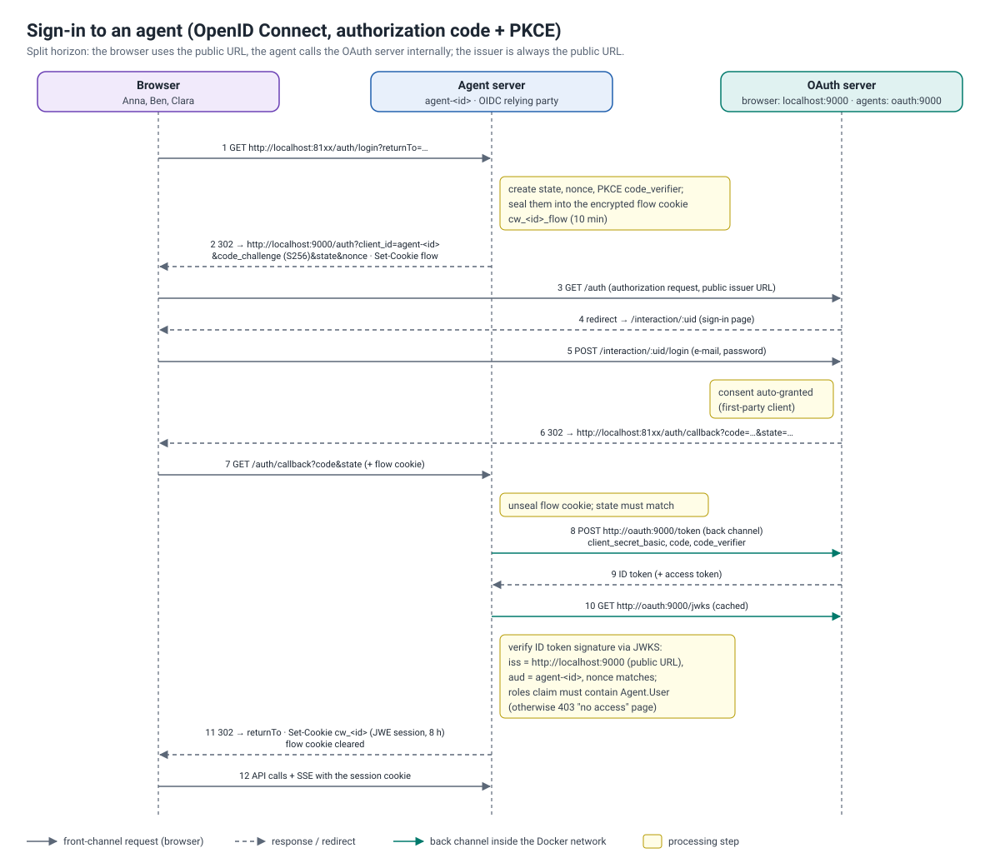

- **OAuth server** (`apps/oauth-server`): node-oidc-provider 9, authorization code + PKCE (required), confidential
  clients, RS256 keys generated on first start, RP-initiated logout, consent granted automatically (first-party),
  failed-login throttling, scrypt password hashes.
- **Clients:** `cw-admin` (admin console) and one client per agent `agent-<id>` (created by the admin console).
- **Roles claim per client:** users have `platformRoles` and `agentRoles` (`{"max": [...], "*": [...]}`); the
  ID token for client `agent-max` contains the roles for `max` (+ `*`), Platform admins get all agent roles. A user
  without `Agent.User` for an agent is refused already at the sign-in page.
- **Agents** accept identity only from their own session (or EasyAuth headers on Azure); decisions and comments carry
  the server-side principal into Temporal.

| Role | Granted per | Allows |
|---|---|---|
| `Agent.User` | agent (or `*`) | everything in the agent UI except the following |
| `Agent.Approver` | agent (or `*`) | decide on tasks of others |
| `Agent.Admin` | agent (or `*`) | cancel any task, force-release the lock, edit system schedules, codec endpoint |
| `Platform.Admin` | platform | admin console; implicitly all agent roles |

## 9. Control plane (admin console)

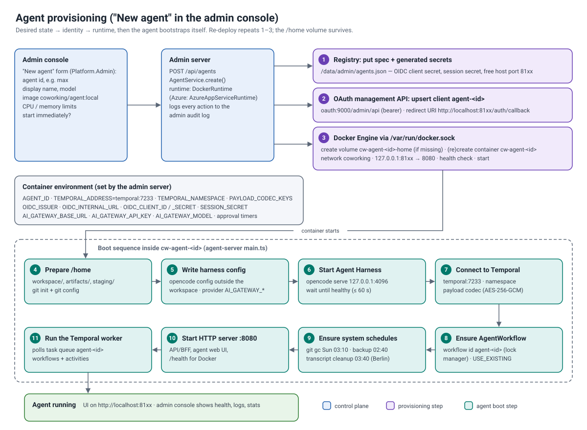

The admin server (`apps/admin-server`) runs in the `temporal` container and

1. supervises the Temporal dev server (restart with back-off) and bootstraps namespace and search attributes;
2. keeps the **desired state** of agents (`/data/admin/agents.json`: spec + generated OIDC client secret and session
   secret);
3. drives the **runtime** (`DockerRuntime`; `AzureAppServiceRuntime` is a documented stub): create/re-create container
   and volume, start/stop/restart, inspect, stats (CPU/memory/network), log streaming, list images;
4. administers the **OAuth server** through its management API (users, per-agent roles, clients);
5. shows platform health, task counters (visibility `count`), recent tasks across agents, lock state per agent;
6. hosts the **codec endpoint** for the Temporal Web UI;
7. writes an **admin audit log** (`/data/admin/audit.jsonl`).

Agent lifecycle operations: *create* (registry → OIDC client → volume → container → start), *update/redeploy*
(re-create container, keep volume), *start/stop/restart*, *delete* (optionally purge volume, schedules and running
workflows). Port allocation: first free port in `AGENT_PORT_RANGE` (8101–8199).

## 10. User interfaces

All UIs use React 19, MUI 9 (shared theme `packages/ui`, light/dark/system), TanStack Query and React Router.

| UI | Pages |
|---|---|
| Agent (`apps/agent-web`) | Tasks (status banner, new task, filters), Task detail (approval panel with rendered plan or anomalies, live panel, SVG timeline, steps, commits with diff viewer, decisions/comments, token budget), Activity timeline (swimlanes, agent lane, *Fit* zoom), Schedules (calendar picker daily/weekly/monthly/cron/once, pause, run now, history), Workspace (tree, Markdown/CSV/image/PDF preview, file history with trailers, upload), Audit (tasks + commits search), notifications |
| Admin (`apps/admin-web`) | Dashboard, Agents (cards, create dialog), Agent detail (Overview, Monitoring, Logs, Tasks, Access, Settings, Audit), Users & access, Audit log |
| Sign-in (`apps/oauth-web`) | sign-in page of the OAuth server |

| | |
|---|---|
| 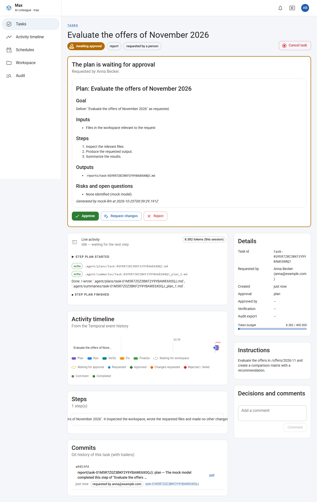 | 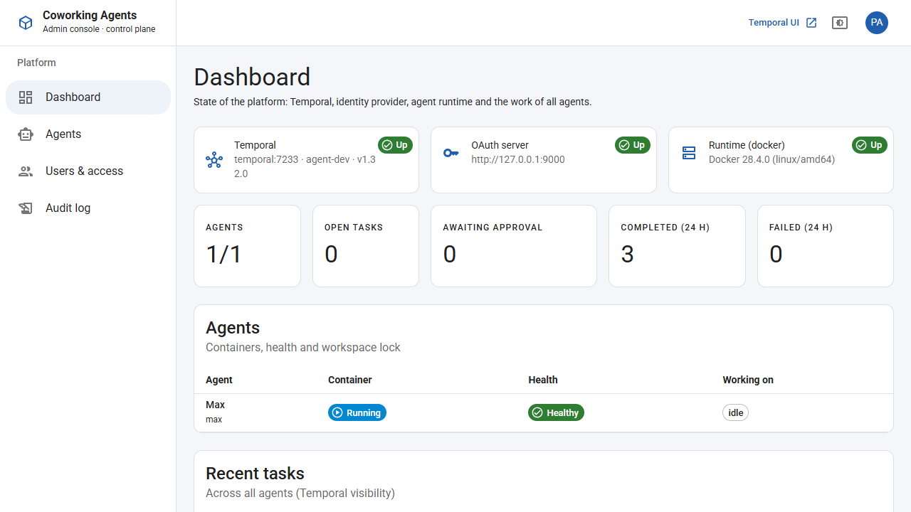 |
| Task waiting for plan approval (agent UI) | Admin console dashboard |
| 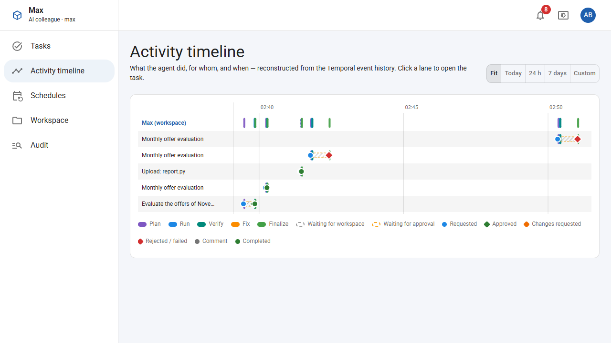 | 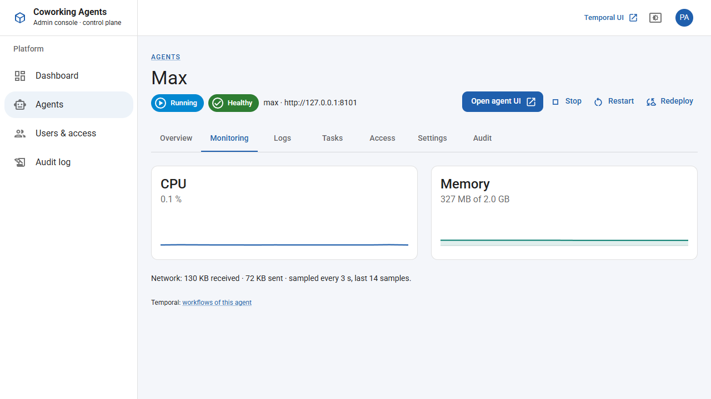 |
| Global activity timeline | Agent monitoring in the admin console |

More screenshots in [images/](images/).

## 11. APIs

### 11.1 Agent API (`/api`, session cookie or EasyAuth; role `Agent.User` unless noted)

| Method & path | Notes |
|---|---|
| `GET /health` | unauthenticated; `{status, harness, temporal, version}` |
| `GET /api/me` | principal, roles mapping, Temporal UI link |
| `GET /api/agent/status` | lock holder/queue with titles + health |
| `POST /api/tasks` | `{title, instructions, type, approval?, maxTokens?}`; 30/user/hour |
| `GET /api/tasks` | `status, requestedBy (me), type, from, to, pageToken, pageSize` |
| `GET /api/tasks/:id` | live state (query) or audit export beyond retention |
| `POST /api/tasks/:id/decision` | `{decision, comment?}` approver or requester |
| `POST /api/tasks/:id/cancel` | requester or `Agent.Admin` |
| `POST /api/tasks/:id/comments` | `{text}` |
| `GET /api/tasks/:id/timeline`, `GET /api/timeline?from&to` | spec §10 |
| `GET /api/tasks/:id/live` | SSE, keep-alive every 20 s |
| `GET/POST /api/schedules`, `GET/PATCH/DELETE /api/schedules/:id`, `POST /api/schedules/:id/trigger` | owner or `Agent.Admin`; system schedules admin only |
| `GET /api/workspace/tree|file|commits`, `GET /api/workspace/commits/:hash` | read-only, path safety |
| `POST /api/workspace/uploads` | multipart, ≤ 10 files × 50 MB → upload task |
| `GET /api/audit/search?q&person&path&from&to` | tasks (visibility + audit exports) and commits |
| `GET /api/notifications` | inbox of the current user |
| `POST /api/admin/agent/force-release`, `GET /api/admin/audit-log` | `Agent.Admin` |
| `POST /codec/encode|decode` | `Agent.Admin` |

### 11.2 Admin API (`/api`, `Platform.Admin`)

`GET /me`, `GET /overview`, `GET /tasks?agentId&status`, `GET|POST /agents`, `GET|PATCH|DELETE /agents/:id`,
`POST /agents/:id/{start|stop|restart|redeploy}`, `GET /agents/:id/stats`, `GET /agents/:id/logs` (SSE),
`GET /agents/:id/access`, `PUT /agents/:id/access/:userId`, `GET /images`, `GET|POST /users`,
`PATCH|DELETE /users/:id`, `POST /users/:id/revoke-sessions`, `GET /clients`, `GET /audit`. Codec: `POST /codec/*`.

### 11.3 OAuth server

Standard OIDC endpoints (`/.well-known/openid-configuration`, `/auth`, `/token`, `/jwks`, `/session/end`, …),
interaction endpoints for the sign-in page, and the management API `/admin/api/*` (bearer `OAUTH_ADMIN_TOKEN`):
`stats`, `users` CRUD, `users/:id/agent-roles/:agentId`, `users/:id/revoke-sessions`, `clients` (upsert/delete).

## 12. Configuration reference

Generated by `scripts/stack.mjs` into `.env` on first start (fresh random secrets):

| Variable | Used by | Meaning |
|---|---|---|
| `PUBLIC_HOST` | compose | host name in all browser URLs (default `localhost`) |
| `PAYLOAD_CODEC_KEYS` | control plane, agents | `id:base64key[,…]`, first key encrypts |
| `OAUTH_ADMIN_TOKEN` | OAuth, control plane | management API token |
| `ADMIN_CLIENT_SECRET`, `ADMIN_SESSION_SECRET` | OAuth, control plane | admin console OIDC client and session |
| `BOOTSTRAP_ADMIN_EMAIL/PASSWORD` | OAuth | first platform admin (first start only) |
| `SEED_DEMO_USERS`, `DEMO_USER_PASSWORD` | OAuth | Anna, Ben, Clara (spec §19) on first start |
| `AI_GATEWAY_BASE_URL/API_KEY/MODEL` | control plane → agents | model provider (default: mock) |
| `TEMPORAL_NAMESPACE`, `AGENT_IMAGE` | control plane | namespace, default agent image |
| `APPROVAL_REMINDER_AFTER/EXPIRE_AFTER` | control plane → agents | approval timers |
| `GATEWAY_TOKEN` | control plane, MCP gateway, agents | control plane ↔ gateway API; gateway → agent A2A calls (`A2A_GATEWAY_TOKEN`) |
| `MCP_DEMO_TOKEN` | control plane, mcp-demo | demo upstream credential, seeded into Key Vault as `mcp-demo-authorization` |
| `OPENAI_API_KEY` (host environment, not in `.env`) | control plane | agent portraits; `AVATAR_IMAGE_MODEL` (default `gpt-image-2.5-flare`), `AVATAR_QUALITY` |
| `KEYVAULT_URL`, `KEYVAULT_EMULATOR`, `AZURE_POD_IDENTITY_AUTHORITY_HOST`, `NODE_EXTRA_CA_CERTS` | control plane, MCP gateway (set in compose) | Key Vault access via managed identity |

Agent environment (set by the control plane, see `apps/agent-server/src/config.ts` for the full list): `AGENT_ID`,
`AGENT_DISPLAY_NAME`, `AGENT_GIT_EMAIL`, `PUBLIC_BASE_URL`, `TEMPORAL_ADDRESS`, `TEMPORAL_NAMESPACE`,
`TEMPORAL_TASK_QUEUE` (default `agent-<id>`), `TEMPORAL_TLS_CERT/KEY/CA`, `PAYLOAD_CODEC_KEYS`, `AI_GATEWAY_*`,
`AUTH_MODE` (`oidc|easyauth|dev`), `OIDC_ISSUER`, `OIDC_INTERNAL_URL`, `OIDC_CLIENT_ID/SECRET`, `SESSION_SECRET`,
`TASK_DEFAULT_TOKEN_BUDGET` (400 000), `TASK_MAX_FIX_ROUNDS` (2), `TASK_MAX_REVISIONS` (3), `APPROVER_POLICY`,
`TASK_RATE_LIMIT_PER_HOUR` (30), `NOTIFY_TEAMS_WEBHOOK_URL`, `BACKUP_TARGET` (`local|azure-blob|none`),
`BACKUP_CONTAINER_URL`, `TRANSCRIPT_RETENTION_DAYS` (180), `APPLICATIONINSIGHTS_CONNECTION_STRING`, `AGENT_DESCRIPTION`,
`MCP_GATEWAY_URL`/`MCP_GATEWAY_BASE_URL`/`MCP_GATEWAY_TOKEN` (per-agent token), `A2A_GATEWAY_TOKEN`,
`CONTROL_PLANE_URL`/`CONTROL_PLANE_TOKEN` (safety stats, portraits).

## 13. Security

| Area | Local implementation | Azure (see [azure.md](azure.md)) |
|---|---|---|
| Transport | HTTP on loopback-bound ports | HTTPS only, TLS ≥ 1.2, private VNet |
| Identity | own OIDC server, PKCE, nonce, audience/issuer checks, JWE session cookies | Entra ID (EasyAuth or OIDC), app roles |
| Authorization | roles per agent in ID token; validated again in workflow update validators | same |
| Harness isolation | 127.0.0.1, per-boot password, allow-list, no git write, no network tools, config outside workspace | + egress restrictions |
| Secrets | `.env` (git-ignored), registry file on the control-plane volume | Key Vault references, managed identities |
| Temporal | plaintext on the Docker network | mTLS, private ingress |
| Payloads | AES-256-GCM codec | same, keys in Key Vault |
| Docker socket | mounted into the control plane (root-equivalent; local only) | not used — ARM API with managed identity |
| Input limits | zod validation, size limits, rate limit for task creation, path safety (symlink escape, `.git`) | same |
| Logging | no prompt/file contents in logs, secrets redacted | Application Insights |

## 14. Observability

- Structured JSON logs (pino) in every service; harness output is forwarded with `harness: true`.
- `/health` per agent (harness + Temporal), Docker health checks, admin dashboard, per-agent monitoring (CPU,
  memory, network) and live logs.
- OpenTelemetry metrics in the agent (`agent.task.*`, `agent.step.duration`, `agent.tokens.used`,
  `agent.harness.restarts`); exported to Application Insights when `APPLICATIONINSIGHTS_CONNECTION_STRING` is set.
- Temporal Web UI with decrypted payloads (operators).

## 15. Repository layout and build

```
apps/
  agent-server/   agent-web/        the agent (spec apps/server, apps/web)
  admin-server/   admin-web/        control plane in the temporal container
  oauth-server/   oauth-web/        OpenID Connect server and sign-in pages
  mock-llm/                         scripted OpenAI-compatible model
  mcp-gateway/    mcp-demo/         MCP gateway (tools, kill switch, A2A) and example upstream
packages/
  shared/      DTOs, zod schemas, ids, search attributes     workflows/  deterministic workflow code
  codec/       payload codec + codec server                  harness-config/  opencode config + AGENTS.md
  auth-rp/     OIDC relying party (Express)                  ui/  MUI theme and components
  secrets/     Key Vault access (emulator and Azure)
infra/docker/  Dockerfile (targets agent, control-plane, oauth, mock-llm, mcp-gateway, mcp-demo), agent startup/prewarm scripts
infra/keyvault/ local CA + TLS certificate for the Key Vault emulator
assets/        default guiding image for agent portraits
docs/          this documentation, diagrams, ADRs, screenshots
scripts/       stack.mjs (local stack helper)
docker-compose.yml
```

`pnpm -r build` builds everything (workflow bundle included); `pnpm test` runs all test suites;
`node scripts/stack.mjs up` builds the images and starts the stack.

## 16. Verification

### 16.1 Automated tests (90 tests, all passing)

| Suite | Tests | Covers |
|---|---|---|
| `packages/workflows` (local Temporal test server) | 16 + 2 replay | happy path; second task completes while the first awaits approval; approver/requester rules; revise limit; reminder + expiry; fix rounds → failed; one fix round repairs; deviation rejection with revert; budget exceeded; cancellation releases the lock; upload task; stale-lock recovery; continue-as-new keeps holder + queue; **kill switch**: pause suspends and resumes the running step, cancel while paused still finalizes; **A2A**: waits for delegations without the lock, then integrates; **replay** of 8 recorded histories (non-determinism guard) |
| `apps/agent-server` | 25 | `mapHistory` on the recorded histories, git trailers/idempotency/authorship/reset, path safety incl. symlink escape, EasyAuth principal parsing, verify plug-in output |
| `apps/oauth-server` | 5 | roles claim per client, scrypt hashing, store persistence |
| `apps/admin-server` | 5 | agent environment wiring, safety rule evaluation |
| `apps/mcp-gateway` | 7 | auth, fail-closed, kill switch, allow-list, discovery set, loop detection |
| `packages/codec` | 5 | AES-GCM round trip, key rotation, remote codec protocol |
| `packages/harness-config` | 7 | permission ordering, no `ask`, provider lock-down |
| `packages/shared`, `apps/mock-llm` | 9 + 4 | durations, ids/paths, schedules, DTO rules, kill-switch math, tool patterns, moods; mock script incl. tool hooks |

### 16.2 End-to-end on Docker Desktop (performed in a browser)

1. Stack started; admin signed in through the OAuth server; dashboard shows Temporal 1.32.0, OAuth and Docker up.
2. Agent **Max** created from the admin console → OIDC client, volume, container; healthy within ~5 s.
3. **Anna** signed in to Max, submitted *"Evaluate the offers …"* (report, plan approval). Plan written by the harness
   (via the mock model), live events streamed, plan rendered; Anna approved with comment *"Weight delivery times
   higher."* → run → verify passed → finalize → audit export; commits carry `Requested-By`/`Approved-By`.
4. Schedule *"Monthly offer evaluation"* (1st of month, 07:00 Europe/Berlin, approval `deviation`) created and run
   manually → completed without approval.
5. Upload of `scripts/verify/report.py` → upload task, commit authored by Anna.
6. Scheduled run again → plug-in reported an anomaly → task waited for approval → rejected → run commits reverted,
   records kept, audit export committed.
7. Audit search for "Kranz" found the rejected task (via audit export) and the commits.
8. Temporal Web UI shows the task input **decrypted** through the codec endpoint.
9. Admin console: monitoring (CPU/memory), live logs, access matrix; *Redeploy* re-created the container and kept the
   workspace.

### 16.2a End-to-end: safety, tools and collaboration (Playwright, 2026-10-25)

Recorded as the [guided tour](../guided-tour.md):

1. Lara created; portraits for Max and Lara generated with `gpt-image-2.5-flare`, in 4 moods each.
2. Max's discovery set set to Lara; demo tools allowed.
3. Anna's task on Max called `demo__supplier_lookup` and `demo__fx_rate` through the gateway (the credential came
   from the Key Vault emulator) and delegated to Lara (`a2a__send_task`). Gateway audit: three `ok` entries.
4. Lara started `task-a2a-…` with trigger *agent* and requested-by Anna. After Anna approved Lara's plan and Lara
   completed, Max left `awaiting_delegations`, ran the integrate step and completed.
5. Max paused from the Safety page: the agent UI showed the banner and the fearful portrait. Lifting the pause returned
   Max to normal.

### 16.3 Verification log of spec "⚠ VERIFY" items

| Spec item | Result |
|---|---|
| opencode package/binary, `serve`, health path, basic-auth user | `opencode-ai@1.19.4`, `opencode serve`, `GET /global/health`, user `opencode` ✔ |
| config keys | legacy `permission` accepted; ordered rules; `enabled_providers`, `instructions` used ([ADR-0007](adr/0007-harness-configuration.md)) |
| SDK method names | `@opencode-ai/sdk/v2` flat params ✔ |
| `workflowIdConflictPolicy: 'USE_EXISTING'` | ✔ (SDK 1.24) |
| typed search attributes API | `defineSearchAttributeKey`, `upsertSearchAttributes([{key, value}])` ✔ |
| `continueAsNewSuggested` | ✔ |
| activity `summary` | via `executeWithOptions({ ...opts, summary })` ✔ (also in input) |
| schedule overlap enum | `ScheduleOverlapPolicy.SKIP` ✔ |
| schedule memo updates | **not possible** → [ADR-0010](adr/0010-schedule-history-in-audit-log.md) |
| CLI search attributes at start | `temporal server start-dev --search-attribute Name=Type` ✔ (+ operator API) |
| codec endpoint contract | `POST /encode|/decode {payloads:[{metadata,data}]}` ✔, UI flag `--ui-codec-endpoint` |

## 17. Spec conformance

| Spec | Status |
|---|---|
| §2 architecture, §3 layout | implemented, extended for multi-agent ([ADR-0017](adr/0017-monorepo-and-shared-packages.md)) |
| §4 configuration, §5 process model/boot/shutdown/supervision | implemented |
| §6 harness | implemented, verified ([ADR-0007](adr/0007-harness-configuration.md)); SMB data-dir test (§6.6) only possible on App Service |
| §7 Temporal design (workflows, activities, search attributes, schedules, system schedules, audit export, codec) | implemented |
| §8 Git conventions, idempotency, path safety | implemented |
| §9 API, SSE, app audit log | implemented; identity via OIDC locally, EasyAuth mode for Azure |
| §10 timeline mapping | implemented (pure function, fixtures) |
| §11 UI | implemented with MUI instead of Fluent UI ([ADR-0011](adr/0011-material-ui.md)) |
| §12 AI gateway | provider block ready; mock locally; protocol to be confirmed (open question) |
| §13 security | local equivalents; Azure items documented |
| §14 Bicep | **not implemented** (local-only scope) — resource plan in [azure.md](azure.md) |
| §15 local development | implemented differently: full Docker stack instead of host processes |
| §16 testing | unit, workflow, replay tests; E2E performed manually (above) |
| §17 CI/CD | **not implemented** (no CI requested); commands documented |
| §18 observability, runbook | metrics + logs; alerts are Azure-side; [runbook.md](runbook.md) |

## 18. Known limitations and next steps

- **OpenTelemetry interceptors for Temporal** (trace correlation) are not wired yet; metrics only.
- **Agent image size** ~2.3 GB (opencode ships large binaries, Temporal core bridge, Azure SDKs) — slim later
  (prune unused opencode platform binaries, split Azure deps).
- The OAuth server keeps OP sessions in memory and users/clients in a JSON file — fine locally; needs a database or
  Entra ID on Azure ([ADR-0004](adr/0004-oidc-server-and-per-agent-roles.md)).
- Temporal dev server = SQLite, single process; schedule "recent runs" information is not retained across a restart
  of the dev server (observed); production uses the real server ([ADR-0019](adr/0019-temporal-on-azure.md)).
- Restart-during-step and SMB tests (spec M1/M8) need longer-running real model steps and App Service.
- CI pipeline, Bicep templates, image scanning: follow-up milestones (spec M6–M8).

## 19. Safety, tools and collaboration

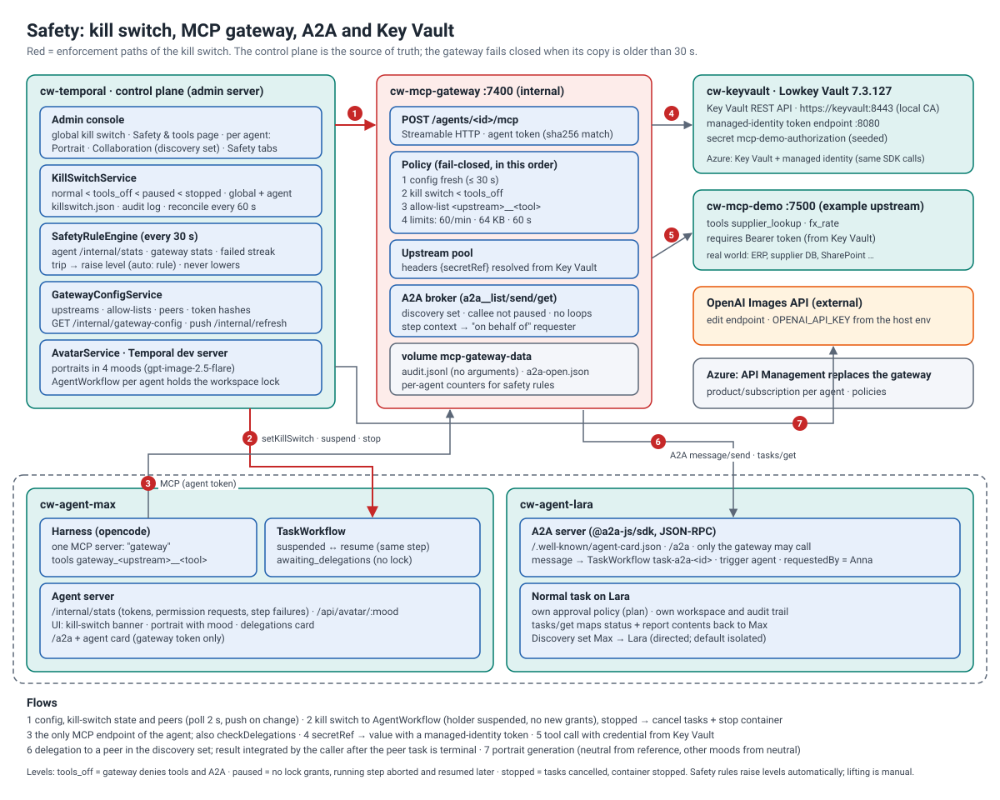

### 19.1 MCP gateway ([ADR-0021](adr/0021-mcp-gateway.md))

Each agent's harness config contains exactly one MCP server: `gateway`, which points to
`http://mcp-gateway:7400/agents/<id>/mcp`, with the agent's own token.

The gateway:

- Pulls its configuration from the control plane (`/internal/gateway-config`: agents, token hashes, peers, allow-lists,
  upstreams, kill-switch levels) every 2 s, and gets a push on every change.
- Aggregates the upstream MCP servers. Their header values can be `{ secretRef }`, resolved from Key Vault.
- Checks every call in this order, failing closed:
  1. config freshness (≤ 30 s);
  2. kill switch;
  3. allow-list;
  4. rate, size and time limits.
- Writes a JSONL audit entry per call, with no arguments.

The benefits:

| Benefit | How |
|---|---|
| One control point for external tools | upstreams, credentials and allow-lists are central, not in containers or workspaces |
| Least privilege | per-agent allow-lists; credentials never reach the agent or harness |
| Fast incident response | `tools_off` takes effect within seconds |
| Fail-safe | unknown state → deny |
| Auditable | every call, decision and kill-switch change is logged; changes are also Temporal signals |
| Azure-ready | the same contract maps to API Management |

### 19.2 Kill switch ([ADR-0022](adr/0022-kill-switch.md))

Levels: `normal < tools_off < paused < stopped`. They can be set globally and per agent; the stricter one applies.

| Enforcement point | Effect |
|---|---|
| MCP gateway | `tools_off` and above deny all tools, including A2A. Paused or stopped peers are not discoverable. |
| `AgentWorkflow` (signal `setKillSwitch`) | While `paused` or `stopped`, no lock grants are made (except `cleanup`). The lock holder gets `suspend`: its step is cancelled, the lock is released and re-requested at the front of the queue (`resume`). The task is `suspended` and resumes after the pause. |
| Control plane | `stopped` cancels the agent's running tasks and stops the container. `reconcile()` re-applies levels every 60 s. |
| Safety rule engine | Raises levels automatically from agent stats (`/internal/stats`), gateway counters and failure streaks. Never lowers them. |

### 19.3 Agent-to-agent delegation ([ADR-0023](adr/0023-a2a-between-agents.md))

- **Discovery set:** `AgentSpec.peers`, one-directional, empty by default.
- **Tools:** the gateway exposes `a2a__list_agents`, `a2a__send_task` and `a2a__get_task`.
- **Callee side:** the callee's A2A server (`@a2a-js/sdk`; agent card + JSON-RPC `/a2a`) accepts calls only from the
  gateway. It turns each message into `TaskWorkflow task-a2a-<id>` with `trigger.kind = 'agent'`, on behalf of the
  original requester.
- **Caller side:** the calling task records the delegation from the harness tool output, then waits in
  `awaiting_delegations` without the lock (`checkDelegations` every 30 s). When all delegations are terminal, it runs an
  integrate step.

### 19.4 Key Vault emulation ([ADR-0024](adr/0024-key-vault-emulation.md))

- Lowkey Vault serves the Key Vault API with TLS from a local CA; consumers trust the CA via `NODE_EXTRA_CA_CERTS`.
- It also provides a managed-identity token endpoint, which `@cw/secrets` uses through `ManagedIdentityCredential`.
- The admin console manages secrets write-only.

### 19.5 Agent portraits ([ADR-0025](adr/0025-agent-portraits.md))

- The control plane generates four moods per agent with the OpenAI Images edit API, from a shared guiding image and
  the admin's prompt.
- Agents proxy their images (`/api/avatar/:mood`).
- The UIs map task and agent state to a mood (`moodForTaskStatus`, `moodForAgent`).

### 19.6 APIs added

| API | Auth | Purpose |
|---|---|---|
| Admin `GET/PUT /api/killswitch`, `PUT /api/agents/:id/killswitch` | admin session | global and per-agent level |
| Admin `GET/PUT /api/safety/rules`, `POST /api/safety/run` | admin session | automatic triggers |
| Admin `GET /api/gateway`, `PUT/DELETE /api/gateway/upstreams/:name`, `GET/PUT /api/agents/:id/tools`, `GET /api/agents/:id/tool-calls` | admin session | gateway configuration and audit |
| Admin `GET /api/secrets`, `PUT/DELETE /api/secrets/:name` | admin session | Key Vault (write-only values) |
| Admin `GET/PUT/DELETE /api/avatars/reference`, `GET/POST /api/agents/:id/avatar`, `GET /api/agents/:id/avatar/:mood` | admin session | portraits |
| Control plane `GET /internal/gateway-config` | `GATEWAY_TOKEN` | gateway configuration |
| Control plane `GET /internal/avatars/:agentId/:mood` | agent internal token | portraits for agents |
| Gateway `POST /agents/:id/mcp`, `PUT /agents/:id/step-context`, `POST /agents/:id/a2a/status` | agent internal token | MCP, on-behalf-of context, delegation status |
| Gateway `/internal/refresh`, `/internal/stats`, `/internal/audit`, `/internal/tools` | `GATEWAY_TOKEN` | control-plane use |
| Agent `/.well-known/agent-card.json`, `POST /a2a` | `A2A_GATEWAY_TOKEN` + `x-a2a-caller` | A2A server |
| Agent `GET /internal/stats` | agent internal token | safety counters |
| Agent `GET /api/avatar/:mood` | user session | portrait |
