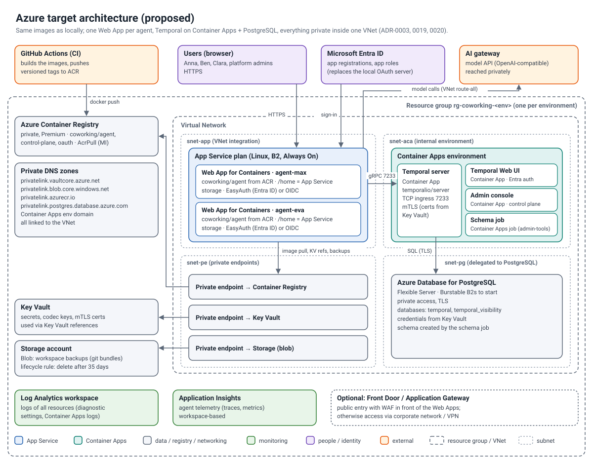

# Moving to Microsoft Azure — resource types and technical implications

> Status: planning document. The local implementation was built so that the **same images** run on Azure; only
> configuration and the runtime adapter change. Spec references: §1.1 #6, §13, §14, §17.



## 1. Mapping local → Azure

| Local (Docker Desktop) | Azure resource type | Notes |
|---|---|---|
| Image store of Docker Desktop (`coworking/*:local`) | **Azure Container Registry** (`Microsoft.ContainerRegistry/registries`), private | Admin user disabled; CI pushes `coworking/agent:<git-sha>` etc.; pull with managed identity (`AcrPull`). Private endpoint requires the **Premium** SKU ([ADR-0020](adr/0020-container-registry.md)). |
| Agent container `cw-agent-<id>` | **App Service plan** Linux (`Microsoft.Web/serverfarms`, B2, Always On) + **Web App for Containers** per agent (`Microsoft.Web/sites`, `kind: app,linux,container`) | As in spec §14.2. `/home` = App Service persistent storage (`WEBSITES_ENABLE_APP_SERVICE_STORAGE=true`), `WEBSITES_PORT=8080`, health check `/health`, VNet integration, `vnetRouteAllEnabled`. Several agents can share one plan (capacity!) or get one plan each (spec: predictable cost). |
| Named volume `cw-agent-<id>-home` | App Service `/home` (Azure Storage, SMB, per app) | Run the harness data-dir test (spec §6.6); if SMB locking is a problem set `HARNESS_DATA_DIR=/tmp/oc`. |
| Temporal dev server in `cw-temporal` | **Container Apps environment** (`Microsoft.App/managedEnvironments`, internal, workload profiles, VNet) + **Container App** `temporalio/server` (TCP ingress 7233, mTLS) + **Container Apps Job** `temporalio/admin-tools` (schema) | [ADR-0019](adr/0019-temporal-on-azure.md). Do not use the dev server or `auto-setup`. |
| SQLite file of the dev server | **Azure Database for PostgreSQL – Flexible Server** (`Microsoft.DBforPostgreSQL/flexibleServers`) | Databases `temporal`, `temporal_visibility`; private access (delegated subnet), TLS; check the PostgreSQL version supported by the pinned Temporal server. |
| Temporal Web UI on :8233 | **Container App** `temporalio/ui` with Container Apps authentication (Entra, admin group) | Codec endpoint → admin console (must be behind the same Entra auth, [ADR-0008](adr/0008-payload-codec-and-codec-server.md)). |
| Admin console in `cw-temporal` | **Container App** (or Web App) running `coworking/control-plane` with `TEMPORAL_MODE=external`, `RUNTIME=azure-app-service` | Needs a managed identity with rights to create/update Web Apps in the resource group (*Website Contributor* scoped to the RG) and `AcrPull`/registry read for listing tags. The Docker socket is **not** used on Azure. |
| OAuth server `cw-oauth` | **Microsoft Entra ID** (app registrations, app roles, enterprise apps with "assignment required") — recommended. Alternative: Container App with the same image + PostgreSQL for users/sessions | With Entra, the admin console manages role assignments via **Microsoft Graph** (app role assignments to users/groups) instead of the management API. Agents use EasyAuth (`AUTH_MODE=easyauth`) or OIDC against Entra (`AUTH_MODE=oidc`). |
| `.env` secrets | **Key Vault** (`Microsoft.KeyVault/vaults`, RBAC, private endpoint, purge protection) | App Service **Key Vault references** in app settings; Container Apps secrets from Key Vault. Codec keys, mTLS certs, AI gateway API key, OIDC secrets. |
| Local backup dir | **Storage account** (`Microsoft.Storage/storageAccounts`) Blob container, private endpoint, lifecycle 35 days, optional immutability | `BACKUP_TARGET=azure-blob`, `BACKUP_CONTAINER_URL`, managed identity with *Storage Blob Data Contributor*. |
| Docker logs, `docker stats` | **Log Analytics workspace** + **Application Insights** (workspace-based) | `APPLICATIONINSIGHTS_CONNECTION_STRING` enables Azure Monitor OpenTelemetry in the agent. Alerts per spec §18.2 as **Azure Monitor alert rules**. |
| Docker network `coworking` | **Virtual network** with subnets `snet-app` (/26, delegated `Microsoft.Web/serverFarms`), `snet-aca` (/23), `snet-pg` (/28, delegated PostgreSQL), `snet-pe` (/27) + **Private DNS zones** (PostgreSQL, Key Vault, Blob, ACR, Container Apps env) | Temporal reachable only inside the VNet. |
| MCP gateway `cw-mcp-gateway` | **Azure API Management** (`Microsoft.ApiManagement/service`, Standard v2 or Premium for VNet injection) | Upstream APIs exposed as MCP servers; **one product + subscription per agent** = tool allow-list and per-agent kill switch (disable subscription); global kill switch = policy reading a Named Value; `rate-limit-by-key`, `validate-content`; logs to Application Insights ([ADR-0021](adr/0021-mcp-gateway.md)). |
| A2A broker (part of the gateway) | **Container App** (internal) behind APIM | APIM does not broker A2A; the broker keeps the discovery-set and loop checks. Agents' `/a2a` endpoints reachable only from it (access restrictions); Entra workload identities replace the shared `A2A_GATEWAY_TOKEN` ([ADR-0023](adr/0023-a2a-between-agents.md)). |
| Key Vault emulator `cw-keyvault` (Lowkey Vault) | **Key Vault** (same vault as above or a dedicated one for upstream credentials) | Same SDK calls (`@cw/secrets`); only `KEYVAULT_URL` and the identity change (`DefaultAzureCredential` → managed identity, *Key Vault Secrets User* for APIM/broker, *Key Vault Secrets Officer* for the admin console) ([ADR-0024](adr/0024-key-vault-emulation.md)). |
| Kill-switch state `killswitch.json`, safety rules | Control-plane storage (Azure Files) or **Azure App Configuration** / **Table Storage** | Automatic triggers can additionally come from **Azure Monitor alert rules** with an action group calling the admin API ([ADR-0022](adr/0022-kill-switch.md)). |
| Agent portraits (OpenAI Images API) | **Azure OpenAI** image deployment (or OpenAI via APIM), key in Key Vault; images on Azure Files/Blob | [ADR-0025](adr/0025-agent-portraits.md). |
| `mock-llm` | – (AI gateway) | Reach the platform via VNet route-all (NSG/UDR/firewall rules for its endpoint). |
| Browser access on localhost | Public endpoints of the Web Apps (HTTPS) — optionally **Azure Front Door** / **Application Gateway** with WAF and custom domains | |

## 2. Technical implications (double-checked)

1. **Agent runtime adapter.** Implement `AzureAppServiceRuntime` (stub in `apps/admin-server/src/runtime/azure.ts`)
   with `@azure/arm-appservice` (create/update site with `siteConfig.linuxFxVersion = DOCKER|<acr>/coworking/agent:<tag>`,
   `acrUseManagedIdentityCreds`, app settings, `authsettingsV2`), `@azure/monitor-query` (CPU/memory metrics),
   Log Analytics or the Kudu log stream (logs), `@azure/container-registry` (tags). Desired state could stay in a file
   on the control-plane's storage, but Table Storage/Cosmos DB is more robust.
2. **Per-agent identity.** Each Web App gets a **system-assigned managed identity** with `AcrPull` on the registry and
   `Key Vault Secrets User`. Creating these role assignments from the admin console requires *User Access
   Administrator* (or *Role Based Access Control Administrator* with conditions) for the control plane — or use one
   **user-assigned identity** shared by all agents (simpler, created once by IaC).
3. **Hostnames and OIDC.** Locally the browser and containers see different hosts (split horizon). On Azure each agent
   has `https://app-agent-<id>.azurewebsites.net`; redirect URIs must be registered per agent (Entra app registration
   or OAuth client). With EasyAuth, App Service handles the flow and the agent reads `x-ms-client-principal`
   (already implemented, tested).
4. **Cookies.** Cookies are no longer shared across ports of one host; `Secure` is set automatically for HTTPS public
   URLs. Session lifetime is governed by EasyAuth (or the agent's JWE cookie in OIDC mode).
5. **Temporal transport.** Set `TEMPORAL_TLS_CERT/KEY/CA` (PEM content from Key Vault references) and
   `TEMPORAL_TLS_SERVER_NAME`; the agents and the admin console already support mTLS. Container Apps TCP ingress needs
   a VNet-integrated environment.
6. **Namespace and search attributes.** Run `infra/temporal/bootstrap.sh` once per environment (or let the admin
   console's bootstrap run with `TEMPORAL_MODE=external` — it registers the namespace and search attributes
   idempotently through the operator API).
7. **Egress.** opencode needs **no npm/models.dev access at runtime** (pre-warmed `HARNESS_HOME`, models fetch
   disabled). Allow egress to the AI gateway only (spec §13).
8. **Single instance per agent.** App Service scale-out must stay at 1 (workspace on `/home`, one worker per task
   queue is assumed by design). Deployments restart the container; Temporal retries and Git checkpoints make this safe
   (spec §14.2 note). B2 has no deployment slots.
9. **Codec endpoint.** Must be protected by Entra (Container Apps auth) together with the Web UI; CORS origin = Web UI.
10. **Cost driver.** One B2 per agent ≈ the spec's fixed cost × number of agents. Alternative for many small agents:
    P0v3/P1v3 plan hosting several agent apps (each still isolated `/home`).
11. **Backups.** System schedule `sched-sys-<agent>-backup` writes `git bundle` to Blob via managed identity
    (implemented, `BACKUP_TARGET=azure-blob`).
12. **ACR network.** If the registry must not be public, use Premium + private endpoint and enable
    `vnetImagePullEnabled` on the Web Apps (image pull through the VNet).

## 3. Suggested Bicep module structure (milestone M6)

```
infra/bicep/
  main.bicep                 params: env, location (Germany West Central), names
  network.bicep              VNet, subnets, NSGs, private DNS zones
  registry.bicep             ACR (+ private endpoint if Premium)
  keyvault.bicep             Key Vault (RBAC, PE, purge protection)
  monitoring.bicep           Log Analytics, Application Insights, alert rules
  postgres.bicep             PostgreSQL Flexible Server, databases
  temporal.bicep             Container Apps env, Temporal server, UI, schema job
  controlplane.bicep         admin console Container App + identity + role assignments
  appservice-plan.bicep      Linux plan (B2)
  agent.bicep                one Web App for Containers per agent (optional: admin console creates them at runtime)
  storage.bicep              backup storage account, container, lifecycle
```

## 4. Migration checklist

- [ ] Create ACR; push `coworking/agent`, `coworking/control-plane` (and `coworking/oauth` if kept) from CI.
- [ ] Deploy network, Key Vault, monitoring, PostgreSQL, Temporal (schema job → server → UI).
- [ ] Decide identity: Entra ID (app registrations per agent or shared, app roles `Agent.User/Approver/Admin`) vs.
      hosting the OAuth server.
- [ ] Deploy control plane with `TEMPORAL_MODE=external`, `RUNTIME=azure-app-service`, Key Vault references.
- [ ] Implement and test `AzureAppServiceRuntime`; create the first agent; run the spec §19 scenario on staging.
- [ ] Run SMB/harness data test (§6.6), restart-during-step test (M8), backup restore rehearsal.
- [ ] Configure alerts (§18.2) and runbook procedures for certificates and codec key rotation.
