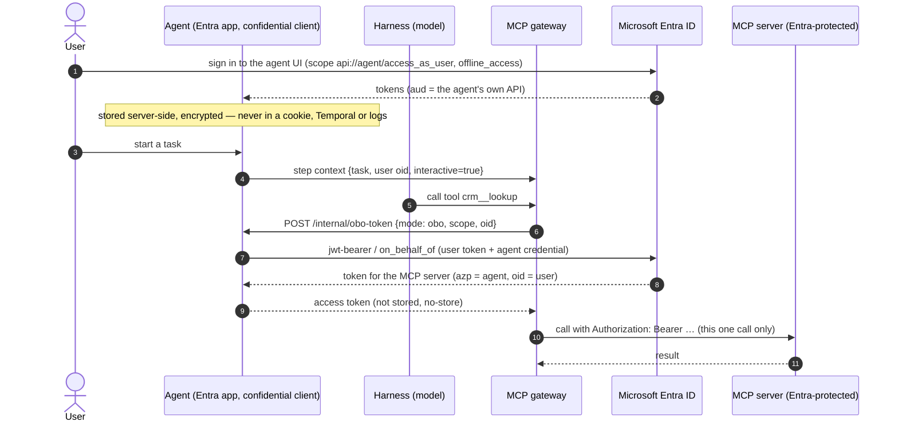

# Microsoft Entra On-Behalf-Of for MCP calls (optional)

Decision record: [ADR-0032](adr/0032-entra-obo-for-mcp.md). This page explains the model, how to set it up and how it behaves.

## What it is for

By default an agent reaches MCP servers through the MCP gateway with static credentials from Key Vault. The MCP server
sees "the platform", not who the work is for.

With **Entra OBO** the MCP server receives a Microsoft Entra access token that carries **two identities**:

| Claim | Meaning |
|---|---|
| `azp` / `appid` | the **agent** (its Entra application / agent identity) |
| `oid`, `upn` / `preferred_username` | the **user** the agent works for |

This is the identity model of Microsoft Foundry: an agent acts under its own identity, on behalf of a user, and the MCP
server can authorise and log by both. The capability is **optional**: with it off, nothing changes.

## The flow

Key points:

- The **agent is the confidential client**. Its credential is a client secret, a certificate or a federated credential.
- The **user token never leaves the agent**. The gateway only receives the final token for one call, uses it, and drops it.
  OBO upstream connections are created per call and never shared between users or agents.
- The **gateway decides** which mode applies, in one pure, tested function (`decideUpstreamAuth`), and fails closed.

## Modes and rules

| Task | Upstream `Authentication` | Agent allows agent-only | Result |
|---|---|---|---|
| started by a user, valid sign-in | Entra OBO | – | **OBO token** (agent + user) |
| started by a user, sign-in missing/expired/revoked | Entra OBO | any | **denied** — the user must sign in again |
| schedule or agent-to-agent (no signed-in user) | Entra OBO, fallback *Deny* | any | **denied** |
| schedule or agent-to-agent | Entra OBO, fallback *Agent-only* | yes | **agent-only token** (client credentials, no user claims) |
| schedule or agent-to-agent | Entra OBO, fallback *Agent-only* | no | **denied** |
| any | Static headers | – | unchanged (today's behaviour) |
| any, agent without Entra identity | Entra OBO | – | **denied** |

An OBO upstream **never** falls back to its static headers, and a task with a user is **never** downgraded to the
agent's own token. The original owner of a scheduled task is recorded in the audit log, but not asserted to the MCP
server.

## Set-up

### 1. Entra ID (once per tenant, by an Entra administrator)

1. **App registration per agent** (the agent's identity; with Foundry this is the agent identity):
   - Redirect URI (web): `<agent public URL>/auth/callback`, e.g. `http://localhost:8101/auth/callback`.
   - Expose an API: Application ID URI `api://<client id>`, scope **`access_as_user`**.
   - App roles `Agent.User`, `Agent.Approver`, `Agent.Admin` (they arrive in the `roles` claim and control access).
   - Credential: client secret, certificate, or a federated credential.
2. **App registration per MCP server**: expose its API and (for agent-only access) an application role.
3. Grant the agent app permission to call the MCP server API (delegated for OBO; an application role for agent-only) and
   give admin consent. For consent-free OBO, add the agent app as a *known client application* of the MCP server app.
4. Users and groups get the agent's app roles.

### 2. Platform

- Use Microsoft Entra ID as the sign-in provider for the platform (`OAUTH_ISSUER=https://login.microsoftonline.com/<tenant>/v2.0`,
  see [ADR-0004](adr/0004-oidc-server-and-per-agent-roles.md) / [azure.md](azure.md)). The local OAuth server **cannot** issue OBO tokens.
- Set `ENTRA_TENANT_ID=<tenant id>` for the control plane (compose passes it through). Without it the capability is hidden
  in the admin console.
- Store the credential in Key Vault via *Safety & tools → Secrets* (client secret, or PEM with certificate and private key).

### 3. Admin console

1. **Agent → Identity**: switch on, enter the application (client) ID, choose the credential and its Key Vault secret name.
   Saving re-creates the container. Optionally allow agent-only tokens.
2. **Safety & tools → upstream** (add or edit): *Authentication* = *Entra On-Behalf-Of*, *Scope* =
   `api://<mcp server app id>/.default`, and the fallback for tasks without a signed-in user.
3. **Agent → Safety**: allow the tools of that upstream for the agent (as for any tool).
4. Users sign in to the agent again once, so the agent receives their tokens.

## Security properties

- **Agents never access Key Vault.** The control plane resolves the credential and hands it over as an environment value
  (like the other agent secrets). If the secret cannot be read, the agent is not deployed.
- User tokens are stored **only in the agent**, encrypted (AES-256-GCM, key derived from the session secret), one file per
  user under the agent's volume. They never appear in cookies, Temporal history, workflow input, logs or the audit log.
- `POST /internal/obo-token` answers only the MCP gateway (own bearer token), returns `Cache-Control: no-store`, and
  answers 404 when the capability is off.
- Revoked or expired grants (`invalid_grant`, `interaction_required`, …) delete the stored grant and deny the call.
- The audit log of the gateway records `authMode` (`obo` / `agent-only` / `static`) and the user's `oid` per tool call —
  never a token.
- Tool lists of OBO upstreams are discovered with the agent-only token (if allowed); otherwise the last known list is used.
  Calls are always authorised individually.

## Operations

| Situation | What happens | What to do |
|---|---|---|
| a tool call says the user must sign in again | the stored grant is missing, expired or revoked | the user signs out and in again |
| call denied: "requires Entra OBO, not enabled for this agent" | upstream is OBO, agent has no Entra identity | configure the agent's *Identity* tab |
| agent does not start after enabling | credential secret unreadable or missing | check the Key Vault secret name; see the control plane log |
| OBO upstream shows no tools | no token available for discovery | allow agent-only on the upstream and the agent, or run one task with a user first |
| `AADSTS65001` (consent) | consent for the MCP server API is missing | grant admin consent or add the agent as known client application |
| remove the capability | admin removes the Identity (or switches it off) | OBO upstreams then refuse the agent; static upstreams are unaffected |

## Limitations

- Needs a real Entra tenant; the local OAuth server cannot do OBO. Tests use a fake token endpoint.
- Federated credentials need the platform to mount the workload-identity assertion in the container
  (`ENTRA_FEDERATED_TOKEN_FILE` on the control plane); it is re-read on every exchange.
- Tasks that wait for days keep working as long as the user's refresh token is valid; otherwise the next OBO call is denied
  until the user signs in again.
- The sign-in client of an OBO-enabled agent is its Entra application; the per-agent client in the local OAuth server is not used.

## Configuration reference

| Where | Variable | Meaning |
|---|---|---|
| control plane | `ENTRA_TENANT_ID` | default tenant; unset = capability hidden |
| control plane | `ENTRA_AUTHORITY_HOST` | default `https://login.microsoftonline.com` (sovereign clouds differ) |
| control plane | `ENTRA_FEDERATED_TOKEN_FILE` | path of the workload-identity assertion in agent containers |
| agent (set by the control plane) | `ENTRA_ENABLED`, `ENTRA_TENANT_ID`, `ENTRA_CLIENT_ID`, `ENTRA_CREDENTIAL_KIND`, `ENTRA_CLIENT_SECRET` / `ENTRA_CLIENT_CERT_PEM` / `ENTRA_FEDERATED_TOKEN_FILE`, `ENTRA_ALLOW_AGENT_ONLY` | the agent's Entra identity |
| admin API | `GET /api/entra`, `GET/PUT /api/agents/:id/entra` | availability and per-agent settings (audited as `agent.entra`) |
| gateway upstream | `auth`, `oboScope`, `oboFallback` | `static` \| `obo`; scope of the token; `deny` \| `agent-only` |
