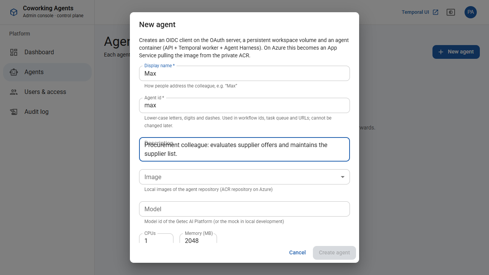

# Getting started (local, Docker Desktop)

## Prerequisites

- **Docker Desktop** (tested with Engine 28.4, WSL 2 backend on Windows 11), ~6 GB free disk for images
- **Node.js ≥ 22.12** (only to run `scripts/stack.mjs`; tested with 24)
- For development without Docker: `corepack` (pnpm 10.34.8 is pinned in `package.json`)

## 1. Start the stack

```bash
node scripts/stack.mjs up        # or: pnpm stack:up
```

On first run this

1. creates `.env` with fresh secrets (codec key, OAuth admin token, client and session secrets, admin and demo passwords),
2. builds four images: `coworking/agent`, `coworking/control-plane`, `coworking/oauth`, `coworking/mock-llm`
   (first build ~5–10 min),
3. starts the `temporal`, `oauth` and `mock-llm` containers and waits until they are healthy,
4. prints URLs and credentials:

```
  Admin console     http://localhost:8080
  Temporal Web UI   http://localhost:8233
  OAuth server      http://localhost:9000
  Platform admin    admin@example.local  /  <generated>
  Demo users        anna@example.com, ben@example.com (approver), clara@example.com
```

> If `localhost` does not resolve in your browser (some sandboxed browsers), add `PUBLIC_HOST=127.0.0.1` to `.env`
> and run `docker compose up -d` again. All OIDC URLs follow this setting.

## 2. Create an agent

1. Open the admin console, sign in as the platform admin.
2. **Agents → New agent**: display name `Max` (id `max`), keep the default image and model → **Create agent**.
   The console registers the OIDC client `agent-max`, creates the volume `cw-agent-max-home` and the container
   `cw-agent-max` on port 8101. After ~5 s the agent is *Healthy*.
3. **Access** tab: the demo users have `Agent.User` on all agents (Ben also `Agent.Approver`). Tick or untick roles
   per person.



## 3. Walk through the reference scenario (spec §19)

| Step | What to do | What to look at |
|---|---|---|
| 1 | Open `http://localhost:8101`, sign in as **Anna**, *New task*: "Evaluate the offers in /offers/2026-11 …", type *report*, approval *Approve plan first* | status *Planning* → *Awaiting approval*; live panel shows the harness writing the plan |
| 2 | (second browser/profile) **Ben** submits a *change* task with *No approval* | it runs and completes while Anna's task waits (the lock is not held during approval) |
| 3 | Anna (or Ben as approver) **Approve** with comment "Weight delivery times higher." | run → verify → finalize; commits with `Approved-By` |
| 4 | Workspace → **Upload** `scripts/verify/report.py` printing `["Offer of supplier Kranz GmbH is missing"]` | upload task; commit authored by Anna |
| 5 | **Schedules → New schedule** "Monthly offer evaluation", monthly day 1, 07:00, approval *Only on deviations* → **Run now** | the run stops with *Verification found deviations*; approve or reject (reject reverts the run's changes) |
| 6 | **Clara**: Audit → search "Kranz" | task (via audit export), commits, diffs; timeline from the task page |
| 7 | Admin console → Agent **Max** → Monitoring / Logs / Tasks | CPU/memory, live logs, tasks of the agent |
| 8 | Temporal Web UI → workflow `task-…` | payloads are encrypted at rest and shown decrypted (codec endpoint) |

The default model is the **mock** (`mock-llm`), which writes the files a prompt asks for. To use the real AI gateway
Platform set `AI_GATEWAY_BASE_URL`, `AI_GATEWAY_API_KEY`, `AI_GATEWAY_MODEL` in `.env`, recreate the control plane
(`docker compose up -d`) and **Redeploy** the agents (or set the model per agent in *Settings*).

## 4. Everyday commands

| Command | Effect |
|---|---|
| `node scripts/stack.mjs up` | build + start (idempotent) |
| `node scripts/stack.mjs build` | build all images incl. the agent image |
| `node scripts/stack.mjs down` | stop the stack (agent containers keep running; `--agents` removes them) |
| `node scripts/stack.mjs reset` | **delete everything**: agent containers and volumes, Temporal and OAuth data (`--env` also removes `.env`) |
| `docker compose logs -f temporal` | control plane + Temporal logs |
| `docker logs -f cw-agent-max` | agent logs (also in the admin console) |
| `docker build --target agent -t coworking/agent:v2 -f infra/docker/Dockerfile .` | new agent image version → select it in the agent's *Settings* |

## 5. Developing

```bash
corepack pnpm install
corepack pnpm -r build           # all packages, apps and the workflow bundle
corepack pnpm test               # all test suites (workflow tests start a local Temporal test server)
RECORD_HISTORIES=1 corepack pnpm --filter @cw/workflows test   # refresh replay fixtures (review the diff!)
```

UI development against running containers: `pnpm --filter @cw/agent-web dev` (proxies to `AGENT_URL`, default
`http://localhost:8101`) and `pnpm --filter @cw/admin-web dev` (proxies to `ADMIN_URL`). Sign in once in the proxied
app (`/auth/login`), the session cookie is set for `localhost`.

Workflow code lives in `packages/workflows` and must stay deterministic (no Node APIs, no I/O, no `Date.now()`
outside the workflow sandbox). Any change that alters the command sequence needs `patched()` — the replay test
fails otherwise.
