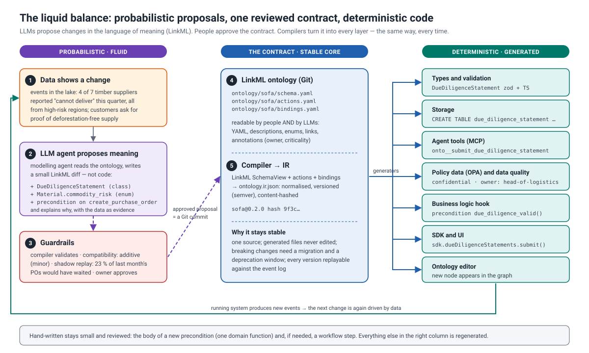

# LinkML: the bridge between LLMs and generated code

*An LLM should change what the business **means**, not hand-write the code that implements it.*

Liquid Enterprise ([docs/liquid-enterprise.md](liquid-enterprise.md)) describes the company once, as a
[LinkML](https://linkml.io) ontology, and generates every layer that depends on it: types, storage, agent tools, policy
data, data-quality checks, the SDK for UIs and the ontology editor's graph. This document explains why that one file
format matters so much in a system where AI agents propose changes. It then follows one business requirement from the
data that triggers it to the screen where people use it.

Decision records: [ADR-0038](adr/0038-liquid-enterprise-extension.md) (the extension),
[ADR-0041](adr/0041-ontology-linkml-ir-generators.md) (ontology, IR and generators).

## The problem: two ways to get it wrong

Software that adapts by itself has two easy failure modes.

- **The LLM writes the code.** An agent edits SQL, API handlers, UI forms and policies directly. Every change touches
  many files in different languages; review becomes guesswork, layers drift apart, and the next model run may "fix" the
  same thing differently. Probabilistic output ends up in places that must be exact.
- **People write every layer by hand.** Safe, but a new business rule needs a ticket for the database, one for the API,
  one for the UI, one for permissions. The organisation cannot keep up with what its data is telling it.

The way out is a **narrow waist**: one small, declarative description of meaning that both sides can work with. LLMs
are good at proposing changes to it; people can review it in minutes; compilers can turn it into code the same way,
every time.

## Why LinkML is a good narrow waist

| Property | Why it matters here |
|---|---|
| **Plain YAML with descriptions** | Readable for people in a review and for an LLM in its context window. A change is a short diff, not a refactoring. |
| **Semantic, not just structural** | Classes, typed attributes, enums, links between classes, identifiers, annotations (owner, criticality, data class). The model says what a *supplier* is, not only what a row looks like. |
| **Standard tooling** | `SchemaView` resolves the schema; LinkML ships generators (JSON Schema, SQL, Pydantic, OWL …). We can add our own on a normalised representation. |
| **Linked-data ready** | Every element has a URI (`https://w3id.org/wrigglets/ontology/sofa/…`), so the model can be shared beyond this platform. |
| **Versioned like code** | Semver in the schema, files in Git, every change a reviewed commit with an author and a reason. |
| **Open source, vendor-neutral** | The meaning of the business is not locked into a database, a SaaS product or a model provider. |

How the alternatives compare for this job:

| | Readable by LLMs and people | Meaning (links, enums, ownership) | Generates many layers | Typical problem |
|---|---|---|---|---|
| **LinkML** | yes | yes | yes, via generators and an IR | needs a compiler step |
| JSON Schema | so-so | structure only | some | no notion of links or ownership |
| OWL / RDF | hard | very rich | rarely to app code | too heavy for application code |
| TypeScript types | developers only | structure only | no | the code *is* the model; LLMs edit code again |
| Database schema | developers only | weak | no | couples meaning to one storage engine |

LinkML has no notion of *behaviour*. We keep that in two companion files next to the schema, validated by the
compiler: `actions.yaml` (typed actions: input, preconditions, events) and `bindings.yaml` (where the source data
lives). Together they are the contract.

## The liquid balance



The architecture has three zones, and the balance between them is what makes it *liquid* without making it *loose*:

- **Fluid (probabilistic).** Data changes, people ask for things, agents notice patterns and propose. This zone may be
  wrong; its output is a *proposal*, never a deployment.
- **Stable core (the contract).** The LinkML ontology in Git, compiled into a normalised, versioned and content-hashed
  IR. It changes rarely and only through review: the compiler validates it, a compatibility check classifies the change
  (patch, additive or breaking), shadow replay shows the effect on real past data, and the owner named in the ontology
  approves.
- **Deterministic (generated).** Everything that depends on the meaning is produced from the IR by generators: the same
  input gives byte-identical output. Generated files carry a header and are never edited by hand.

The running system produces new events, so the next change is driven by data again. The core stays small and
trustworthy; everything around it can move.

## Worked example: a requirement that comes out of the data

This walks through demonstration D3 of the plan with the sofa company. The data, LinkML and IR steps use the formats
that exist today (M1, M2). The proposal flow, live apply and the generated snippets are what M6–M10 deliver; their
shapes follow the generators described in ADR-0041.

### 1. The data shows a change

The event log and the raw zone are queryable with DuckDB (docs/liquid-enterprise.md, "Lake"). A scheduled analysis, or
an agent asked by the head of logistics, notices a pattern:

```sql
SELECT s.id, s.name, count(*) AS cannot_deliver_events
FROM lake.raw.events e JOIN lake.raw.erp_suppliers s ON s.id = e.object_id
WHERE e.type = 'SupplierCannotDeliver' AND e.occurred_at > now() - INTERVAL 90 DAY
GROUP BY ALL ORDER BY 3 DESC;
```

```text
S-NORDHOLZ  Nordholz Sägewerk GmbH       3
S-SILESIA   Silesia Wood sp. z o.o.      2
S-BALTIC    Baltic Timber OÜ (Tallinn)   1
```

At the same time two key accounts ask for proof of deforestation-free supply. The business requirement that follows:
*purchase orders for high-risk commodities need a valid supplier due-diligence statement before release.*

### 2. An LLM agent proposes meaning, not code

The person creates a task for the modelling agent. The agent reads the current ontology (`config__read`), drafts a
change and validates it (`config__validate`). Its proposal is a short LinkML diff:

```yaml
# ontology/sofa/schema.yaml (diff)
enums:
+ CommodityRisk:
+   permissible_values:
+     low: {}
+     high: { description: Commodity from a region with a deforestation risk }

classes:
  Material:
    attributes:
+     commodity_risk: { range: CommodityRisk, required: true }
+ DueDiligenceStatement:
+   description: A supplier's statement that a commodity was produced deforestation-free.
+   annotations: { criticality: business_critical, data_class: confidential, owner: head-of-logistics, mcp_group: erp }
+   attributes:
+     id: { identifier: true }
+     supplier: { range: Supplier, required: true }
+     material: { range: Material, required: true }
+     valid_until: { range: date, required: true }
+     document_ref: { required: true, description: Link to the signed statement }
```

```yaml
# ontology/sofa/actions.yaml (diff)
  - name: create_purchase_order
-   preconditions: [supplier_can_deliver, supplier_supplies_sku, quantity_within_supplier_limits, express_offered_if_requested]
+   preconditions: [supplier_can_deliver, supplier_supplies_sku, quantity_within_supplier_limits, express_offered_if_requested, due_diligence_valid]
+ - name: submit_due_diligence_statement
+   target: DueDiligenceStatement
+   kind: create
+   description: WRITE. Record a supplier's due-diligence statement for a commodity.
+   input:
+     supplierId: { range: Supplier, required: true }
+     sku: { range: Material, required: true }
+     validUntil: { range: date, required: true }
+     documentRef: { range: string, required: true }
+   emits: [DueDiligenceStatementSubmitted]
```

The agent attaches the reason and the query from step 1 as evidence. It has not touched a single line of TypeScript,
SQL or Rego.

### 3. Guardrails decide whether it may become real

```text
compile        ok     sofa@0.2.0 (was 0.1.0), 20 classes, 32 actions, hash 9f3c…
compatibility  minor  additive: 1 class, 1 enum, 1 attribute (required, default for existing rows: high), 1 action, 1 precondition
data quality   ok     all existing materials get a commodity_risk; FK supplier/material resolvable
shadow replay  23 %   of last month's purchase orders would have waited for a statement (7 of 30), KPI delta: +2 late orders
```

The proposal waits in the review queue for the owner named in the ontology (`owner: head-of-logistics`). The editor
shows the change as a diff graph: the new class in green, the changed action in amber. The owner approves; the
approval is a Git commit with `Requested-By`, `Approved-By` and `Change-Id`.

### 4. What appears automatically

The reconciler compiles the approved ontology and runs the generators. Without anyone writing it:

| Layer | Generated from the IR |
|---|---|
| Types and validation | `DueDiligenceStatement` as a zod schema and TypeScript type; the input schema of the new action |
| Storage | `CREATE TABLE due_diligence_statement (id text PRIMARY KEY, supplier text NOT NULL REFERENCES supplier (id), material text NOT NULL REFERENCES material (sku), valid_until date NOT NULL, document_ref text NOT NULL, version bigint NOT NULL, updated_seq bigint NOT NULL)`, plus `ALTER TABLE material ADD COLUMN commodity_risk text` for the additive change |
| Agent tools (MCP) | `onto__submit_due_diligence_statement` with its JSON input schema, `readOnlyHint: false`, visible to agents after the next reconcile |
| Policy data (OPA) | `data.liquid.ontology.classes.DueDiligenceStatement = { criticality: "business_critical", data_class: "confidential", owner: "head-of-logistics" }`, so existing rules (e.g. four eyes on confidential writes by agents) apply at once |
| Data quality | checks for required fields, enum values and foreign keys of the new class |
| SDK | `sdk.dueDiligenceStatements.list()`, `sdk.actions.submitDueDiligenceStatement({ … })` with typed input |
| Editor | the graph shows the new node and its links to `Supplier` and `Material` |

### 5. The small part that is written by hand

A precondition has a name in the ontology and a body in the domain package. The body is the only new logic, and it is
reviewed like any code change (an agent may draft it; CI and a person check it):

```ts
// packages/sofa-domain — registered under the name used in actions.yaml
export const due_diligence_valid: Precondition<CreatePurchaseOrderInput> = (input, s) => {
  if (s.material(input.sku).commodity_risk !== 'high') return ok();
  const valid = s.dueDiligenceStatements.some((d) => d.supplier === input.supplierId && d.material === input.sku && d.valid_until >= s.today);
  return valid ? ok() : fail(`${input.supplierId} has no valid due-diligence statement for ${input.sku}`);
};
```

Where the requirement needs waiting instead of failing, the business workflow gets a new version
(`PurchaseOrderRelease` v2 waits for the statement, with a reminder); running v1 workflows finish on v1.

### 6. The UI and the agents use it

- The **SDK** carries the new type, so a small app (the "due-diligence upload" of M9) offers the form and calls the
  action. The app never talks to a table.
- **Agents** see `onto__submit_due_diligence_statement` and get a clear precondition message when they try to order a
  high-risk material without a statement. They can ask the supplier for one, which is new work they could not do
  before.
- **People** see the new class in the ontology editor and can follow every statement in the event log.

From observation to running system: one reviewed diff of about 30 lines of YAML, one ten-line function, and
everything else regenerated.

## What is generated, what is written

| Generated from the IR (never edited) | Written and reviewed |
|---|---|
| zod schemas and TypeScript types | the LinkML schema, `actions.yaml`, `bindings.yaml` |
| SQL DDL and migrations of the projection | bodies of named preconditions and action handlers (domain package) |
| MCP tool definitions (names, descriptions, input schemas, hints) | business workflow versions (Temporal) |
| OPA data (classes, criticality, data class, owners, action metadata) | policy rules (Rego) |
| data-quality checks | UIs built on the SDK |
| SDK client | |

## Status in this repository

| Piece | Status |
|---|---|
| LinkML schema, actions and bindings of the sofa company (`ontology/sofa/`) | done (M2) |
| Compiler (Python, LinkML 1.12.1, pinned image, CLI and HTTP) → IR | done (M2) |
| Generators: types, SQL, MCP tools, OPA data, DQ checks, SDK; stale check | done (M2) |
| Ontology editor: viewer (E1) | done (M2) |
| Ontology editor: drafts and validation (E2) | M3 |
| Ontology server using the generated artefacts as the only write path | M3 |
| Proposals and review queue, diff graph (E3) | M6 |
| Compatibility check, live apply, modelling agent (E4) | M8 |
| The walkthrough above as an automated scenario (D3) | M10 |

## Further reading

- [docs/liquid-enterprise.md](liquid-enterprise.md): the Liquid Enterprise extension, its layers and operations.
- [docs/liquid-enterprise-extension.md](liquid-enterprise-extension.md): the implementation plan (M2 "Ontology and
  compiler", M8 "Ontology change pipeline", D3).
- [LinkML documentation](https://linkml.io/linkml/) and [SchemaView](https://linkml.io/linkml/developers/schemaview.html).
