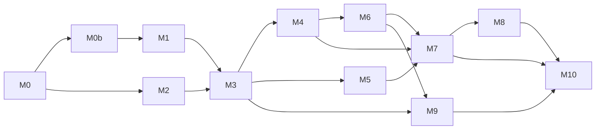

# Liquid Enterprise on Wrigglets: implementation plan

> **Audience:** the Claude Code agent that implements this plan in this repository (and the people reviewing its work).
> **Status:** plan v1.1, 2026-11-16. Baseline commit `79ac9c6` ("optional signals module …").
> v1.1: installable from the admin console (M0b), React Flow ontology editor (E1–E4), one user document
> `docs/liquid-enterprise.md`, ADR numbers in creation order.
> **License:** MIT (unchanged). n8n is **out of scope**: the platform covers short-running flows with Temporal and the
> ontology's action handlers.

---

## 0. How to use this document

- Work **milestone by milestone** (M0 → M10). Do not start a milestone until the previous one's *exit criteria* pass,
  unless the dependency graph in §4 says the milestones can run in parallel.
- Every milestone ends with: green checks (`node scripts/liquid/check.mjs`: build, typecheck, tests, later `opa test` and the stale-generated check), an ADR in `docs/adr/`
  (numbering continues at **0038**, in creation order: see §6), updated docs, and a short entry in the implementation
  log, the appendix of `docs/liquid-enterprise.md` (what was done, what was verified, open points).
- Items marked **⚠ VERIFY** are assumptions about third-party APIs, images or versions. Before you build on one, check
  it with a minimal spike, write down the result in the milestone's ADR, and adjust the plan if it does not hold (same
  convention as `agent-implementation-spec.md`).
- If something in this plan conflicts with an existing ADR, the existing behaviour wins until a new ADR replaces it.
  Say so explicitly in the new ADR ("Supersedes ADR-00xx in part: …").
- Ask the human before you: delete existing features, change the license, introduce a non-OSS dependency, or change
  the security defaults (fail closed, kill switch semantics, approval rules).

---

## 1. Target picture

### 1.1 What we are building

A **prototype of the "liquid enterprise"**: an enterprise architecture that adapts to new business requirements and new
security risks by itself, within guardrails, and avoids vendor lock-in. Business data stays in **open formats we own**,
its meaning lives in a **versioned LinkML ontology**, rules are **policy as code**, and everything above those three
(agents, workflows, UIs) is replaceable behind a contract.

Wrigglets already provides the agent half and the governance core: agents with a harness, durable Temporal workflows,
the MCP gateway as the only tool path, kill switch, safety rule engine, Entra OBO, approvals, wikis and Signals. This
plan adds the data half and turns the safety rule engine into a control loop for the whole platform.

### 1.2 Target architecture (layers)

| Layer | Role | Implemented by (target) | Owned core or replaceable |
|---|---|---|---|
| Data lake and event log | raw, immutable operational data in open table formats; append-only events | SeaweedFS (S3) + Apache Iceberg (REST catalog) + Postgres event outbox; DuckDB for queries | **owned core** |
| Ontology and actions | object types, links, typed actions, bindings to lake objects; the **only write path** | LinkML schema + `actions.yaml` + `bindings.yaml` → ontology compiler → `apps/ontology-server` | **owned core** |
| Policy | who may run which action on which object | OPA (Rego) at two points: MCP gateway (coarse) and ontology server (object level) | **owned core** |
| Identity | people, agents, apps | Entra ID (target) / existing `oauth-server` (local fallback); Entra OBO at the gateway | replaceable behind OIDC |
| Orchestration | long-running business processes, agent tasks, playbook runs, replays | Temporal (existing) + new `business` namespace | replaceable behind workflow contracts |
| Agents | work on tasks with skills and memory | existing agent containers (opencode harness) via MCP gateway | replaceable |
| UIs | many small, generated or vibe-coded apps | generated TypeScript SDK + app registry in the admin console | disposable |
| Control loop | sense → decide → act with autonomy tiers | config repository (GitOps) + playbooks + shadow replay, run as Temporal workflows | **owned core** |

### 1.3 Architectural invariants (do not violate)

1. **Nothing above the ontology binds to physical tables.** Agents, workflows and UIs use ontology tools / the SDK only.
2. **Actions are the only write path.** Every change to business data is a typed action: validated, policy-checked,
   audited, and emitted as an event. No direct writes to the projection or the lake from anywhere else.
3. **Raw data is immutable.** Corrections are new events. The Postgres projection is a cache and must be rebuildable from
   the event log at any time.
4. **One source, compiled everywhere.** The LinkML schema (+ actions and bindings) is the single source; types, SQL, MCP
   tools, SDK, policy stubs and data-quality tests are generated. Generated files carry a header and are never edited by
   hand.
5. **Fail closed** (already true for the gateway; extend it to the ontology server and OPA): unknown, stale or
   unreachable means deny.
6. **Tighten automatically, loosen only with approval.** Automated steps may only reduce permissions or pause work;
   anything that widens access or resumes work needs a human decision (generalizes ADR-0022).
7. **Desired state lives in Git.** From M6 on, configuration that defines behaviour (ontology, policies, playbooks,
   gateway upstreams, allow-lists, safety rules, agent specs without secrets) is read from the config repository.
   Secrets stay in Key Vault.
8. **Everything new is optional and additive** until M10: the existing stack and the existing tests keep working
   without the extension. It is installed from the admin console's Extensions page (M0b) or, for development and CI,
   with the overlay `docker-compose.liquid.yml`. Uninstalling removes everything the extension registered.

### 1.4 Out of scope for this prototype

n8n; production Azure deployment (Bicep); multi-tenant Temporal; a real ERP; high availability; performance tuning
beyond "the sofa scenarios run without timeouts"; GraphQL (REST + MCP + SDK are enough; GraphQL can be generated later
from the same IR).

---

## 2. The proof we want to show

The prototype is done when these three demonstrations run end to end on the local stack, scripted like
`scripts/sofa-company/run.mjs`, with results stored as JSON and a written report like `agentic-mitigations.md`:

| # | Demonstration | What it proves |
|---|---|---|
| D1 | **Backend swap.** The five sofa-company scenarios run unchanged against the ontology server (data in the lake/projection) instead of `mock-mcp.mjs`, with comparable KPIs. | Everything above the contract is independent of the backend: the anti-lock-in claim. |
| D2 | **New security risk.** A vulnerability alert for an upstream triggers an automatic, tightening playbook (gateway disables the upstream, OPA overlay requires extra approval for affected actions, Temporal workflows touching affected objects are held). An agent proposes the fix, shadow replay validates it, a human approves, the system loosens again. | Automatic containment with human-gated recovery; blast radius from the ontology. |
| D3 | **New business requirement.** "Supplier due diligence before a purchase order is released": an agent proposes a LinkML extension, a person approves, the compiler regenerates every layer, `PurchaseOrderRelease` v2 adds a wait step, shadow replay reports the share of orders that would be blocked, rollout follows approval. | The system extends itself through the ontology, with one change compiled into all layers. |

---

## 3. Target repository layout (additions)

```
ontology/
  sofa/
    schema.yaml                 LinkML schema of the sofa company (classes, slots, enums, annotations)
    actions.yaml                typed actions: input, preconditions, effects, events, MCP grouping
    bindings.yaml               class → lake table/column mappings (raw zone)
    README.md
packages/
  ontology-ir/                  zod schema of the ontology IR + loader + compatibility checker
  ontology-codegen/             IR → TS types/zod, SQL DDL, MCP tool defs, OPA stubs, DQ tests, SDK
  sofa-domain/                  domain logic ported from mock-mcp.mjs: KPI, simulation, action handlers
  liquid-sdk/                   generated TypeScript SDK for UIs (output of codegen, published in the workspace)
  business-workflows/           deterministic Temporal workflows for business processes (holdable)
  playbooks/                    playbook schema, validator (tighten-only rule), step registry
tools/
  ontology-compiler/            Python: LinkML → IR JSON (pinned container image; CLI and HTTP `serve` mode)
apps/
  ontology-server/              MCP + REST endpoint for objects and actions; event outbox; projection; OPA checks
  business-worker/              Temporal worker for the `business` namespace
  lake-writer/                  flushes the event outbox and seeds into Iceberg (if not part of ontology-server, see M1)
policies/
  liquid/                       Rego: gateway policy, object policy, tightening overlays; tests (`opa test`)
playbooks/
  *.yaml                        playbooks (moved to the config repository in M6)
scripts/liquid/
  setup.mjs                     registers upstreams, agents, seeds data (like scripts/sofa-company/setup.mjs)
  parity.mjs                    D1: runs the sofa scenarios against both backends and compares KPIs
  scenario-security.mjs         D2
  scenario-business.mjs         D3
docker-compose.liquid.yml       optional overlay: SeaweedFS, Iceberg catalog, ontology DB, ontology server, OPA, business worker
docs/
  liquid-enterprise-extension.md  this file (the plan)
  liquid-enterprise.md          the one user/operator document: activation, architecture, ontology + IR contract,
                                editor, policies, workflows, proposals, playbooks, runbook, results D1–D3,
                                appendix: implementation log
packages/
  extensions/                   extension manifest schema (zod), dependency order, env rendering, plan diff (M0b)
apps/admin-server/src/extensions/  extension runtime (Docker), install/uninstall state machine, liquid manifest (M0b)
apps/admin-web/src/
  pages/ExtensionsPage.tsx      install / uninstall optional modules (M0b)
  pages/Liquid*Page.tsx         liquid pages: overview, ontology, policies, processes, proposals, playbooks, apps
  components/ontology/          React Flow ontology editor: irToFlow, diffIr, nodes, side panels (E1–E4)
infra/docker/
  ontology-compiler.Dockerfile  pinned Python image for the compiler; CLI and HTTP `serve` mode
```

Naming: gateway upstream for the ontology server is `onto` (new tool names) plus compatibility groups `erp` and `crm`
during the parity phase (M3).

---

## 4. Milestones overview

| # | Milestone | Main deliverable | Depends on |
|---|---|---|---|
| M0 | Baseline and conventions | KPI baseline of the sofa scenarios, ADR-0038, `docs/liquid-enterprise.md` | – |
| M0b | Extension manager | Extensions page; admin server installs/uninstalls the liquid containers | M0 |
| M1 | Data foundation | lake + event outbox in the liquid manifest and `docker-compose.liquid.yml`; seed of the sofa state | M0b |
| M2 | Ontology and compiler | LinkML schema, IR, compiler, codegen (types, SQL, MCP tools, OPA stubs, DQ tests) | M0 (M1 for bindings) |
| M3 | Ontology server and backend swap (D1) | `apps/ontology-server`, `sofa-domain`, parity report | M1, M2 |
| M4 | Policy as code | OPA at gateway and ontology server, generated stubs, tests | M3 |
| M5 | Business workflows | `business` namespace, holdable workflows, actions that start/signal workflows | M3 |
| M6 | Config repository (GitOps) | desired state in Git, reconciler, change proposals with review queue | M4 (can start after M3) |
| M7 | Playbooks and control loop | playbook engine as Temporal workflows, tighten-only validator, shadow replay | M4, M5, M6 |
| M8 | Ontology change pipeline | compatibility check, versioned tools, projection migration, modelling skill | M6, M7 |
| M9 | Identity and UIs | Entra as IdP option, generated SDK, app registry, sample vibe-coded app | M3 (SDK), M6 (registry) |
| M10 | Acceptance: D2 and D3, final report | scripted scenarios, results, `docs/liquid-enterprise.md` §Results | M7, M8, M9 |

Editor tracks run alongside: **E1** viewer and **E2** draft editing + validate with M2/M3, **E3** proposals + diff
view with M6, **E4** compatibility + live apply with M8 (see §5, "Ontology editor").

ADR numbers in creation order: 0038 M0 · 0039 M0b · 0040 M1 · 0041 M2 · 0042 editor · 0043 M3 · 0044 M4 · 0045 M5 ·
0046 M6 · 0047 M7 · 0048 M8 · 0049 M9.



---

## 5. Milestones in detail

### M0 — Baseline and conventions

**Goal:** a measured starting point and shared conventions before anything changes.

Tasks
1. Build and test the repository as it is; record the result (test count, failures) in the implementation log.
2. Start the stack and run the sofa-company example (`scripts/sofa-company/setup.mjs`, `run.mjs`) **three times** per
   scenario where the budget allows (the model is probabilistic). Store results under
   `scripts/sofa-company/results/baseline-<n>-<scenario>.json` and a summary table (late orders before → after, spend,
   number of decisions, number of tool calls, guard halts).
3. Write **ADR-0038 "Liquid enterprise extension"**: scope, invariants (§1.3), the extension approach, n8n out of scope.
4. Add `docs/liquid-enterprise.md` with all sections as stubs and the implementation log (appendix) with a template
   per milestone (done / verified / open / deviations from plan).
5. Add a CI-like local check script `scripts/liquid/check.mjs` that runs build, typecheck, tests and (from M4) `opa test`.

Deliverables: baseline results, ADR-0038, `docs/liquid-enterprise.md`, `scripts/liquid/check.mjs`.

Exit criteria
- All existing tests pass (or pre-existing failures are documented with cause).
- Baseline KPI table exists with the spread across runs.

---

### M0b — Extension manager and install UI

**Goal:** an administrator installs and uninstalls Liquid Enterprise from the admin console. Signals (ADR-0037) can only
be switched on by restarting the stack with an overlay; this milestone adds a real install path, reusing the Docker
socket the control plane already holds for agent containers (`apps/admin-server/src/runtime/docker.ts`). No new service
gets the socket.

Design
- **Manifest** (`packages/extensions`, zod): `id`, `name`, `description`, `services[]` (name, image, env template with
  `{{secret:NAME}}` and `{{svc:NAME.url}}`, volumes, internal port, healthcheck, `dependsOn`, user), `secrets[]`
  (generated on install), `bootstrap[]` (named idempotent steps), `upstreams[]` (gateway upstreams the extension owns),
  `uiRoutes[]`. Pure functions: dependency order, env rendering, plan diff (desired vs. actual containers).
- **Liquid manifest** (`apps/admin-server/src/extensions/liquid.ts`) grows per milestone: M0b `ontology-db` + `minio`,
  M1 catalog, M2 compiler (`serve` mode), M3 ontology server, M4 OPA, M5 business worker. Every service is declared both
  in the manifest and in `docker-compose.liquid.yml`; a test checks that both declare the same service set.
- **Runtime:** containers `cw-ext-<extension>-<service>`, labels `cw.role=extension` + `cw.extension=<id>`, volumes
  labelled `cw.role=extension-data`, network `DOCKER_NETWORK` with the service name as alias, no host ports by default
  (loopback only when needed). `docker compose up --remove-orphans` leaves them alone (no compose labels), as it does
  agent containers.
- **State machine** in `DATA_DIR/admin/extensions.json`: `not_installed → installing → installed | failed →
  uninstalling → not_installed`, with per-step progress. Install: preflight (images present or pullable) → secrets
  into the secret store → volumes → containers in dependency order → wait healthy → bootstrap steps (migrations,
  Temporal namespace, owned upstreams, optional demo seed). Steps are idempotent; an interrupted install resumes when the
  admin server starts. Uninstall removes containers, **the owned upstreams** and schedules; "purge data" also removes
  the volumes.
- **Availability** is decided at runtime: installed and healthy, or overlay environment present. All liquid routes go
  through a `requireLiquid` middleware (404 when off), as Signals routes do.
- **API** (Platform.Admin, audited): `GET /api/extensions`, `GET /api/extensions/:id`, `POST …/:id/install {seedDemo}`,
  `POST …/:id/uninstall {purgeData}`, `POST …/:id/repair`.
- **UI:** `ExtensionsPage` (always in the nav) with a card per extension: status, install/uninstall, step progress,
  service health, and a hint with `node scripts/stack.mjs build --liquid` when images are missing. Signals is shown
  read-only ("managed by overlay"). When Liquid is installed, the nav gains a "Liquid enterprise" group.
- **Stack:** `stack.mjs build --liquid` builds the liquid images; `reset` also removes `cw.role=extension*` resources;
  `liquid up|down|reset` drive the overlay. Default commands are unchanged.

Tasks
1. ADR-0039 "Extension manager: optional modules installed from the admin console".
2. `packages/extensions`, runtime, state machine, API, Extensions page, nav integration, stack flags.
3. Tests with a fake Docker client: manifest validation, dependency order, env rendering (secrets never logged), step
   idempotency and resume, uninstall touches only labelled resources and removes owned upstreams.

Exit criteria
- From a fresh stack: Install → containers healthy → Liquid nav visible. An admin-server restart during install resumes
  it. Uninstall leaves no `cw-ext-*` container and no owned upstream. All existing tests stay green.

---

### M1 — Data foundation: lake and event log

**Goal:** an open-format raw zone and an append-only event log, both rebuildable, with the sofa company's initial state
seeded into them.

Design
- **Object storage:** SeaweedFS with its S3 gateway (Apache-2.0, pinned by digest). Decided 2026-11-16 instead of MinIO,
  whose community images and binaries are no longer published. **⚠ VERIFY** S3 compatibility with the chosen catalog
  and writer (multipart upload, path-style access).
- **Table format and catalog:** Apache Iceberg with a REST catalog. Candidates: Lakekeeper or Apache Polaris.
  **⚠ VERIFY** image, licence (must be OSS), REST catalog compatibility with the chosen writer.
- **Writer and query engine:** DuckDB from Node (`@duckdb/node-api`) with the `iceberg` extension.
  **⚠ VERIFY** that the DuckDB version in use can *write* (append) to Iceberg tables through a REST catalog. Fallback:
  a small Python `apps/lake-writer` using `pyiceberg` (append via REST catalog), pinned, in its own container. Decide in
  a spike at the start of M1 and record the decision in the ADR.
- **Event log:** table `events` in a new Postgres (`cw-ontology-db`), append-only (no UPDATE/DELETE grants for the
  application role). Columns: `seq bigserial`, `event_id uuid`, `type`, `object_type`, `object_id`, `action`,
  `actor_agent`, `actor_user`, `task_id`, `workflow_id`, `payload jsonb`, `occurred_at`, `ontology_version`.
- **Flush:** a Temporal schedule `lake-flush` (every minute) appends new events to Iceberg `raw.events` and records the
  high-water mark. Idempotent by `seq`.
- **Raw zone tables:** `raw.erp_*`, `raw.crm_*` (one per entity of the mock: factories, machines, workers, materials,
  suppliers, inventory, purchase_orders, production_orders, maintenance_tickets, customers, orders, campaigns, demand).
- **Seed:** `scripts/liquid/seed.mjs` exports the initial state of `mock-mcp.mjs` (refactor the mock so its initial
  state can be imported as a module without starting the server, or read it from `/scenario` reset) and writes it into
  the raw zone as the "source system extract" at time T0.

Tasks
1. Spike writer/catalog (⚠ VERIFY above), write ADR-0040 "Lake: Iceberg on SeaweedFS, event outbox in Postgres".
2. `docker-compose.liquid.yml` with `minio`, catalog (+ its DB if needed), `ontology-db`; health checks; volumes;
   loopback-only ports; secrets generated by `scripts/stack.mjs env` (extend it, keep existing behaviour).
3. Package code for: event append (typed, zod-validated), outbox flush activity, raw-zone writer, raw-zone reader.
4. `scripts/liquid/seed.mjs` + a `lake-flush` schedule registered by the control plane when the overlay is on.
5. Tests: event append idempotency, flush high-water mark, seed round trip (state in → raw tables → read back equal).

Deliverables: overlay compose file, ADR-0040, event log + flush, seeded raw zone, tests.

Exit criteria
- `docker compose -f docker-compose.yml -f docker-compose.liquid.yml up` starts everything healthy.
- After seeding, a DuckDB query over the raw zone returns the same entity counts as the mock's initial state.
- Appending 1,000 events and flushing twice yields exactly 1,000 rows in `raw.events`.

---

### M2 — Ontology and compiler

**Goal:** the sofa company described once in LinkML, compiled into all artefacts the other layers need.

Design
- **LinkML schema** `ontology/sofa/schema.yaml`: classes `Factory`, `Machine`, `Worker`, `Absence`, `Material`, `Bom`,
  `Supplier`, `InventoryItem`, `PurchaseOrder`, `ProductionOrder`, `MaintenanceTicket`, `Customer`, `SalesOrder`,
  `Campaign`, `DemandSignal`; links as slots with `range` of another class; enums for statuses.
  Annotations used by the compiler (document them in `docs/liquid-enterprise.md` §Ontology):
  - `criticality: normal | business_critical | payment_critical`
  - `data_class: public | internal | confidential`
  - `owner: <role or person>` (domain owner who approves structural changes)
  - `mcp_group: erp | crm` (only for the parity phase)
- **Actions** `ontology/sofa/actions.yaml` (LinkML has no action concept; this companion file is validated by a zod
  schema in `ontology-ir`). Per action: `name`, `description`, `target` (class), `input` (slots or inline fields),
  `read_only` (bool), `destructive` (bool), `preconditions` (named checks implemented in TS + optional Rego rule names),
  `emits` (event types), `starts_workflow` / `signals_workflow` (from M5), `mcp_group`. For parity, action names equal
  the mock tool names (`create_purchase_order`, `update_production_order`, `send_customer_notice`, …) and the read
  tools (`list_suppliers`, `get_kpi`, `simulate_change`, …) are modelled as read-only actions.
- **Bindings** `ontology/sofa/bindings.yaml`: class → raw table, column mapping, key, optional transform name.
- **IR (the contract):** a normalized JSON document (`ontology.ir.json`) with classes, slots, enums, links, actions,
  bindings, annotations, `version` (semver) and a content hash. Defined as a zod schema in `packages/ontology-ir`.
  All generators read **only** the IR, never LinkML directly.
- **Compiler front end** `tools/ontology-compiler` (Python, because LinkML is Python): loads the schema with LinkML's
  `SchemaView`, merges `actions.yaml` and `bindings.yaml`, validates references, emits the IR. Runs in a pinned
  container (`docker run … ontology-compiler compile ontology/sofa -o build/ontology.ir.json`).
  **⚠ VERIFY** current LinkML package version and `SchemaView` API; pin it.
- **Code generators** `packages/ontology-codegen` (TypeScript), each a pure function `IR → files`:
  1. zod schemas + TS types per class and per action input;
  2. SQL DDL for the Postgres projection (one table per class, FK for links, `version` + `updated_seq` columns);
  3. MCP tool definitions (name, description, JSON input schema, `readOnlyHint`, `destructiveHint`) per action, grouped
     by `mcp_group` or into `onto`;
  4. OPA stubs: `data.liquid.ontology` with classes, criticality, data class, action metadata (Rego data JSON, not
     logic), plus a test skeleton;
  5. data-quality tests (required slots, enum values, FK integrity) runnable against the projection;
  6. the UI SDK skeleton (`packages/liquid-sdk`, used in M9).
  Every generated file starts with `// GENERATED from ontology <name>@<version> (<hash>) — do not edit`.
- **Build integration:** `pnpm ontology:build` runs compiler + codegen; outputs go to `packages/*/src/generated/`;
  a test fails if generated files are stale (hash mismatch).

Tasks
1. Write the LinkML schema by reading `scripts/sofa-company/mock-mcp.mjs` (state shape, tool inputs and outputs).
2. Write `actions.yaml` covering **every** mock tool (ERP and CRM), with read-only/destructive flags matching the mock.
3. Write `bindings.yaml` against the M1 raw tables.
4. Implement IR zod schema, compiler, generators; ADR-0041 "Ontology: LinkML + actions + IR + generators".
5. `docs/liquid-enterprise.md` §Ontology: the IR contract, annotations, generator outputs, versioning rules.
6. Tests: golden-file tests for each generator; compiler validation errors (unknown class in action, missing binding);
   stale-generated-files check.

Deliverables: `ontology/sofa/*`, IR package, compiler image, codegen package, generated artefacts, ADR-0041, docs.

Exit criteria
- `pnpm ontology:build` is deterministic (two runs, identical hashes).
- Generated MCP tool list matches the mock's tool list one-to-one (names, read-only flags, input schemas compatible).
- Generated DDL applies to an empty Postgres; DQ tests pass on the seeded projection (after M3's projection build).

---

### M3 — Ontology server and backend swap (D1)

**Goal:** the agents work on the ontology server instead of the mock, unchanged, and reach comparable KPIs.

Design
- **`packages/sofa-domain`:** port the business logic of `mock-mcp.mjs` (capacity, projections, KPI, `simulate_change`,
  scenario disruptions, every write tool's effect) into typed functions over a `StateStore` interface. Two adapters:
  `InMemoryStateStore` (for unit tests and to prove parity with the mock logic) and `ProjectionStateStore` (Postgres).
  Keep the mock's numbers exactly; the KPI is the judge.
- **`apps/ontology-server`** (Node/TS, Express, `@modelcontextprotocol/sdk` same version as the gateway):
  - MCP endpoints `/onto/mcp`, and for parity `/erp/mcp` and `/crm/mcp` (tools filtered by `mcp_group`).
  - REST: `GET /objects/:class`, `GET /objects/:class/:id`, `POST /actions/:name` (for SDK/UIs), `GET /kpi`,
    `POST /scenario/:id/start` (disruption injection now **writes events**, e.g. `SupplierNoticeIssued`), `GET /health`.
  - **Action pipeline** (one code path for MCP and REST): authenticate caller (gateway token or user/app token) →
    validate input (generated zod) → load objects → preconditions → policy check (stub "allow" until M4, but the hook
    exists and fails closed if configured) → handler (pure domain function returns new state + events) → in one DB
    transaction: append events, update projection → response. Read-only actions never write.
  - **Projection rebuild:** `POST /admin/projection/rebuild` (and a Temporal workflow) replays the event log from T0 seed
    into a fresh schema and swaps it in. Used again by shadow replay in M7.
  - Caller context: the gateway already forwards agent identity and task context (`step-context`, `_agent`, `_task`
    for Signals). **⚠ VERIFY** how upstreams currently receive agent/task identity from `apps/mcp-gateway`
    (`upstreams.ts`, `caller.ts`); extend minimally so every event records `actor_agent`, `actor_user` (OBO `oid` when
    present), `task_id`.
- **Registration:** `scripts/liquid/setup.mjs` registers upstreams `erp`/`crm` pointing to the ontology server (same
  names, so the sofa agents' allow-lists and `AGENTS.md` stay valid) and `onto` for new work.
- **Parity runner** `scripts/liquid/parity.mjs`: runs each sofa scenario against the mock and against the ontology
  server (fresh state each time), stores results, and writes a comparison table.

Tasks
1. `sofa-domain` port with unit tests that run the same operations against the mock's logic and the domain package and
   compare outputs (deterministic parts: KPI, simulation, effects of each write tool).
2. Ontology server with action pipeline, MCP + REST, projection, events, rebuild.
3. Event types for every write action and every scenario disruption.
4. Setup + parity scripts; ADR-0043 "Ontology server, action pipeline, event-sourced projection".
5. Tests: action pipeline (validation error, precondition failure, read-only never writes, transaction rollback on
   handler error), rebuild equals live projection, MCP tool list equals generated list.

Deliverables: `sofa-domain`, `ontology-server`, setup and parity scripts, parity report in `docs/liquid-enterprise.md` §Results.

Exit criteria
- Deterministic parity: for every write tool and for `get_kpi`/`simulate_change`, domain package and mock produce equal
  results on the same inputs (unit tests).
- End-to-end parity: the five scenarios complete on the ontology server; final KPIs are within the spread measured in
  M0 (or deviations are explained by model variance with evidence).
- Rebuilding the projection from the event log after a full scenario run gives an identical projection (row hash).
- **Demonstration D1 is recorded.**

---

### M4 — Policy as code (OPA)

**Goal:** authorization rules that are portable, versioned and testable, enforced at the gateway and the ontology server.

Design
- **OPA** container (pinned by digest), policies from `policies/liquid/`, data from the generated
  `data.liquid.ontology` plus a writable `data.liquid.overlays` document (tightening overlays, used by playbooks in M7).
  Bundle delivery: the control plane serves a bundle endpoint; OPA polls it. **⚠ VERIFY** OPA bundle API and polling
  config for the pinned version.
- **Gateway enforcement point** (`apps/mcp-gateway/src/policy.ts`): keep `decideToolCall` as the first, pure check;
  add an OPA query after the allow-list check for tools of upstreams marked `policy: opa` (new optional field on
  `upstreamServer`, default off). Input: `{ agent, user (oid/upn if OBO), tool, upstream, action (from tool metadata),
  task: { id, step, interactive }, killSwitch }`. Decision `{ allow, reason, obligations[] }`. Fail closed on timeout or
  error. Add the OPA decision to the audit entry (`policy`, `reason`).
- **Ontology server enforcement point:** object-level policy in the action pipeline with the loaded objects'
  attributes (criticality, data class, owner, status) and the action's metadata. Obligations supported in the
  prototype: `require_four_eyes` (action returns `pending_approval` and starts an approval in M5),
  `require_step_up` (deny with reason in the prototype; real step-up with Entra later), `deny`.
- **Policy content (initial):** least privilege per agent role (mirrors today's allow-lists), read-only in plan steps
  (mirrors today's gateway rule, as a second line), destructive actions require an approved plan, actions on
  `payment_critical` objects by agents require four eyes, overlays can only add restrictions (`deny` wins).
- **Tests:** `opa test policies/` in `scripts/liquid/check.mjs`; TS tests for both enforcement points with a fake OPA.

Tasks
1. ADR-0044 "Policy as code with OPA at two enforcement points".
2. OPA in the overlay, bundle endpoint in the control plane, policies + tests.
3. Gateway integration (optional per upstream, fail closed, audited).
4. Ontology server integration with obligations.
5. Admin console: read-only "Policies" page (current bundle revision, overlays in effect, last decisions).

Exit criteria
- With `policy: opa` on `erp`/`crm`, the five sofa scenarios still run (policies reproduce today's allow-lists).
- Negative tests: an agent outside its role is denied by OPA even if the allow-list were widened; an overlay denying
  an action takes effect within 30 s without restarting anything; OPA down ⇒ all `policy: opa` calls denied.

---

### M5 — Business workflows (Temporal `business` namespace)

**Goal:** long-running business processes as durable workflows that actions can start and that playbooks can hold.

Design
- New namespace `business` (bootstrapped by the control plane like `agent-dev`), `apps/business-worker`,
  `packages/business-workflows` (deterministic; replay tests with recorded histories like `packages/workflows`).
- **Holdable workflow helper:** every business workflow handles signals `hold(reason, ref)` and `release(ref)`; while
  held it does not execute activities that change state. Query `holdState`.
- **Search attribute `OntologyObjects`** (KeywordList, values like `PurchaseOrder:PO-1234`, `Supplier:S-NORDHOLZ`):
  set at start and updated when a workflow touches more objects. Enables "find every running workflow that touches
  objects of type X / object Y" for blast-radius and hold steps.
- **Action ↔ workflow binding:** `starts_workflow` / `signals_workflow` in `actions.yaml`; the action pipeline starts or
  signals the workflow after the transaction commits (outbox pattern: record the intent as an event, a dispatcher
  starts the workflow idempotently with a workflow id derived from the event id).
- **First workflows:**
  - `PurchaseOrderRelease` v1: created → (four-eyes approval if obliged) → released → awaiting delivery (timer from
    lead time) → received / late (raises a Signals-style expectation or notifies the owner).
  - `ApprovalWorkflow`: generic human approval for policy obligations, reusing the e-mail decision pattern of
    ADR-0026 (deep link, decision dialog, reminder, expiry).
- **Versioning:** use Temporal worker versioning or patching (**⚠ VERIFY** the recommended mechanism for TS SDK 1.24);
  M8/D3 needs v2 of `PurchaseOrderRelease` while v1 runs continue.

Tasks
1. ADR-0045 "Business workflows: namespace, holdable helper, OntologyObjects".
2. Namespace bootstrap, worker, workflows, dispatcher, approval workflow + UI integration (admin console page
   "Business processes": running workflows, held ones, pending approvals).
3. Tests: hold/release semantics (no state-changing activity while held), idempotent start from events, approval
   reminder/expiry, replay tests.

Exit criteria
- `create_purchase_order` starts `PurchaseOrderRelease`; signalling `hold` to all workflows with
  `OntologyObjects = Supplier:S-NORDHOLZ` pauses exactly those; `release` resumes them; nothing is lost across a worker
  restart.

---

### M6 — Config repository (GitOps) and change proposals

**Goal:** the platform's desired state lives in Git; agents and people change it through reviewed proposals; a
reconciler applies it.

Design
- **Config repository:** a Git repository in a volume (`config-repo`), owned by the control plane; branch `main` is the
  desired state. Layout:
  ```
  ontology/<domain>/{schema,actions,bindings}.yaml
  policies/liquid/*.rego
  playbooks/*.yaml
  gateway/upstreams.yaml        (no secrets; secretRef only)
  gateway/allow-lists.yaml
  safety/rules.yaml
  agents/<id>.yaml              (AgentSpec without secrets)
  ```
- **Migration:** the admin server's JSON stores that define behaviour (`agents.json` spec part, gateway config, safety
  rules) become *read from the repository*; generated secrets and runtime state stay in `/data`. Admin console edits
  become commits (author = signed-in admin, trailers like the workspace convention: `Requested-By`, `Approved-By`,
  `Change-Id`).
- **Change proposals:** a proposal is a branch + diff + reason + evidence, reviewed in the admin console. Reuse the
  review-queue pattern of the company wiki (ADR-0035: `wiki/proposals`, decide with comment, audit entry). Agents
  propose through a new gateway upstream `config` served by the control plane with tools `config__read`,
  `config__propose_change`, `config__get_proposal`. Approval by the owner declared for the touched path (ontology
  `owner` annotation, `CODEOWNERS`-style file `OWNERS.yaml`).
- **Reconciler:** on every merge to `main` (and every 60 s), validate → build (ontology compiler + codegen, OPA bundle,
  playbook validation) → apply (gateway config push, OPA bundle revision, safety rules, agent specs) → record the
  applied revision. A failed build blocks the merge (proposals are validated before they can be approved).

Tasks
1. ADR-0046 "Desired state in a config repository; proposals and reconciler" (supersedes in part ADR-0021/0022 storage).
2. Repository bootstrap from current state (export script), loaders, reconciler, commit-on-edit in admin console.
3. Proposal model, `config` MCP upstream, review UI, OWNERS resolution.
4. Tests: export/import round trip; reconciler idempotency; invalid proposal cannot be approved; an approved proposal
   changes behaviour (e.g. an allow-list) within one reconcile cycle; secrets never appear in the repository.

Exit criteria
- Stack restart with an empty `/data/admin` (but intact secrets and repository) reproduces the same behaviour.
- An agent can propose an allow-list change; after approval it takes effect; rejection leaves `main` unchanged.

---

### M7 — Playbooks and the control loop

**Goal:** the generalized "sense → decide → act" loop with autonomy tiers, the tighten-only rule and shadow replay.

Design
- **Playbook schema** (`packages/playbooks`, zod; documented in `docs/liquid-enterprise.md` §Playbooks):
  ```yaml
  id: third-party-upstream-vulnerability
  version: 1
  trigger:
    kind: alert                  # alert | safety_metric | signal | schedule
    match: { source: vuln-feed, severity: [high, critical] }
  assess:
    blast_radius: ontology       # walk upstream → tools → actions → classes → objects / running workflows
  steps:
    - id: disable-upstream
      type: gateway.upstream.disable
      autonomy: auto             # auto | propose | human
    - id: tighten-policy
      type: policy.overlay.add
      autonomy: auto
      with: { actions_on: "{{ blast.classes }}", obligation: require_four_eyes }
    - id: hold-workflows
      type: temporal.hold
      autonomy: auto
      with: { objects: "{{ blast.objects }}", ref: "{{ run.id }}" }
    - id: propose-fix
      type: agent.task           # an agent proposes the fix as a config proposal
      autonomy: propose
      with: { agent: platform-agent, approval: plan }
    - id: replay
      type: shadow.replay
      autonomy: auto
      with: { window: 7d }
    - id: restore
      type: restore              # reverts the tightening steps of this run
      autonomy: human
  learn:
    record_incident: true
  ```
- **Step registry** with a declared **direction** per step type: `tighten` (gateway.upstream.disable, killswitch.raise,
  policy.overlay.add, temporal.hold, entra.revoke_scope), `neutral` (notify, shadow.replay, agent.task,
  config.propose), `loosen` (restore, policy.overlay.remove, temporal.release, gateway.upstream.enable,
  killswitch.lower). **Validator rule: a `loosen` step must have `autonomy: human`.** Enforced at proposal validation
  and again at run time.
- **Execution:** `PlaybookRun` workflow in the control plane namespace; each step is an activity with summary; approvals
  use `ApprovalWorkflow` (M5); every step result is audited; a run can be cancelled (and cancel triggers no loosening).
- **Triggers:** existing safety rule engine (`apps/admin-server/src/safety.ts`) becomes one trigger source (its rules
  map to `safety_metric` triggers; existing behaviour preserved); `POST /internal/alerts` (token-protected) for external
  alerts such as a vulnerability feed; Signals observations; schedules.
- **Blast radius:** a pure function over the IR + gateway config + Temporal visibility: upstream → tools → actions →
  classes → objects (from projection) → running workflows (`OntologyObjects`).
- **Shadow replay:** `ShadowReplayWorkflow` forks the projection into a scratch schema at time T−window, replays the
  window's events through the **candidate** configuration (new ontology version / policy bundle / action
  preconditions / patched upstream), and reports: events processed, diffs vs. actual, policy denials, actions that
  would be blocked, KPI delta (via `sofa-domain`). Result is attached to the proposal as evidence.
- **Entra steps:** `entra.revoke_scope` is a stub locally (records intent, adjusts the agent's gateway allow-list as the
  local equivalent); real implementation with Microsoft Graph behind `ENTRA_TENANT_ID` later. **⚠ VERIFY** Graph API
  for removing app role assignments / service principal permissions.

Tasks
1. ADR-0047 "Playbooks, autonomy tiers and the tighten-only rule".
2. Schema, validator, step registry, `PlaybookRun`, blast radius, shadow replay, alert endpoint.
3. Admin console: playbook runs (timeline of steps, pending approvals, evidence), playbook list from the repository.
4. Port today's safety rules to playbooks without behaviour change (test: same inputs trip the same levels).
5. Tests: validator rejects auto-loosening; run survives restarts; cancel never loosens; blast radius on the sofa
   ontology; shadow replay determinism (same window + same config ⇒ identical report).

Exit criteria
- A synthetic alert runs the example playbook end to end on the sofa company; all tightening steps take effect
  automatically; `restore` waits for a human; after approval everything is back to baseline (verified by diffing
  gateway config, OPA overlays and held workflows before/after).

---

### M8 — Ontology change pipeline

**Goal:** the ontology can evolve safely while the system runs; agents can propose extensions.

Design
- **Compatibility checker** (in `ontology-ir`): compares two IRs → `additive` (minor), `breaking` (major: removed
  class/slot, narrowed range, renamed action, changed required-ness), `patch` (descriptions/annotations). Breaking
  changes require a migration note and a deprecation window (old action names stay as aliases for N versions).
- **Versioned tools:** the ontology server serves the current version and keeps aliases for deprecated actions; tool
  descriptions mention deprecation. Events carry `ontology_version`.
- **Projection migration:** additive changes → DDL migration generated from the IR diff; breaking changes → rebuild
  from events into a new schema, then swap.
- **Hot reload:** the reconciler (M6) hands the new IR to the ontology server, which reloads generated artefacts without
  dropping in-flight requests. **⚠ VERIFY** whether generated TS needs a rebuild/restart; acceptable fallback: rolling
  restart of the ontology server container by the control plane.
- **Modelling skill:** an agent role `modelling-agent` with a skill file (in its workspace) describing how to propose a
  LinkML change: read the current schema via `config__read`, draft the diff, run the compiler via a `config__validate`
  tool (build + compatibility report + DQ tests on the projection), submit `config__propose_change` with the report as
  evidence. The domain owner approves.

Tasks
1. ADR-0048 "Ontology evolution: compatibility, versioning, migration".
2. Checker, migration generator, alias support, reload path, `config__validate` tool, modelling agent setup script.
3. Tests: checker classification on a table of cases; additive change applied live without losing events; breaking
   change with rebuild; deprecated alias still works and is logged.

Exit criteria
- Adding a class and a link (the D3 change) goes from proposal to live in one reconcile cycle after approval, with the
  generated tools visible to agents and the SDK regenerated.

---

### Ontology editor (tracks E1–E4, alongside M2/M3, M6, M8)

**Goal:** people see and change the ontology as a graph in the admin console. Changes go through the same governed
path as agent proposals: draft → validate → proposal → owner approval → compile → live.

Design
- **Libraries:** `@xyflow/react` (MIT) for the canvas; auto-layout with `@dagrejs/dagre` (MIT) or `elkjs` (EPL-2.0).
  **⚠ VERIFY** current versions, React 19 compatibility, licence acceptable; pin exact versions.
- **E1 — viewer (with M2).** Page `/liquid/ontology`. Reads the live IR (`GET /api/liquid/ontology` → IR + revision).
  Nodes are classes (name, key slots, chips for criticality / data class / owner, number of actions); edges are link
  slots (label, cardinality). Enums and actions in a side panel; filter by `mcp_group` and criticality; search; layout
  positions remembered per browser. Pure `irToFlow(ir) → { nodes, edges }`.
- **E2 — drafts and validation (with M2/M3).** Edit operations: add/rename class, add/edit slot (range, required,
  multivalued), enum values, annotations, a link by dragging from one class to another, add/edit action (input,
  flags, preconditions). Drafts live in `DATA_DIR/admin/liquid/drafts/<id>` as the three YAML source files forked from a
  revision. The server applies typed operations (`PATCH /api/liquid/ontology/drafts/:id { ops[] }`) with the `yaml`
  Document API, so comments and key order survive. `POST …/validate` calls the compiler service (the compiler image's
  HTTP `serve` mode, installed as an extension service, so the admin server never starts ad-hoc containers) and, from M3,
  the DQ tests against the projection. Errors are shown on the affected node.
- **E3 — proposals and diff view (with M6).** `POST …/submit` creates a config proposal (branch + diff + reason +
  validation report as evidence). The proposal page shows a **diff graph** (added green, removed red, changed amber)
  from a pure `diffIr(a, b)`. Approval by the owner (`owner` annotation, `OWNERS.yaml`); the reconciler applies it.
- **E4 — compatibility and live apply (with M8).** Compatibility class (patch / minor / major) in the validation panel
  and the proposal; breaking changes need a migration note; deprecated actions shown struck through; after apply the
  editor moves to the new revision. The modelling agent's proposals use the same type, so D3 is reviewed in this view.

Tasks
1. ADR-0042 "Ontology editor: React Flow, drafts as YAML operations, proposals" (at E1).
2. E1–E4 as above, each delivered with the milestone it depends on.
3. Tests: `irToFlow`, `diffIr`, operation → YAML golden files, invalid operations rejected; a Playwright run that adds a
   class and a link, validates (a wrong range shows an error on the node), submits, approves and sees the class live.

Exit criteria
- E1/E2 with M3: the sofa ontology is shown completely; a draft with a new class validates and reports errors on nodes.
- E3/E4 with M8: the D3 change can be made in the editor, approved in the diff view and is live after one reconcile.

---

### M9 — Identity (Entra) and UIs

**Goal:** Entra as the target identity provider, and a governed path for many small UIs.

Design
- **Entra as IdP option:** `AUTH_MODE=entra` for admin console and agent UIs via OIDC against Entra (app roles map to
  `Platform.Admin`, `Agent.User`, `Agent.Approver`, `Agent.Admin`); the existing `oauth-server` stays the default for
  local runs (ADR-0004 remains valid for local). Agent identities continue to use the Entra identity tab and OBO
  (ADR-0032). **⚠ VERIFY** whether Entra Agent ID should be used for agent identities in the tenant available; document
  the choice.
- **Generated SDK** `packages/liquid-sdk`: typed client for objects and actions (REST of the ontology server),
  OIDC token injection, no other network access. Regenerated by the reconciler on ontology changes.
- **App registry** in the admin console: register an app (name, owner, OIDC client, allowed actions, expiry date
  default 180 days, repository/source link); a registration check runs before activation: dependency audit, the app
  uses only the SDK (static check of imports and fetch targets), CSP with only the ontology server as `connect-src`.
  Expired apps lose their OIDC client.
- **Sample vibe-coded app:** "Supplier due-diligence upload" (used by D3): a small React app built only on the SDK,
  served as a static container, registered through the registry.

Tasks
1. ADR-0049 "Entra as identity provider option; app registry for generated UIs".
2. Entra OIDC mode in `packages/auth-rp` and the UIs; role mapping; docs in `docs/entra-obo.md` or a new page.
3. SDK generator completion, app registry (API + UI + checks + expiry job), sample app.
4. Tests: role mapping from Entra claims (fixtures), registry checks (an app importing `fetch` to another host is
   rejected), expiry disables the client.

Exit criteria
- With a real tenant (`ENTRA_TENANT_ID` set): sign-in to admin and agent UI via Entra works with mapped roles. Without
  it: everything still runs on the local OIDC server.
- The sample app runs, can submit a due-diligence statement through an action, and is listed with its expiry.

---

### M10 — Acceptance: D2 and D3, final report

**Goal:** the two adaptation scenarios run end to end and are documented with evidence.

D2 — New security risk (`scripts/liquid/scenario-security.mjs`)
1. Post a synthetic vulnerability alert for the upstream that serves supplier/bank-like data (in the sofa domain: the
   `erp` group's supplier actions; optionally add a `BankAccount` class to make the payment-critical path explicit).
2. Expect automatically: upstream disabled for affected tools, OPA overlay with `require_four_eyes` on affected
   actions, `PurchaseOrderRelease` workflows touching affected suppliers held, notification to the security owner.
3. A platform agent proposes the fix (config proposal: upstream version/URL change); shadow replay evidence attached.
4. The script signs in as the security owner and approves (like `run.mjs`); `restore` runs; verify baseline restored.
5. Incident recorded as ontology objects; playbook updated (proposal) to allow automatic remediation when replay is
   clean.

D3 — New business requirement (`scripts/liquid/scenario-business.mjs`)
1. A person creates a task for the modelling agent: "Purchase orders for high-risk commodities need a valid supplier
   due-diligence statement before release."
2. The agent proposes: `DueDiligenceStatement` class, `Supplier.due_diligence_statements`, `Material.commodity_risk`,
   precondition on the release action, `PurchaseOrderRelease` v2 with a wait-for-statement step (timer + reminder).
3. Validation report: additive change (minor version), DQ results, shadow replay of the last scenario run ("x % of
   purchase orders would have been blocked").
4. The owner approves; reconciler applies; SDK regenerated; sample app (M9) used to submit a statement; a blocked
   purchase order is released after the statement arrives; v1 workflows finish on v1.

Final report in `docs/liquid-enterprise.md` §Results: like `agentic-mitigations.md` — what ran, what was real vs. scripted, results of
D1–D3 with numbers, findings, limits, next steps. Update `README.md` with a short "Liquid enterprise (optional)"
section linking to it.

Exit criteria
- D1, D2 and D3 scripts run green from a fresh stack (`stack reset` → setup → scenarios) and store results JSON.
- The report states for each claim where the evidence is (results file, audit log, Temporal history, Git history).

---

## 6. Cross-cutting requirements

**Security**
- Keep and extend fail-closed behaviour; every new service authenticates every call (tokens from `.env` generated by
  `scripts/stack.mjs env`, later Key Vault). No new service gets the Docker socket.
- New containers: pinned image digests, non-root users, loopback-only host ports, documented in
  `docs/architecture.md` §3.
- Agents never get credentials for the lake, the ontology DB, OPA or the config repository; they reach them only through
  gateway tools.
- Red-team suite (`docs/red-teaming.md`): add cases for the new tools (prompt-injected config proposal, attempt to
  loosen via a playbook proposal, attempt to call a destructive action in a plan step).

**Audit**
- Every action event, policy decision, proposal decision, playbook step and reconcile is attributable (agent, user,
  task, workflow, revision) and queryable from the admin console audit page.

**Testing**
- Pure functions for decisions (policy inputs, blast radius, compatibility, validator) with table-driven unit tests.
- Temporal workflows: local test server + replay tests of recorded histories (existing pattern).
- Golden files for generators; stale-generated check in `scripts/liquid/check.mjs`.
- No test depends on a real model; scenario scripts that need one are separate from `pnpm test` (existing pattern).

**Documentation**
- One ADR per milestone (0038–0049, numbered in creation order, see §4), the implementation log kept current, architecture diagrams updated where the
  container set changes.

**Operations**
- `scripts/stack.mjs` gains `liquid up|down|reset` (or flags) without changing the default commands.
- Runbook entries for: rebuilding the projection, replaying a window, restoring after a playbook run, rotating the
  ontology DB credentials.

---

## 7. Risks and mitigations

| Risk | Mitigation |
|---|---|
| Iceberg write path from Node not mature | Spike first (M1); fallback `pyiceberg` writer container |
| Parity fails because the mock logic is subtle | Port with unit-level parity tests before end-to-end runs; KPI from `sofa-domain`, not from agents |
| Model variance hides regressions | Baseline spread from M0; compare distributions, not single runs |
| Config migration (M6) breaks the admin console | Export/import round trip test; keep JSON fallback behind a flag until M10 |
| Self-modification loosens security by accident | Tighten-only validator at proposal and run time; red-team cases; human approval for every loosening step |
| Scope creep | §1.4 is binding; new ideas go to the implementation log → "Later" |

---

## 8. Definition of done (whole plan)

- [ ] D1, D2, D3 run green from a fresh stack and are documented in `docs/liquid-enterprise.md` §Results.
- [ ] Without the liquid overlay, the original stack and all original tests behave as at commit `79ac9c6`.
- [ ] ADR-0038 … ADR-0049 written; `docs/liquid-enterprise.md` complete; README section added.
- [ ] All invariants of §1.3 hold and each has at least one automated test that would fail if it were broken.
