# Liquid Enterprise: an architecture that adapts within guardrails

*Business data in open formats you own, its meaning in a versioned ontology, rules as code — and everything above that
replaceable.*

Liquid Enterprise is an **optional extension** of the platform. It adds the data half to the agent half: an open lake
and an append-only event log, a LinkML ontology that is compiled into every layer, an ontology server as the only write
path, policy as code, holdable business workflows, a config repository with reviewed proposals, and playbooks that
tighten automatically and loosen only with a human decision.

- Decision record: [ADR-0038](adr/0038-liquid-enterprise-extension.md) (and ADR-0039 … ADR-0049, one per milestone and one for the simplification).
- Implementation plan: [liquid-enterprise-extension.md](liquid-enterprise-extension.md).
- Why LinkML, and how a requirement travels from data to ontology to logic and UI: [link-ml.md](link-ml.md).

> **Status:** under construction. Sections marked *(planned)* describe what the named milestone delivers; the
> [implementation log](#appendix-implementation-log) says what exists today.

## Contents

1. [Overview](#overview)
2. [Activation](#activation)
3. [Architecture](#architecture)
4. [Ontology and IR contract](#ontology-and-ir-contract)
5. [Ontology editor](#ontology-editor)
6. [Policies](#policies)
7. [Business workflows](#business-workflows)
8. [Config repository and proposals](#config-repository-and-proposals)
9. [Playbooks](#playbooks)
10. [Identity and apps](#identity-and-apps)
11. [Operations runbook](#operations-runbook)
12. [Results D1–D3](#results-d1d3)
13. [Appendix: implementation log](#appendix-implementation-log)

## Overview


| Layer | Role | Implemented by |
|---|---|---|
| Data lake and event log | raw, immutable data in open table formats; append-only events | Postgres event log + DuckLake (catalog in Postgres, Parquet files), written and queried with DuckDB 2 |
| Ontology and actions | object types, links, typed actions; the **only write path** | LinkML schema + `actions.yaml` + `bindings.yaml` → compiler → ontology server |
| Policy | who may run which action on which object | Rego compiled to WASM, embedded in the MCP gateway and the enterprise core |
| Orchestration | long-running business processes, playbook runs, replays | Temporal, namespace `business` |
| Agents | work on tasks with skills and memory | existing agent containers via the MCP gateway |
| UIs | many small, generated apps | generated TypeScript SDK + app registry |
| Control loop | sense → decide → act with autonomy tiers | config repository on a Git host (Forgejo) + playbooks + shadow replay |
| Approvals | every decision of a person, in one inbox | `ApprovalWorkflow` (Temporal) + pull requests on the Git host |

The rules that hold everywhere (plan §1.3): nothing above the ontology binds to physical tables; actions are the only
write path; raw data is immutable and the projection can be rebuilt from events; one source compiled everywhere; fail
closed; tighten automatically, loosen only with approval; desired state in Git.

**Why DuckDB next to Postgres?** Postgres is the operational store: the event log is written in the same transaction as
an action, and the projection serves lookups. DuckDB (embedded in the ontology server, no container of its own) writes
the open-format copy (DuckLake: Parquet files that any engine can read without our code) and runs historical scans and
time travel without loading the operational database. The DuckLake catalog itself lives in the same Postgres.

### Roadmap


## Activation

Decision record: [ADR-0039](adr/0039-extension-manager.md).


**Install from the admin console** (Platform.Admin): **Extensions** → *Liquid Enterprise* → **Install**.

1. The control plane checks Docker and the images (public images are pulled, the extension's own images must be built
   once with `node scripts/stack.mjs build --liquid`; the card says when they are missing).
2. It generates the extension's secrets, creates its data volumes and starts its services in dependency order, waiting
   for each to be healthy.
3. It runs the bootstrap steps (with *Seed the sofa-company demo data*, also the demo seed) and registers the gateway
   upstreams the extension owns.

| Installing | Installed |
|---|---|
|  |  |

Every step is shown with its state; a failed step shows its error and **Retry install** continues from there. An install
interrupted by a restart of the control plane resumes by itself. While installed and healthy, the navigation shows a
**Liquid enterprise** group. **Repair** re-creates missing or changed containers and starts stopped ones (data and
secrets are kept). **Uninstall** removes the upstreams it registered and its containers; *also delete its data volumes
and secrets* removes everything.

What gets created:

| Resource | Name | Notes |
|---|---|---|
| containers | `cw-ext-liquid-<service>` | labels `cw.role=extension`, `cw.extension=liquid`; network `coworking`, host name = service name; no host ports |
| volumes | `cw-ext-liquid-<volume>` | label `cw.role=extension-data` |
| secrets | `DATA_DIR/admin/extensions-secrets.json` (0600) | upstream credentials also in Key Vault as `ext-liquid-<secret>` |
| state | `DATA_DIR/admin/extensions.json` | phase, steps of the last operation, owned upstreams |

Services (after the simplification, [ADR-0049](adr/0049-liquid-simplification.md)):

| Service | Role |
|---|---|
| `ontology-db` | Postgres 17.6, the one database of the extension: event log, projection, lake catalog, dispatch cursor, Forgejo's database |
| `ontology-server` | the **enterprise core**: only write path, event log owner, lake writer, embedded policy engine, and the business worker (Temporal worker + event dispatcher) |
| `ontology-compiler` | LinkML → IR compiler and Rego → WASM builder, as an HTTP service |
| `forgejo` | the Git host of the config repository (pull requests, review, branch protection); web UI on `127.0.0.1:3300` only |

An install of a newer manifest removes the containers of services that were retired (OPA and business-worker before
ADR-0049), so an upgrade needs no manual cleanup.

**Compose overlay** (development and CI): the same services under the same names, secrets from `.env`.

```bash
node scripts/stack.mjs liquid up      # = docker compose -f docker-compose.yml -f docker-compose.liquid.yml up -d
node scripts/stack.mjs liquid down    # removes the liquid services, restarts the control plane without the overlay
node scripts/stack.mjs liquid reset   # also deletes the overlay's volumes
```

The **Overview** page (Liquid enterprise → Overview) shows the installation and which layers are live:


In overlay mode the Extensions page shows Liquid read-only. Use one mode at a time: `liquid up` refuses to start while a
console install exists. `node scripts/stack.mjs reset` removes both.

## Architecture

Decision record: [ADR-0040](adr/0040-lake-ducklake-event-log.md).


### Event log

Table `events` in `ontology-db` (Postgres 17.6). Every change to business data is an event; from M3 only the action
pipeline writes them. Appends are zod-validated, written in one statement and idempotent by `event_id`. A trigger
rejects `UPDATE`, `DELETE` and `TRUNCATE` for every role: corrections are new events.

| Column | Meaning |
|---|---|
| `seq` | position in the log (bigserial); the lake's high-water mark |
| `event_id` | uuid, unique; a repeated append returns the existing `seq` |
| `type`, `object_type`, `object_id` | e.g. `SupplierNoticeIssued`, `Supplier`, `S-NORDHOLZ` |
| `action`, `actor_agent`, `actor_user`, `task_id`, `workflow_id` | who and what caused it (filled by the action pipeline, M3) |
| `payload` | jsonb |
| `occurred_at`, `recorded_at`, `ontology_version` | when it happened, when it was stored, under which ontology version |

**One source of truth** ([ADR-0049](adr/0049-liquid-simplification.md)). While Liquid is installed, the platform's other
audit trails are forwarded into the log as event types:

| Event type | From |
|---|---|
| `AdminAction` | the admin console's audit log (who changed what) |
| `GatewayToolCall`, `PolicyDecision` | the MCP gateway's tool calls and the embedded policy's denials |
| `AgentAppAction` | the agents' application audit |
| `ConfigReconciled` | each reconcile run of the config repository |
| `SafetyRuleTripped`, `AlertReceived`, `SignalObserved` | sensing: everything a playbook can react to |

Forwarding polls with persisted cursors and deterministic event ids: a restart or a re-sent entry never appends twice.
The original files stay as each component's local buffer and keep working without Liquid. **Liquid enterprise → Event
log** queries all of it by type, actor and payload text:

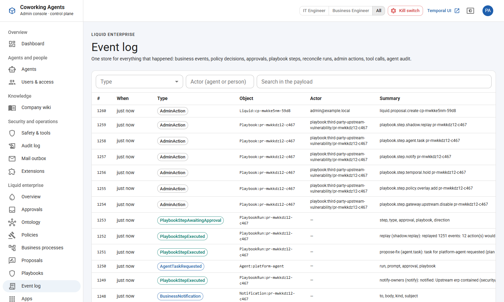

### Lake (raw zone)

A DuckLake database: catalog in Postgres schema `lake_catalog`, data as Parquet files in the volume
`cw-ext-liquid-lake-data` (`/lake`), written and read by DuckDB 2 inside the ontology server. Data inlining is off,
so every table is real Parquet files.

| Table | Content |
|---|---|
| `raw.events` | the flushed event log (same columns) |
| `raw.erp_*` | factories, machines, workers, absences, materials, bom, suppliers, inventory, purchase_orders, production_orders, maintenance_tickets |
| `raw.crm_*` | customers, orders, campaigns, demand |
| `raw._extracts` | one row per source system extract (`sofa-T0`: the sofa company's initial state) |

Each extract row carries `_extract_id` and `_extracted_at`. Raw tables are never updated.

**Flush:** every 60 s (and on demand) the ontology server appends the events after the lake's high-water mark
(`max(seq)` in `lake.raw.events`) as one snapshot. A gap in `seq` stops the batch until it is 60 s old (the missing
number then belonged to a rolled-back insert), so a slow transaction is never skipped. Running the flush twice adds
nothing.

**Seed:** with *Seed the sofa-company demo data*, the install step `seed-sofa` writes the extract `sofa-T0` from
`packages/sofa-domain` (a port of the mock's initial state, checked against the mock by a test).

### Ontology server: the only write path

Decision record: [ADR-0043](adr/0043-ontology-server-action-pipeline.md).

Every change to business data goes through one pipeline, for agents (MCP through the gateway) and for apps (REST):

1. **Validate** the input with the generated schema of the action.
2. **Policy** hook (allow until M4; fail closed when configured).
3. Run the action on a **copy** of the state (the domain logic, `packages/sofa-domain`).
4. A failed precondition (e.g. "Supplier S-NORDHOLZ cannot deliver at the moment") is answered — **nothing is written**.
5. A success is **one transaction**: append the event with input, answer and the changed objects, update the projection.

Read-only actions never write. Each event records the agent the gateway verified, the task and the person
(`actor_agent`, `task_id`, `actor_user`).

| Endpoint | Who | What |
|---|---|---|
| `/onto/mcp` | agents via gateway upstream `onto` (owned by the extension) | all 31 actions as MCP tools |
| `/erp/mcp`, `/crm/mcp` | agents via upstreams `erp`/`crm` after `scripts/liquid/setup.mjs` | the parity groups — same tools as the mock |
| `/objects/:class`, `/actions/:name`, `/kpi` | control plane, SDK/apps (M9) | REST over the same pipeline |
| `/api/liquid/sim/*` (control plane) | parity runner | KPI, write log, notices, reset, scenarios — as events |
| `/api/liquid/projection/rebuild`, `/dq` | operators | rebuild and data-quality checks |

**Projection:** schema `projection` in `ontology-db` (generated DDL, one table per class, plus `company_meta`). It is a
cache: `POST /api/liquid/projection/rebuild?dryRun=true` rebuilds it from T0 and the event log into a scratch schema and
compares row hashes; without `dryRun` the rebuilt schema is swapped in.

**Backend swap (D1):**

```bash
node scripts/liquid/setup.mjs                    # erp/crm → ontology server (same upstream names)
node scripts/sofa-company/run.mjs --backend onto --no-shots --prefix onto-1
node scripts/liquid/setup.mjs --restore          # erp/crm → mock
```

The Overview page shows the event log, the flush state and every raw table:

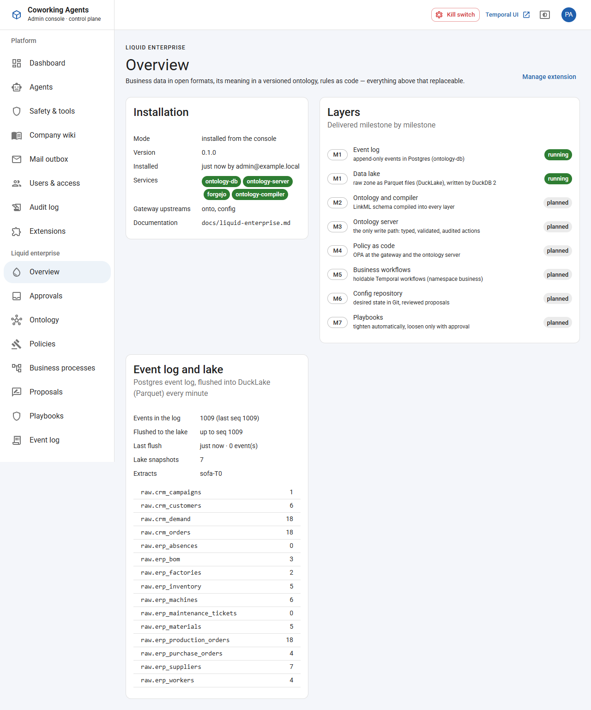

## Ontology and IR contract

Why LinkML is the bridge between LLM proposals and generated code, with a worked example: [link-ml.md](link-ml.md).

Decision record: [ADR-0041](adr/0041-ontology-linkml-ir-generators.md).

**Source** — `ontology/sofa/`, three files, the only place where the meaning of business data is written down:

| File | Content |
|---|---|
| `schema.yaml` | LinkML schema: 19 classes with class-local attributes, 12 enums, links (attributes whose range is a class), one identifier per class |
| `actions.yaml` | 31 typed actions (exactly the tools of the sofa mock) with kind, read-only/destructive flags, input fields, named preconditions and emitted events; the event catalog (19 events, incl. the scenario disruptions) |
| `bindings.yaml` | 15 classes bound to their raw-zone tables (`lake.raw.erp_*`, `lake.raw.crm_*`) with key and column mapping; the other classes exist only through actions |

Annotations the compiler requires on every class:

| Annotation | Values | Used by |
|---|---|---|
| `criticality` | `normal`, `business_critical`, `payment_critical` | policy (e.g. four eyes for agent writes on payment-critical objects, M4), blast radius (M7) |
| `data_class` | `public`, `internal`, `confidential` | policy, app registry (M9) |
| `owner` | a role, e.g. `head-of-logistics` | approves structural changes of the class (proposals, M6) |
| `mcp_group` | `erp`, `crm` | tool groups of the parity phase (M3) |

**Compiler** — `tools/ontology-compiler` (Python, LinkML 1.12.1, pinned image `coworking/ontology-compiler:local`;
its tests run in the image build). It validates all references and rules and reports every error with its path, for
example `actions.yaml#create_purchase_order.emits: unknown event 'PurchaseOrderMade'`.

**IR (the contract)** — `packages/ontology-sofa/ir/ontology.ir.json`, schema in `packages/ontology-ir`: name, semver,
enums, classes (attributes with range kind, required, multivalued, identifier), links, events, actions, bindings,
SHA-256 of each source file and a content hash over canonical JSON. Generators read only the IR. The TypeScript side
recomputes the hash and rejects an edited IR.

**Generated** (pure functions IR → files, `packages/ontology-codegen`; every file starts with `GENERATED from ontology
sofa@0.1.0 (<hash>) — do not edit`):

| Artefact | File | Used by |
|---|---|---|
| zod schemas + TS types per enum, class, action input | `packages/ontology-sofa/src/generated/types.ts` | domain code, SDK |
| SDK client | `…/src/generated/sdk.ts` | UIs (M9) |

Everything else is computed from the IR in force at runtime by the same pure generator functions (ADR-0048, ADR-0049):
MCP tool definitions, input validation, data-quality checks, projection DDL, the policy data document, and the OPA
test fixtures (`scripts/liquid/opa-fixtures.mjs`, used by `check.mjs`).

**Changing the ontology** (until proposals exist, M6): edit the YAML, then

```bash
node scripts/liquid/ontology-build.mjs --verify   # compile (twice, must be identical) and regenerate
node scripts/liquid/check.mjs                     # includes the stale check: sources ↔ IR ↔ generated files
```

and commit sources, IR and generated files together. Versioning: patch for descriptions/annotations, minor for
additive changes, major for removals or narrowing (enforced from M8). Why this matters, with a worked example from data
to UI: [link-ml.md](link-ml.md).

## Ontology evolution

Decision record: [ADR-0048](adr/0048-ontology-evolution-runtime.md).

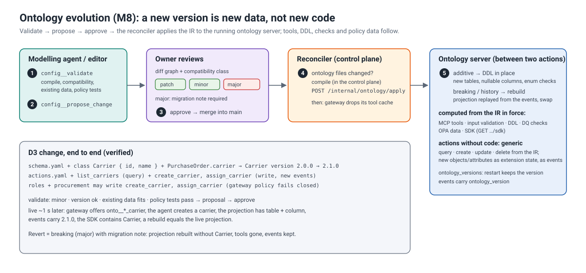

The ontology server **interprets the ontology at runtime**: tool schemas, input validation, the projection's tables,
data-quality checks and the OPA data are computed from the version in force. A new ontology version is new data, not
new code, so it goes live without a build or restart:

1. A change is proposed (modelling agent with `config__validate` / `config__propose_change`, or the editor). Validation
   reports the **compatibility class** — `patch` (descriptions, annotations), `minor` (additions, renames with an alias),
   `major` (removals, type changes, new required fields) — checks that the version was raised accordingly, and checks
   the candidate against the existing objects.
2. A `major` change needs a **migration note**.
3. After approval the reconciler compiles `main` and applies the IR to the running ontology server: additive changes
   alter the projection in place, breaking changes (and classes that come back with history in the event log) rebuild
   it from the events. The gateway refreshes its tool list immediately; the embedded policy engines get the new
   actions with their next package poll (5 s); new events carry the new `ontology_version`. `GET /api/liquid/ontology/versions` lists what was
   applied, `GET /api/liquid/ontology/sdk` returns the TypeScript SDK of the version in force.

**Actions without code.** The domain code implements the ontology it was written for. Actions that a newer version
adds run generically from the IR — query (filter by inputs), create, update, delete — and the objects of new classes
are stored like all others (events, projection). New write actions also need a role that may write them
(`policies/liquid/roles/data.json`); put that into the same proposal.

**Renames** keep the old name working: `aliases: [old_name]` on the action (served as a deprecated tool, recorded in
the event). `deprecated: <note>` marks an action that still works but should not be used.

**The modelling agent:** `node scripts/liquid/modelling-agent.mjs` creates `sofa-modeller` with the config tools and
the skill in [assets/liquid/modelling-skill.md](../assets/liquid/modelling-skill.md) (read, draft, validate, propose,
follow up). It spends model tokens only when given a task.

| D3 proposal under review | Ontology after approval |
|---|---|
| 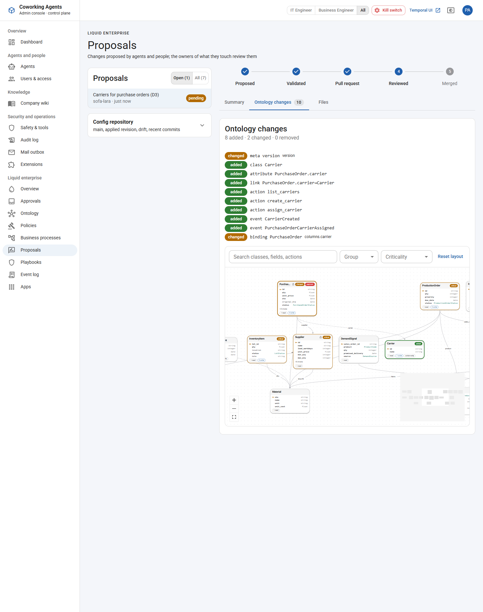 | 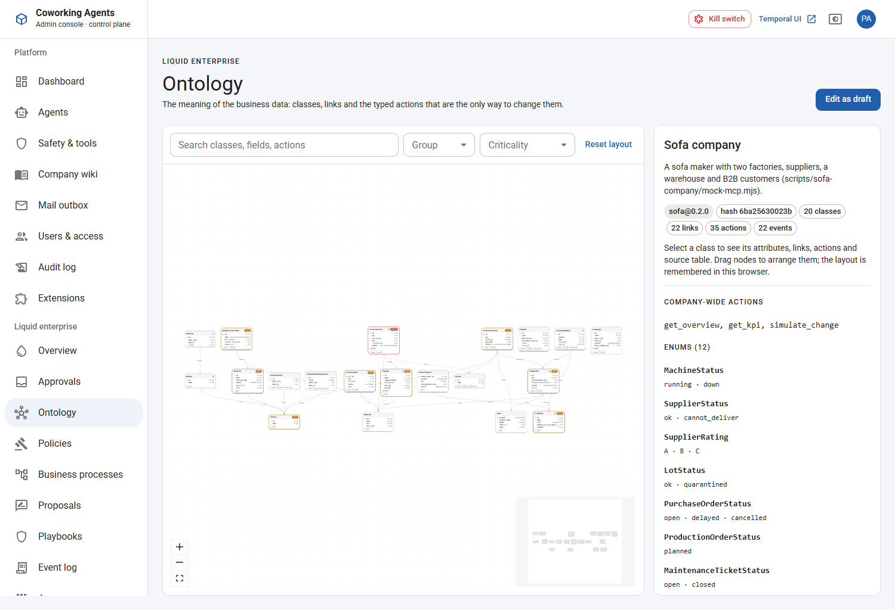 |

## Ontology editor

Decision record: [ADR-0042](adr/0042-ontology-editor-react-flow.md).

Admin console → Liquid enterprise → **Ontology** shows the ontology the ontology server is running on (React Flow):

- **Nodes** are classes: name, criticality (orange: business critical, red: payment critical), a lock for confidential
  data, scalar and enum fields (key icon = identifier, bold = required), and the number of read and write actions.
- **Edges** are links, from the referencing class to the referenced one; dashed = optional, `[*]` = multi-valued.
- **Search and filters** (group, criticality) dim everything that does not match.
- **Selecting a class** zooms to it and its linked classes and shows attributes, incoming links, actions with their
  preconditions and events, and the raw table it is bound to. Without a selection the panel shows version, hash, counts,
  enums and company-wide actions.
- Dragged positions are remembered in the browser; **Reset layout** returns to the automatic layout.

| Graph | Selected class | Filter |
|---|---|---|
| 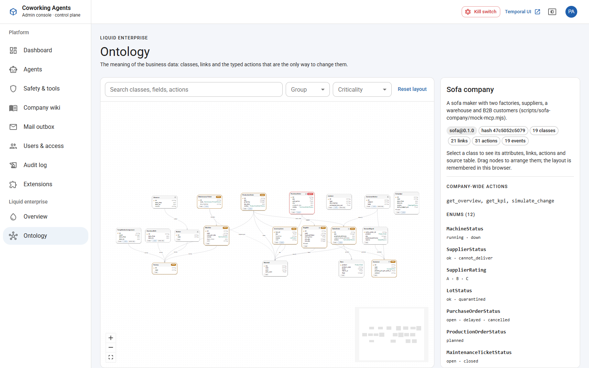 |  | 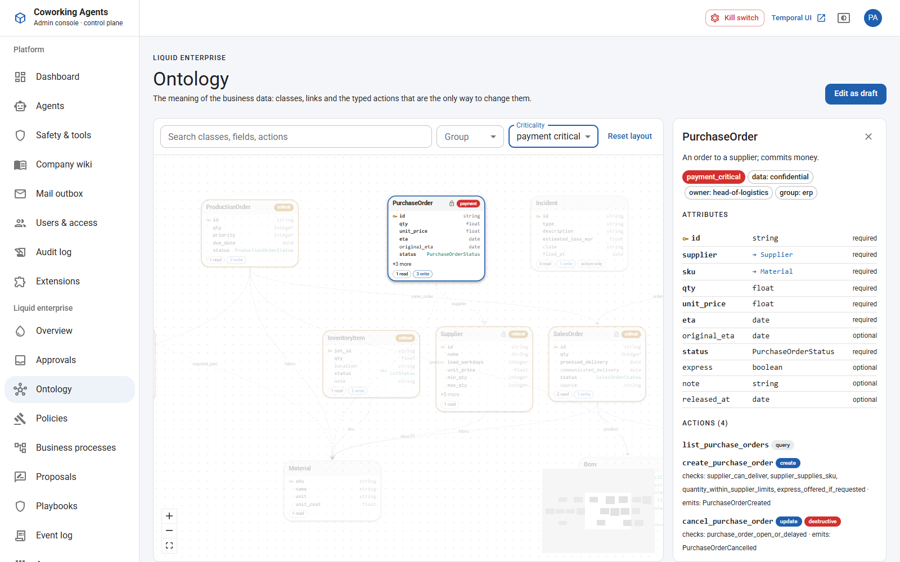 |

**Editing (E2) and proposals (E3).** *Edit as draft* forks the three ontology files from the config repository
(branch `main`). Changes are typed operations: add class, add or change attribute, add link (drag from the blue dot of
one class to another), add enum value, change an annotation. They are applied to the YAML with comments and order
preserved. Every change is compiled by the compiler service; the panel shows errors and the changes against the base,
the canvas colours them (green added, amber changed, red removed) and zooms to them. *Submit* turns the draft into a
proposal (see [Config repository and proposals](#config-repository-and-proposals)); the owners of the touched classes
approve it.

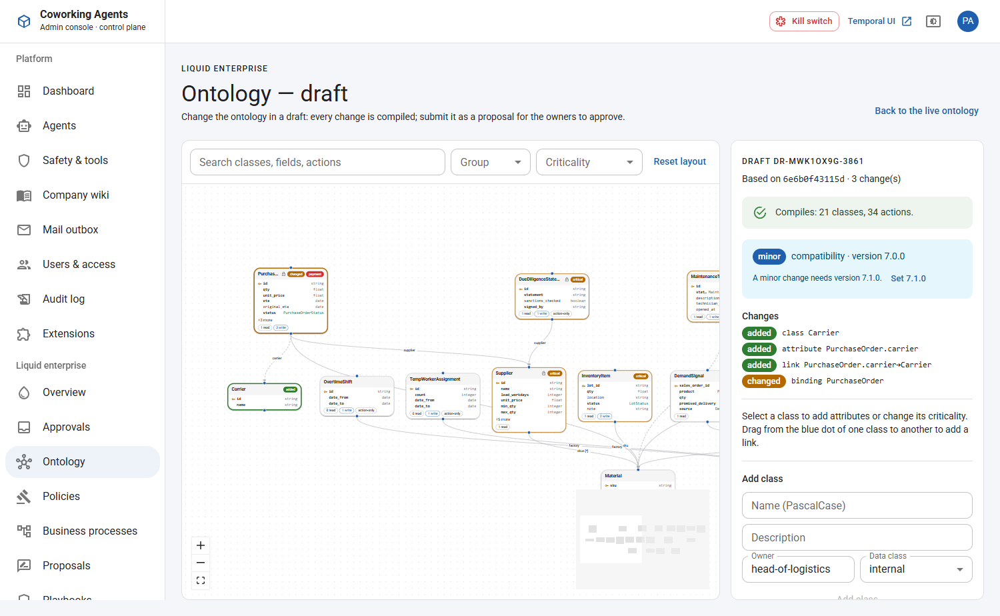

**Compatibility and live apply (E4).** The panel shows the compatibility class of the draft (patch, minor, major) and
offers the version it needs (*Set 2.1.0*). A breaking change asks for a migration note. After approval the change is
live within one reconcile (see [Ontology evolution](#ontology-evolution)) and the editor shows the new version.
Deprecated actions and former names (aliases) are struck through.

## Policies

Decision records: [ADR-0044](adr/0044-policy-as-code-opa.md), embedded engine [ADR-0049](adr/0049-liquid-simplification.md).

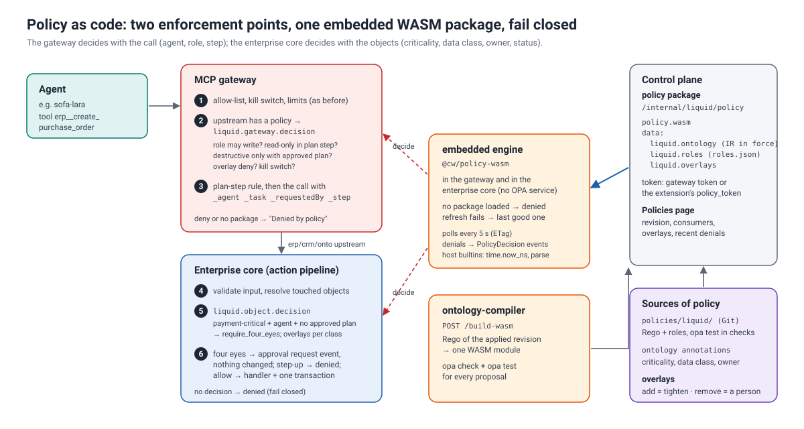

Authorization rules are code in `policies/liquid/` (Rego, tested with `opa test` in `scripts/liquid/check.mjs`). The
compiler service builds the applied revision into a **WASM module**; the control plane serves module and data
(ontology, roles, overlays) at `/internal/liquid/policy` with an ETag, and both enforcement points embed it
(`@cw/policy-wasm`, polled every 5 s). There is no OPA container:

| Point | When | Decides with | Rules |
|---|---|---|---|
| **Gateway** | every call to an upstream with `policy: opa`, after the allow-list | agent, role, tool/action, task step, kill switch | role may write the action (`roles.json`, independent of allow-lists); read-only in plan steps; destructive actions only in an approved plan; overlays |
| **Ontology server** | every action | the objects it touches: criticality, data class, owner, status | agent writes on payment-critical objects outside an approved task need **four eyes**; overlays per class |

Both fail closed: no policy package configured or loaded, a failed fetch before the first load, a module that does not
load, or no decision all mean **denied**. A package that cannot be refreshed keeps the last good one.

**Obligations:** `require_four_eyes` — the action is not run; an `ActionApprovalRequested` event is recorded and the agent is
told that a person must approve; the request becomes an approval workflow (see [Business workflows](#business-workflows)). `require_step_up` — denied in the prototype.

**Overlays** tighten without code changes: Liquid enterprise → **Policies** → *Add overlay* (effect deny / four eyes /
step-up, matching actions, classes, upstreams or agents, optional expiry). Both engines pick it up within about 5 seconds.
Removing an overlay loosens the policy: only a person can do it, and it is audited. From M7 playbooks add overlays
automatically.

**Switching it on for the sofa agents:** `node scripts/liquid/setup.mjs --opa` points `erp`/`crm` at the ontology server with
`policy: opa`; the extension's own upstream `onto` always has it. Any upstream can be switched in Safety & tools → upstream →
*Policy*.

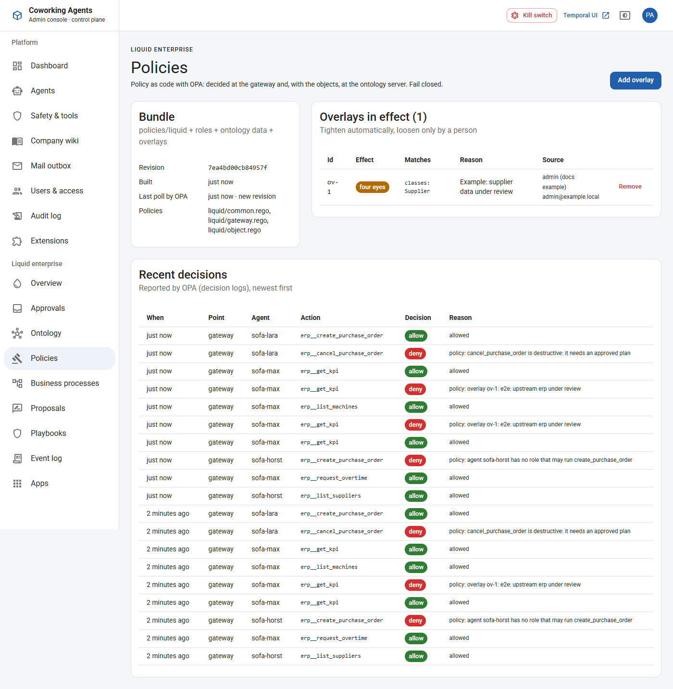

## Business workflows

Decision record: [ADR-0045](adr/0045-business-workflows-temporal.md).

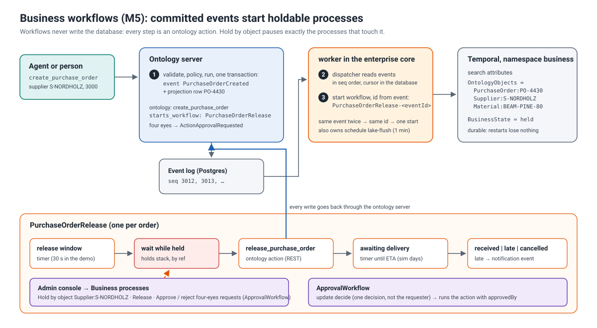

Long-running business processes run as Temporal workflows in their own namespace **`business`** on the platform's
Temporal, executed by the worker inside the **enterprise core** (`ontology-server`; until ADR-0049 a service of its own).
They are started by committed events, not by code calling code: the ontology declares it.

```yaml
# ontology/sofa/actions.yaml
create_purchase_order:
  starts_workflow: PurchaseOrderRelease
cancel_purchase_order:
  signals_workflow: { workflow: PurchaseOrderRelease, signal: cancel }
```

| Workflow | Started by | Steps |
|---|---|---|
| `PurchaseOrderRelease` | `PurchaseOrderCreated` | release window → wait while held → `release_purchase_order` → wait until the ETA → received / late (notification) / cancelled |
| `ApprovalWorkflow` | `ActionApprovalRequested` (four eyes), a playbook's human step, a wiki proposal | wait for a decision (reminder, expiry, withdraw) → apply the effect: run the action with `approvedBy`, continue the playbook run, or decide the wiki proposal |
| `lakeFlush` | schedule `lake-flush`, every minute | flush the event log into the lake (replaces the ontology server's own timer) |

**Every step that changes data is an ontology action** through the ontology server: validated, policy-checked, an
event. A refused action is a result of the workflow (e.g. the order was cancelled meanwhile), not a crash.

**Hold by object.** Each workflow carries the objects it touches in the search attribute `OntologyObjects`
(`PurchaseOrder:PO-4430`, `Supplier:S-NORDHOLZ`, `Material:BEAM-PINE-80`). Liquid enterprise → **Business processes** →
*Hold by object* signals `hold` to every running workflow with that object; they pause before their next step and show
`BusinessState = held`. *Release* lifts that hold (by its ref) everywhere; several holds can stack. Holding is
tightening and needs no approval; it never skips or runs a step. From M7 playbooks hold by object automatically.

**Approvals** (one inbox, ADR-0049). Every decision a person takes inside Liquid is an `ApprovalWorkflow`, listed on
**Liquid enterprise → Approvals** together with config pull requests and agent plan approvals (as links to where they are
decided). Each new item is mailed once with a deep link (`/liquid/approvals?focus=<id>`). For a four-eyes request,
*Approve* runs the action with the signed-in person as `approvedBy`; the policy accepts that as the second pair of eyes
only if it is neither the agent nor the requesting user. One decision per request; it expires after 7 days.

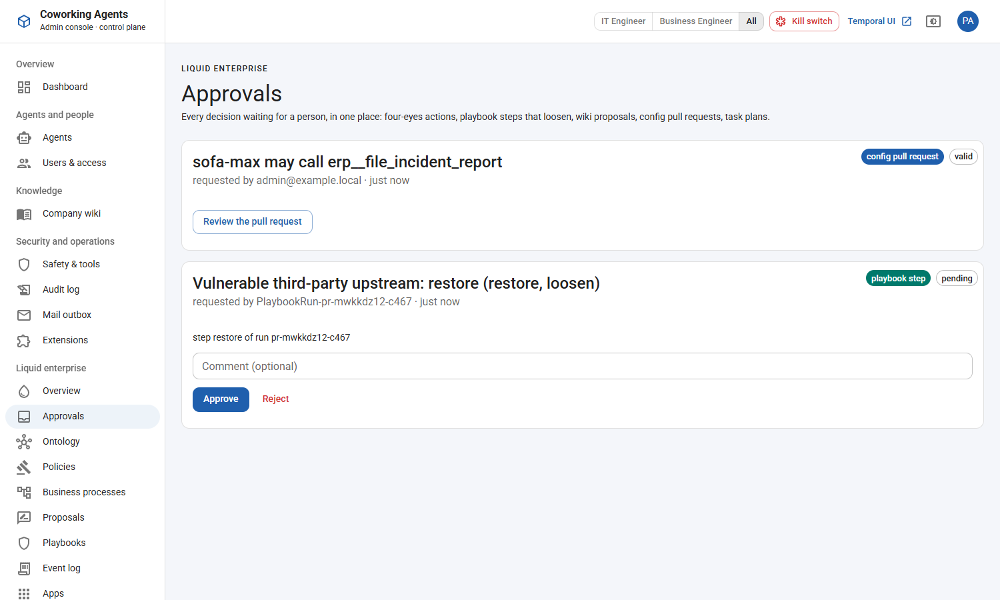

**Durability.** The dispatcher reads the event log in order and remembers its position in the table `dispatch_cursor`
of `ontology-db`. Workflow ids are derived from event ids, so a restart never starts a process
twice; holds and timers live in Temporal and survive worker restarts. Temporal UI → namespace `business` shows the
histories.

**Demo timing** (env of ontology-server): `SIM_TODAY` (2026-10-05), `MS_PER_SIM_DAY` (20 s per simulated day),
`RELEASE_AFTER_MS` (30 s), `APPROVAL_REMINDER_MS` (4 h), `APPROVAL_EXPIRE_MS` (7 d), `LAKE_FLUSH_EVERY` (1m).

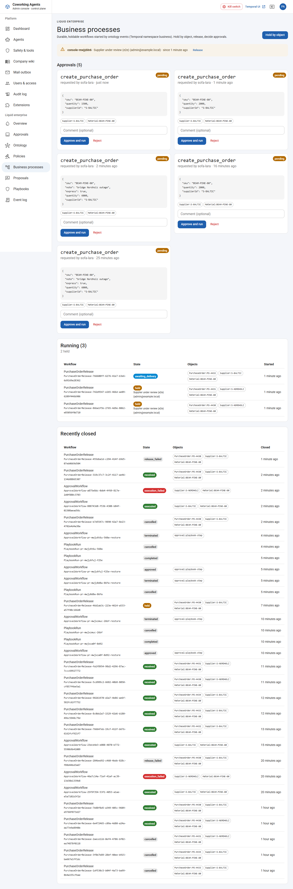

## Config repository and proposals

Decision records: [ADR-0046](adr/0046-config-repository-proposals.md), Git host [ADR-0049](adr/0049-liquid-simplification.md).

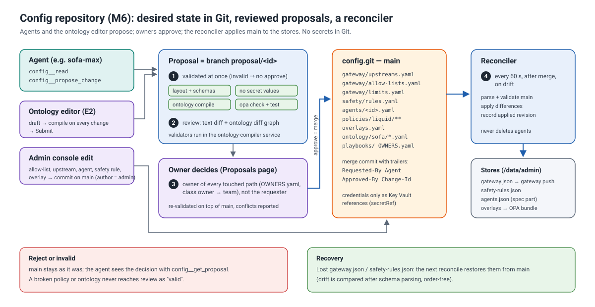

While Liquid is installed, the platform's desired state lives in a Git repository owned by the control plane
(`/data/liquid/config.git`, outside `/data/admin`), mirrored to the extension's Git host **Forgejo** as `liquid/config`.
Branch **`main`** is applied by the **reconciler** every 60 seconds and right after each merge (webhook).

```
gateway/upstreams.yaml   gateway/allow-lists.yaml   gateway/limits.yaml
safety/rules.yaml        agents/<id>.yaml
policies/liquid/*.rego   policies/liquid/roles/data.json   policies/liquid/overlays.yaml
ontology/sofa/{schema,actions,bindings}.yaml
playbooks/               OWNERS.yaml
```

**Three ways in:**

| Who | How | Lands as |
|---|---|---|
| Admin in the console | any change of upstreams, allow-lists, agents, safety rules, overlays | a commit on `main`, author = the admin |
| Agent | MCP upstream `config`: `config__read`, `config__validate`, `config__propose_change`, `config__get_proposal` | a proposal = branch + pull request |
| Person in the ontology editor | *Edit as draft*, then *Submit* | a proposal = branch + pull request |
| Person on the Git host | a pull request against `main` | a proposal, validated like the others |

**Proposals** are validated when they are created: layout and schemas, no secret values, ontology compile with a
structural diff and compatibility class, `opa check` + `opa test` for policies. The result is the required commit status
**`liquid/validate`** of the pull request. Review happens **on the Git host**:

- `CODEOWNERS` (generated from `OWNERS.yaml`) requests the team `reviewers`; branch protection on `main` needs one
  approval and a green `liquid/validate`, and only the bot `liquid-bot` may push. An invalid proposal cannot be merged.
- Merge → signed webhook → the proposal is marked approved (decided by the merging reviewer) and reconciled at once.
  Closing the pull request rejects it. The console shows the link and no longer decides (409 with the link).
- Webhooks can be lost (control plane restarting) and pull requests can disappear (Git host recreated by a reinstall
  with purge): every reconcile also settles pending proposals from the host's state.
- Console edits stay direct commits on `main`, pushed by the bot; if the host is down they are pushed when it is back.

| Pull request on the Git host | Changed files |
|---|---|
|  | 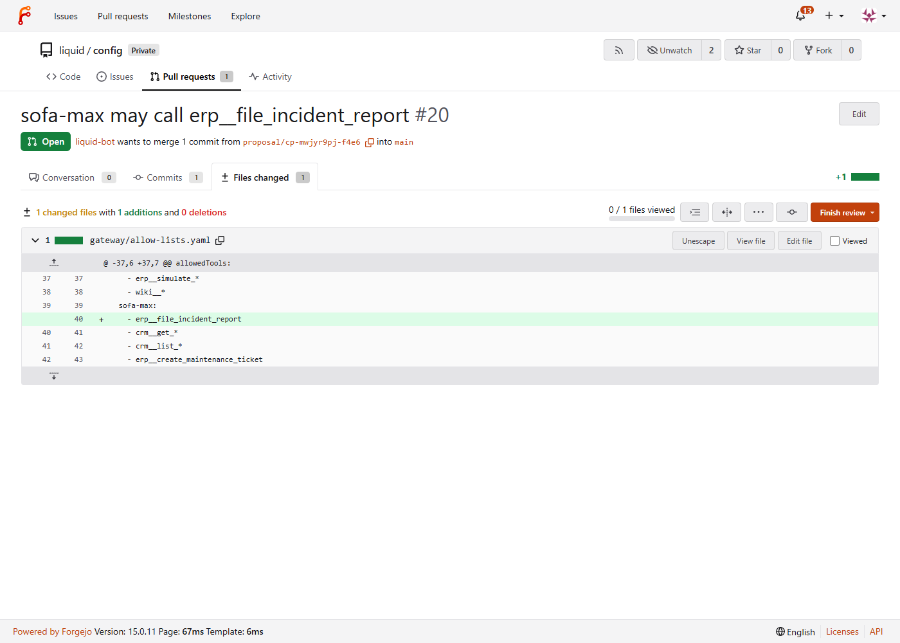 |

Liquid enterprise → **Proposals** still shows reason, evidence, checks, owners, the text diff and, for ontology changes,
the diff graph, with the link to the pull request. The Git host's web UI is only bound to `127.0.0.1:3300`; the
`reviewer` account's password is the extension secret `forgejo_reviewer_password` (`DATA_DIR/admin/extensions-secrets.json`).
In overlay mode without the Git host the console's own review (*Approve and apply*, owners from `OWNERS.yaml`, not the
requester) is used.

**Giving an agent the config tools:** add `config__*` (or only `config__read` and `config__get_proposal`) to its
allow-list. Proposing changes nothing by itself.

**No secrets in the repository.** Upstream credentials appear only as Key Vault references (`secretRef`); literal
credential headers stay in `/data` and are kept on apply; agent files have no secrets. Every commit is checked against
the known secret values and refused if one appears.

**Drift and recovery.** If the stores differ from `main` (for example after `/data/admin/gateway.json` was lost), the
next reconcile restores them from the repository. The Proposals page shows the applied revision, the last reconcile
and any drift; *Reconcile now* forces a run.

| Agent proposal under review | Ontology proposal with diff graph |
|---|---|
| 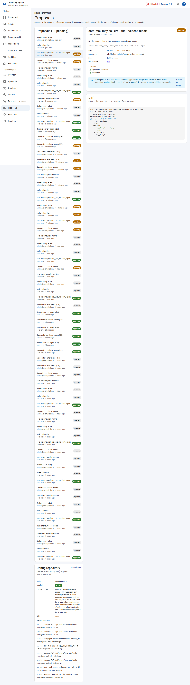 | 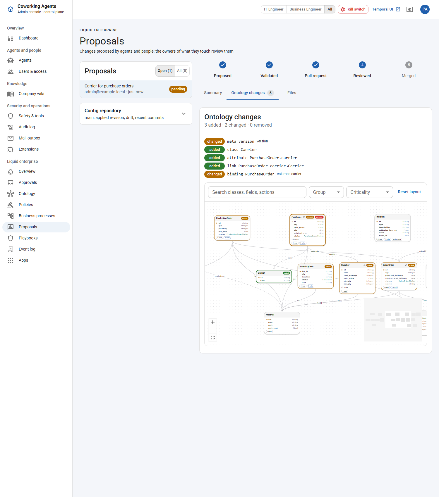 |

## Playbooks

Decision record: [ADR-0047](adr/0047-playbooks-tighten-only.md).

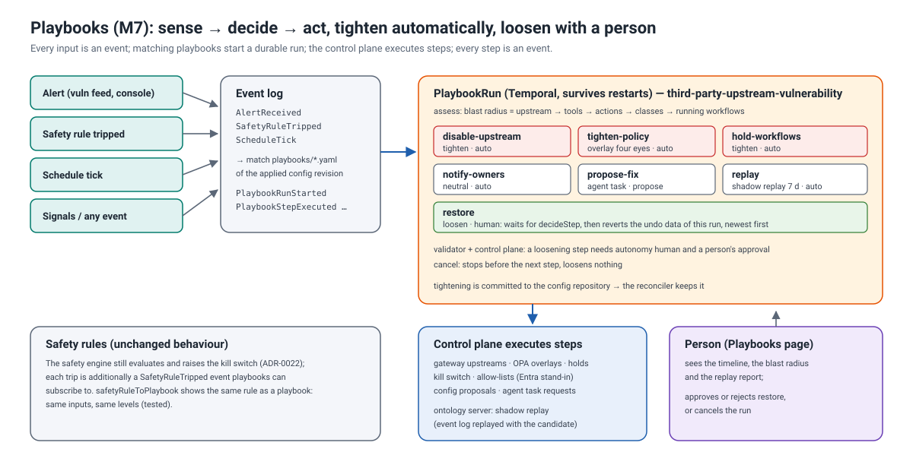

A playbook says what happens when something is sensed: which steps run, and how autonomously. Playbooks live in the
config repository (`playbooks/*.yaml`) and are changed through proposals like any other configuration.

```yaml
id: third-party-upstream-vulnerability
version: 1
trigger: { kind: alert, match: { source: vuln-feed, severity: [high, critical] } }
assess: { blast_radius: ontology }
steps:
  - { id: disable-upstream, type: gateway.upstream.disable, autonomy: auto, with: { upstream: "{{ trigger.upstream }}" } }
  - { id: tighten-policy,   type: policy.overlay.add,       autonomy: auto, with: { actions: "{{ blast.writeActions }}", obligation: require_four_eyes } }
  - { id: hold-workflows,   type: temporal.hold,            autonomy: auto, with: { objects: "{{ blast.objects }}", ref: "{{ run.id }}" } }
  - { id: propose-fix,      type: agent.task,               autonomy: propose, with: { agent: platform-agent } }
  - { id: replay,           type: shadow.replay,            autonomy: auto, with: { window: 7d } }
  - { id: restore,          type: restore,                  autonomy: human }
learn: { record_incident: true }
```

**Triggers** (one sensing path, everything becomes an event first): `alert` (`POST /internal/alerts` with the
extension's alerts token, or *Send test alert* on the Playbooks page), `safety_metric` (a tripped safety rule),
`schedule` (`every: 1h`), `event` (any event type of the log), `signal`.

**Step types and directions:**

| Direction | Steps | Allowed autonomy |
|---|---|---|
| tighten | `gateway.upstream.disable`, `policy.overlay.add`, `temporal.hold`, `killswitch.raise`, `entra.revoke_scope` | auto, human |
| neutral | `notify`, `shadow.replay`, `agent.task`, `config.propose` | auto, propose, human |
| loosen | `restore`, `policy.overlay.remove`, `temporal.release`, `gateway.upstream.enable`, `killswitch.lower` | **human only** |

The **tighten-only rule** is checked three times: when a playbook is proposed (an auto-loosening playbook is invalid
and cannot be approved), when `main` is reconciled, and by the control plane before each step.

**A run** is a durable workflow. `auto` steps run at once, `propose` steps create a request a person decides later
(the run continues), `human` steps are child `ApprovalWorkflow`s and wait in the Approvals inbox (and on the
Playbooks page). **Restore** reverts what this run tightened, newest
first: re-enables the upstream, removes the overlay, releases the hold, lowers the kill switch. **Cancel** stops the run
and loosens nothing; cleaning up is then a person's console work. Tightening is committed to the config repository,
so the reconciler does not undo it. Every step, decision and the end of a run are events; with `record_incident` the
run is also recorded as an incident.

**Blast radius:** upstream → its tools → the ontology actions behind them → their classes → running business
workflows that touch those classes (and their objects, which a hold step pauses).

**Shadow replay** replays the event log of a window with a candidate configuration and reports how many actions the
candidate would have blocked or sent to four eyes, which results diverge, and the KPI delta. Same window and same
candidate give the same report (it carries a hash). With the current configuration the last week replays with zero
divergence.

**Safety rules** keep working as before (ADR-0022): the safety engine evaluates them and raises the kill switch at once
(enforcement stays in-process, a security default). Each trip is also a `SafetyRuleTripped` event that playbooks can
react to; signals observations become `SignalObserved` events the same way.

**Edits and the reconciler.** A playbook step or console edit changes a store first and commits it right after; while
that is in flight the reconciler defers instead of taking the change for drift.

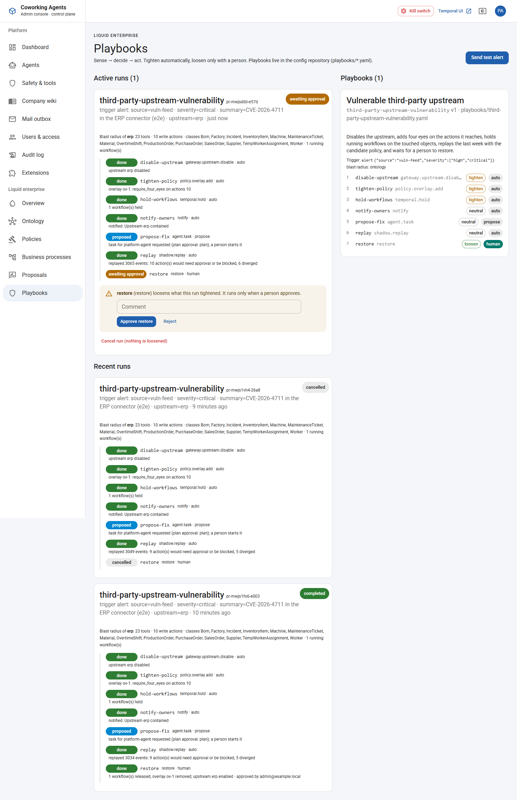

## Identity and apps

Decision record: [ADR-0050](adr/0050-entra-option-app-registry.md).

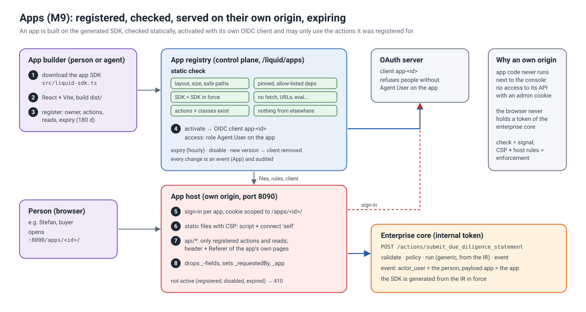

### Entra ID as identity provider (option)

The local OAuth server stays the default. To sign administrators in at Entra ID:

```bash
ADMIN_AUTH_MODE=entra
ENTRA_TENANT_ID=<tenant id (GUID)>
ADMIN_ENTRA_CLIENT_ID=<app registration of the admin console>
ADMIN_ENTRA_CLIENT_SECRET=<its secret>
ENTRA_ROLE_MAP="Admins=Platform.Admin"   # optional: app-role values or group ids → platform roles
```

The admin console's app registration needs the redirect URI `<PUBLIC_URL>/auth/callback`, ID tokens, and an app role
whose value is `Platform.Admin` (then no map is needed) or one mapped to it. Agents with an Entra identity (ADR-0032)
sign their users in at the same tenant; `ENTRA_ROLE_MAP` is passed to them as well. Without these variables
everything runs on the local OAuth server. Entra Agent ID is not used (see the ADR): each agent keeps its own Entra
app registration.

### App registry and app host

Many small UIs, each on the generated SDK, each with an owner, the actions it may use, and an expiry date.
**Liquid enterprise → Apps** lists them:

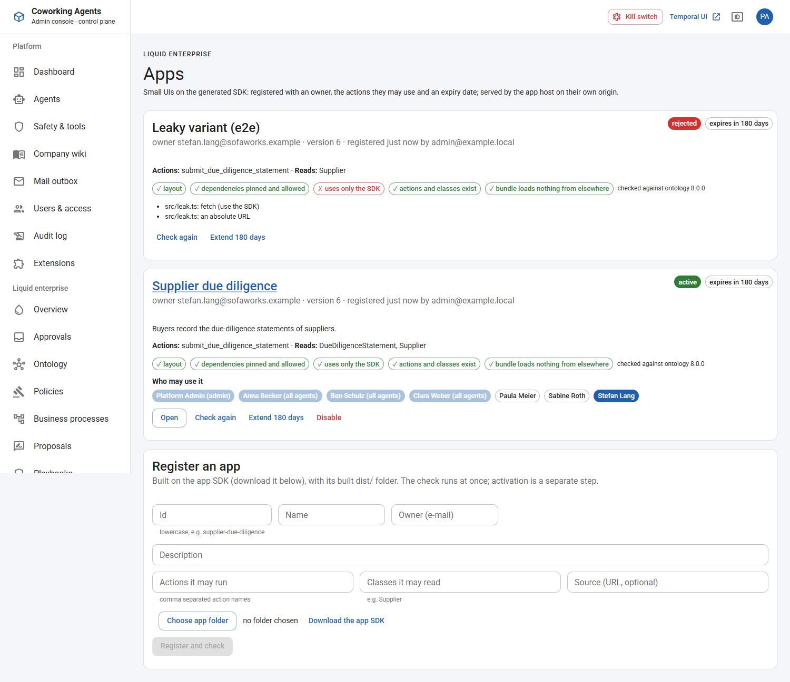

1. **Build on the app SDK.** *Download the app SDK* (or `GET /api/liquid/ontology/sdk?kind=app`) gives one
   TypeScript file for the ontology in force: typed objects (`client.objects.supplier.list()`) and actions
   (`client.actions.submitDueDiligenceStatement({...})`). Put it at `src/liquid-sdk.ts` unchanged. Use React and Vite
   with `base: './'`, and use hash routing if the app has routes.
2. **Register** with the owner, the actions it may run, the classes it may read, and the expiry (default 180 days),
   from the page (*Choose app folder*) or with the script:

   ```bash
   node scripts/liquid/app-register.mjs apps/liquid-app-due-diligence --id supplier-due-diligence      --name "Supplier due diligence" --owner stefan.lang@sofaworks.example      --actions submit_due_diligence_statement --reads Supplier,DueDiligenceStatement --activate
   ```

   The check runs at once. It enforces pinned, allow-listed dependencies, and requires the SDK file to be identical to
   the current one. No other code may make network calls or run dynamic code, and nothing may be loaded from
   elsewhere. A failed app is *rejected* and cannot be activated; its card lists what failed.
3. **Activate.** The app gets its OIDC client and is served at `http://localhost:8090/apps/<id>/`. That is the app
   host, a separate origin from the console.
4. **Grant access** under *Who may use it*: the role `Agent.User` on the app. Administrators, and users with
   `Agent.User` on all agents, inherit it.

What the app host guarantees at runtime:
- **Content Security Policy:** scripts and connections only to its own origin.
- **Forwarding:** only the app's registered actions and classes are forwarded to the enterprise core. The person
  becomes the actor of the event and the app is recorded with it (`payload.app`).
- **Caller fields:** caller fields sent by the browser are dropped.
- **Calls:** calls must come from the app's own pages.
- **Lifecycle:** *Disable* or expiry removes the OIDC client (410 for everyone); *Extend* and *Activate* bring it
  back with the same access list. A new ontology version that changes the SDK makes *Check again* fail. The owner
  then downloads the new SDK, rebuilds and registers a new version.

The sample app **Supplier due diligence** (`apps/liquid-app-due-diligence`) records suppliers' due-diligence
statements. Its action came in through a reviewed pull request (class `DueDiligenceStatement`, actions
`submit_due_diligence_statement` and `list_due_diligence_statements`) and runs generically in the enterprise core,
without domain code:

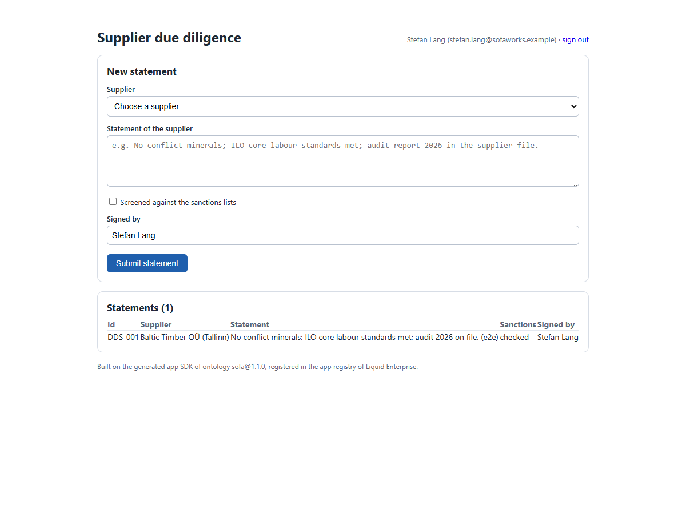

## Operations runbook

**Start here:** *Liquid enterprise → Overview → Control loop health*, or from the shell
`node scripts/liquid/doctor.mjs` (exit code 0 ok, 1 warnings, 2 failures). Every item names what is wrong and where to
fix it ([ADR-0051](adr/0051-control-loop-health-robustness.md)):


All `/internal` routes of the ontology server need its token; from the host, run them inside the container:

```bash
# flush now / lake status
docker exec cw-ext-liquid-ontology-server node -e "fetch('http://127.0.0.1:7710/internal/lake/flush',{method:'POST',headers:{authorization:'Bearer '+process.env.INTERNAL_TOKEN}}).then(r=>r.text()).then(console.log)"
docker exec cw-ext-liquid-ontology-server node -e "fetch('http://127.0.0.1:7710/internal/lake/status',{headers:{authorization:'Bearer '+process.env.INTERNAL_TOKEN}}).then(r=>r.text()).then(console.log)"

# read-only SQL over the lake (single SELECT)
docker exec cw-ext-liquid-ontology-server node -e "fetch('http://127.0.0.1:7710/internal/lake/query',{method:'POST',headers:{authorization:'Bearer '+process.env.INTERNAL_TOKEN,'content-type':'application/json'},body:JSON.stringify({sql:process.argv[1]})}).then(r=>r.text()).then(console.log)" "SELECT id, name, rating FROM lake.raw.erp_suppliers"

# the event log directly (read only!)
docker exec -it cw-ext-liquid-ontology-db psql -U onto -d onto -c "SELECT seq, type, object_id, occurred_at FROM events ORDER BY seq DESC LIMIT 20"
```

- **Re-seed:** the seed is idempotent by extract id; it only writes again after *Uninstall* with *delete data*.
- **Lake files outside the platform:** the Parquet files are in the volume `cw-ext-liquid-lake-data` under
  `raw/<table>/`; any Parquet reader can open them, and DuckDB with the `ducklake` extension can attach the catalog.
- **Failed install:** the Extensions page shows the failed step and its error; *Retry install* continues there,
  *Repair* re-runs all steps and re-creates containers whose image was rebuilt.
- **Rebuild the projection:** `POST /api/liquid/projection/rebuild?dryRun=true` (verify: `identical` must be true), then
  without `dryRun` to swap. **Data quality:** `GET /api/liquid/projection/dq`.
- **Switch the sofa agents' backend:** `node scripts/liquid/setup.mjs` (ontology server) / `--restore` (mock).
- **Business workflows:** histories in Temporal UI → namespace `business`; worker logs
  `docker logs cw-ext-liquid-ontology-server`. The dispatcher position is the row in `dispatch_cursor`
  (`SELECT * FROM dispatch_cursor`; deleting it makes the worker start at the current end of the log).
- **Policy engine:** `GET /api/liquid/policy` shows the package revision, which consumers fetched it when, overlays and
  recent denials; the gateway and the core log `policy package loaded <revision>`.
- **Git host:** `http://localhost:3300` (only from this machine), user `reviewer`. If it is down, proposals cannot be
  opened or merged; the reconciler keeps applying the local `main`. *Repair* on the Extensions page re-runs the
  bootstrap (accounts, repository, branch protection, webhook) idempotently.
- **Apps:** the app host listens on `127.0.0.1:8090` (`APPS_PORT`, `APPS_PUBLIC_URL` for another host name). Registry
  data is in `DATA_DIR/liquid/apps*` (secrets of the OIDC clients in `apps-secrets.json`, 0600). After an ontology
  change, *Check again* shows which apps need a new SDK; their owners re-register. The expiry job runs hourly.
- **Complete runtime test:** `node scripts/liquid/e2e-all.mjs` runs every milestone's end-to-end check in order
  (`--from <suite>` to continue, `--shots` to refresh the screenshots); results in `scripts/liquid/results/`.
- *(planned)* Replaying a window, restoring after a playbook run, rotating the ontology DB credentials.

## Results D1–D3

*(planned, M3 and M10)*

| # | Demonstration | Status |
|---|---|---|
| D1 | Backend swap: sofa scenarios against the ontology server | open |
| D2 | New security risk: automatic containment, human-gated recovery | open |
| D3 | New business requirement: ontology extension compiled into all layers | open |

## Appendix: implementation log

One entry per milestone. Template:

```
### Mx — <title> (<date>)
Done:        what was built
Verified:    tests, scripts, manual checks (with numbers)
Open:        what is left
Deviations:  from the plan, with the ADR that records them
```

### M0 — Baseline and conventions (2026-11-16)

Done
- Branch `liquid-enterprise` from `79ac9c6`. Plan updated to v1.1 (M0b extension manager, editor tracks E1–E4, this
  document, ADR numbering in creation order). [ADR-0038](adr/0038-liquid-enterprise-extension.md).
- `scripts/liquid/check.mjs` (build, typecheck, tests; `opa test` and the stale-generated check switch on once their
  inputs exist) and `scripts/liquid/baseline-summary.mjs` (KPI table + spread from scenario results).

Verified
- Build green; **31 test files, 214 tests, all passing** (the plan's "88 tests" was out of date). `check.mjs` green.
- The plan's command `corepack pnpm -r build` fails on machines where `pnpm` is only available through corepack:
  `-r` includes the root package, whose `build`/`test` scripts call bare `pnpm`. `check.mjs` runs the package scripts
  with `--filter !coworking-agents` instead.

KPI baseline, run 1 (existing results `scripts/sofa-company/results/s1…s5`, recorded before this branch):

| scenario | late before → after | sofas late after | customers not informed | spend € | tasks | decisions | write calls | guard halts |
|---|---|---|---|---|---|---|---|---|
| supplier-beams | 13 → 0 | 0 | 0 | 42 450 | 1 | 1 | 2 | 0 |
| machine-failure | 9 → 2 | 220 | 2 | 9 650 | 4 | 4 | 4 | 0 |
| demand-spike | 0 → 8 | 970 | 8 | 0 | 4 | 5 | 9 | 2 |
| sick-leave | 7 → 0 | 0 | 0 | 5 200 | 3 | 3 | 1 | 1 |
| storm | 8 → 0 | 0 | 0 | 87 720 | 3 | 3 | 6 | 0 |

(demand-spike: the incident snapshot is taken before the extra demand is planned, so "before" is 0.)

Open
- Runs 2 and 3 per scenario (real model, about 15 runs of up to 45 min) to get the spread. Needed before the D1 parity
  judgement in M3, not for M0b–M2. Store as `results/baseline-<n>-<scenario>.json`.

Deviations
- Exit criterion "baseline with spread" is only partly met (n = 1); see Open.

### M0b — Extension manager and install UI (2026-11-16)

Done
- `packages/extensions`: manifest schema with reference checks, dependency order, environment rendering and masking,
  install/uninstall steps, fingerprint, plan diff, API types.
- `apps/admin-server/src/extensions/`: Docker runtime for labelled extension containers, `ExtensionService` (persisted
  state machine, idempotent steps, resume on start, repair, owned upstreams, secrets 0600 + Key Vault refs, runtime
  availability), API router, `requireExtension` middleware, liquid manifest (`ontology-db`).
- Admin console: Extensions page (install / retry / repair / uninstall with purge option, step progress, services,
  logs; Signals read-only), Liquid overview page, nav groups in `AppShell` (`NavItem.group`).
- `docker-compose.liquid.yml`, `stack.mjs` (`build --liquid`, `liquid up|down|reset`, `reset` removes extension
  resources, `LIQUID_ONTOLOGY_DB_PASSWORD` in `.env`), Dockerfile includes the new package. [ADR-0039](adr/0039-extension-manager.md).

Verified
- `check.mjs` green: build, typecheck, tests. New tests: 16 in `packages/extensions` (validation table, order,
  rendering, masking, steps, fingerprint, diff), 22 in `admin-server` with a fake Docker (install order, demo-only steps,
  secrets not in state file, Key Vault reference vs. plain header, missing local image → build hint, third-party pull,
  upstream name collision, health wait and timeout, concurrent operation refused, retry from failed step without
  re-creating healthy services, resume after restart, repair, uninstall only touches own resources, purge, overlay mode,
  Docker status parsing, manifest ↔ overlay service parity).

- **End to end** (`node scripts/liquid/e2e-extension.mjs`, result `scripts/liquid/results/m0b-extension-e2e.json`):
  15/15 checks on the running stack. The control plane was restarted while `service:ontology-db` was running; the
  install resumed and finished by itself. Container labelled and healthy, volume created, `psql` answers, install
  audited, nav route offered, repair keeps the healthy container, uninstall with purge leaves no container, volume or
  owned upstream. Screenshots in `docs/images/liquid/`.

Open
- Nothing for M0b.

Deviations
- None from the plan. The pino logger already redacts any `env` field; the masked environment is logged anyway.
- Found and fixed on the way: `infra/docker/Dockerfile` (from commit `79ac9c6`, Signals) had a literal `\n` instead of a
  line continuation in the `pnpm deploy` step, so no image could be built from that commit (`/bin/sh: n: not found`).
- The control plane was rebuilt with `docker compose build temporal` + `up -d --no-deps temporal`, not `stack.mjs up`,
  because `up --remove-orphans` would remove services of other overlays (e.g. the running `mcp-sofa`).

### M1 — Data foundation: event log and lake (2026-11-16)

Done
- Spike: MinIO no longer viable (no community images since October 2025); SeaweedFS + Iceberg REST catalog dropped as
  too many moving parts. **DuckLake** on DuckDB 2 (2.0.0) works on Windows and in the Linux image: Postgres catalog in
  its own schema, Parquet data files, snapshots, time travel, extensions installed at build. [ADR-0040](adr/0040-lake-ducklake-event-log.md).
- `packages/lake`: event store (validated, idempotent, append-only trigger), gap-safe flush, DuckLake writer/reader
  (extracts in one transaction, read-only query, status, Parquet file counts).
- `packages/sofa-domain`: the mock's initial world in TypeScript plus the raw extract (15 tables). The mock exports
  `freshWorld` and its constants and only starts its server when run directly.
- `apps/ontology-server` (M1 part): internal API, flush loop, image with DuckDB extensions preinstalled.
- Liquid manifest + overlay: `ontology-server` with volume `lake-data`, internal token, demo-only bootstrap step
  `seed-sofa`. Admin API `GET /api/liquid/lake`, "Event log and lake" card on the Overview page.
- Extension manager: the image id is now part of the service fingerprint, so *Repair* re-creates a container whose
  `:local` image was rebuilt.
- Diagrams: milestones (`22-liquid-milestones.svg`), data flow (`23-liquid-data-flow.svg`).

Verified
- `check.mjs` green. New tests: sofa-domain 5 (world and constants identical to the mock, extract shape), lake 15
  (idempotent append, invalid input writes nothing, UPDATE/DELETE/TRUNCATE rejected, gap table, 1,000 events flushed
  twice = 1,000 rows, continuation, field round trip, query guard, seed round trip, every table as Parquet, time
  travel), ontology-server 5 (health, auth, append + flush + status, seed once with counts equal to the extract,
  validation), admin-server +1 (rebuilt image re-created on repair).
- **End to end** on the stack (`node scripts/liquid/e2e-lake.mjs`, result `scripts/liquid/results/m1-lake-e2e.json`):
  10/10 — install with seed; raw-zone counts equal to the **mock's** initial state (not only our port); a DuckDB query
  over the raw zone matches the mock (18 orders, 1,800 sofas, 3 beam suppliers); 1,000 events flushed twice = exactly
  1,000 rows; UPDATE on `events` rejected; every non-empty raw table stored as Parquet; catalog in `lake_catalog`.
- **Overlay path:** `stack.mjs liquid up` started both services healthy, the console switched to overlay mode and read
  the lake with the `.env` secrets, the seed worked; `liquid down` removed them and restarted the control plane
  without the overlay; `mcp-sofa` of the sofa overlay kept running. Reinstall from the console kept the data of the
  earlier install (uninstall without purge).

Deviations
- Plan said MinIO + Iceberg (later SeaweedFS); built DuckLake on Postgres with no extra containers (ADR-0040, decided
  with the user). DuckDB 2.0.0 instead of the 1.5 line (user's choice).
- The flush is a loop in the ontology server, not a Temporal schedule; it moves to one in M5.
- Found on the way: DuckLake inlines small inserts into the catalog by default — switched off
  (`DATA_INLINING_ROW_LIMIT 0`); already inlined data is moved to Parquet at startup. `stack.mjs liquid down` passed
  volume names as services — fixed.

Open
- Baseline runs 2 and 3 (before M3).

### M2 — Ontology and compiler, editor E1 (2026-11-16)

Done
- `ontology/sofa`: LinkML schema (19 classes, 12 enums, annotations), `actions.yaml` (31 actions = every mock tool,
  event catalog of 19 events), `bindings.yaml` (15 classes onto the M1 raw tables).
- `tools/ontology-compiler`: LinkML 1.12.1 SchemaView → IR; collected, path-addressed errors; CLI and HTTP mode;
  pinned image with tests in the build. [ADR-0041](adr/0041-ontology-linkml-ir-generators.md).
- `packages/ontology-ir`: IR schema, canonical hash (identical to Python), reference checks, browser entry, `irToGraph`.
- `packages/ontology-codegen`: generators for types, MCP tools, DQ checks, SDK, projection DDL, OPA data; CLI with
  `--check`. `packages/ontology-sofa`: IR + generated artefacts.
- `scripts/liquid/ontology-build.mjs` (`--verify`: two compiles, identical bytes) and `check-generated.mjs` (in
  `check.mjs`).
- Editor E1: `/liquid/ontology` with React Flow 12.12.1 and dagre; IR served by the ontology server and passed through
  the control plane. [ADR-0042](adr/0042-ontology-editor-react-flow.md).
- [docs/link-ml.md](link-ml.md) and diagram `24-linkml-bridge.svg`.

Verified
- Build deterministic: two compiler runs give the same bytes (hash `47c5052c5079`); the container output equals a local
  LinkML run.
- Compiler tests 15 (validation errors, determinism, hash coverage, canonical form). IR tests 9 (TS hash = Python hash,
  stale source detection, edited IR rejected, dangling reference rejected, graph view). Codegen tests 7 on a synthetic
  ontology. Sofa package tests 38: **generated MCP tools equal the mock's tools one to one** (31 tools: groups, names,
  read-only/destructive hints, fields, types, required, enums, descriptions), **DDL applies to an empty Postgres**, DQ
  checks pass on consistent data and catch a dangling multi-valued link, the DDL rejects bad enums and dangling links,
  generated types validate real objects, generated files are not stale.
- Stale check negative test: editing `schema.yaml` without a rebuild makes `check-generated.mjs` fail.
- **End to end** (`node scripts/liquid/e2e-ontology.mjs`, result `scripts/liquid/results/m2-ontology-e2e.json`): 7/7 —
  repair picked up the new images, the nav offers the Ontology page, the ontology server serves the committed IR (same
  hash), React Flow renders 19 nodes and 21 edges, selecting a class shows its details and source table.

Deviations
- DQ checks on the *seeded projection* move to M3 (the projection is built there); in M2 they run against a test
  projection.
- `pnpm ontology:build` is `node scripts/liquid/ontology-build.mjs` (root `package.json` untouched).
- The SDK lives in `packages/ontology-sofa` until M9 publishes `packages/liquid-sdk`.
- Editor E2 (drafts and validation) is done with M3 instead of M2.

### M3 — Ontology server and backend swap (2026-11-16)

Done
- `packages/sofa-domain`: the mock's logic ported 1:1 (`SofaCompany`: capacity, simulation, KPI, scenarios, 31 tools);
  world ⇄ ontology objects (lossless), diff and apply of changes.
- Ontology: attributes the mock uses added (sales-order source, ticket technician/opened, incident claim/filed, notice
  recipient/sent); DDL generator adds `ord` and applies foreign keys idempotently.
- `apps/ontology-server`: action pipeline (validation, policy hook, copy-on-write handler, one transaction for event +
  projection), projection store (T0 seed, upserts, rebuild + atomic swap, row hash, DQ), MCP `onto`/`erp`/`crm` with caller
  identity, REST, simulation control as events. [ADR-0043](adr/0043-ontology-server-action-pipeline.md).
- Extension: MCP token, owned upstream `onto`; control-plane routes `/api/liquid/sim/*`, `/projection/*`;
  `scripts/liquid/setup.mjs` (swap/restore); `run.mjs --backend onto`.

Verified
- **Deterministic parity:** 6 states (baseline + 5 scenarios) × 57 calls — every answer byte-identical to the mock,
  plus world, id sequences, write count and KPI (sofa-domain tests). The same through the full pipeline against Postgres;
  the only input the generated schema rejects is one the mock's own schema forbids (`get_capacity` with an unknown
  factory).
- Pipeline tests (PGlite): read-only never writes, invalid input and failed preconditions write nothing, a failing
  transaction rolls back completely, the policy hook denies, events carry caller and changes, rebuild is identical and
  swaps, reset restores T0, the write log restarts, DQ passes on the seeded projection (the M2 criterion), MCP groups and
  caller fields.
- Found by the tests: the generated DDL was not idempotent (foreign keys) — the server would have failed on its second
  start; fixed in the generator, the sofa package test now applies the DDL twice.
- **End to end** (`node scripts/liquid/e2e-backend.mjs`, `scripts/liquid/results/m3-backend-e2e.json`): 13/13 — the
  gateway lists 31 `onto__` and 31 `erp__/crm__` tools from the ontology server; agent Lara's calls **through the gateway**
  answer byte-identically to the mock (read, write, failed precondition, KPI); exactly one event, with `actor_agent
  sofa-lara`; KPI equals the mock; rebuild identical; 112 DQ checks pass on the live projection; events reach the lake.

Open
- **D1 with the real model:** baseline runs 2 and 3 on the mock and the five scenarios with `--backend onto` (about 15
  runs of up to 45 min, model costs) — to be scheduled; until then D1 rests on deterministic parity and the agent call
  through the gateway.

Deviations
- Editor E2 (drafts + validation) moves to M6 together with E3 (a draft is only useful once it can become a proposal).
- T0 of the projection comes from the domain package's initial world (the same data as the lake extract); loading it
  through the bindings is part of the projection migration in M8.

### M4 — Policy as code (2026-11-16)

Done
- `policies/liquid/`: `common.rego`, `gateway.rego`, `object.rego`, `system/authz.rego`, `roles/data.json` and tests; the
  generated ontology Rego test fixed (it was not valid Rego).
- OPA 1.22.0 (static, pinned by digest) as extension service; bundle and decision-log sink in the control plane;
  overlays store with add (tighten) / remove (person, audited); gateway config carries OPA address + Key Vault token
  reference. [ADR-0044](adr/0044-policy-as-code-opa.md).
- Gateway: `policy: none | opa` per upstream, OPA query after the allow-list, fail closed, audit fields, `_step` caller
  parameter. Ontology server: object policy with touched objects, obligations (four eyes → approval request event,
  step-up → denied).
- Extension manager: `vaultSecrets`, templated `command`, upstream `policy`. Admin console: Policies page, upstream
  *Policy* field. `setup.mjs --opa`; `opa test` in `check.mjs` (pinned image via Docker).

Verified
- `opa test`: 27/27 (roles, plan step, destructive, kill switch, unknown action, overlays by upstream/class/action,
  expiry, obligations, four eyes in and outside approved tasks, OPA API authorization).
- TypeScript: gateway OPA client fail closed in every variant (not configured, unreachable, 403, no decision, malformed,
  token not resolvable); object policy (touched objects, four eyes records a request and changes nothing, step-up,
  fail closed); bundle (contents, no tests, revision stable and overlay-sensitive, deterministic tar.gz), overlays,
  decision logs.
- **End to end** (`node scripts/liquid/e2e-policy.mjs`, `scripts/liquid/results/m4-policy-e2e.json`): 15/15 — OPA polls the
  bundle; with `policy: opa` on erp/crm a read and a write in the agent's role work; **Horst is denied
  `create_purchase_order` by role although his allow-list was widened**; **an overlay takes effect in 6 s** without
  restart and removing it restores; a destructive action without approved plan is denied; a payment-critical agent write
  outside an approved task becomes an approval request; **OPA stopped ⇒ denied, started ⇒ allowed**; OPA's decisions
  reach the Policies page.
- Found on the way: Express's raw body parser already inflates gzip — the decision-log sink now detects compression by
  magic bytes.

Open
- The sofa scenarios with real agents and `policy: opa` (part of the D1 runs).
- Executing an approved four-eyes request: M5 (ApprovalWorkflow).

### M5 — Business workflows (2026-11-16)

Done
- Temporal namespace `business` with search attributes `OntologyObjects`, `BusinessState` (bootstrap step
  `business-namespace`; ensured at startup in overlay mode). [ADR-0045](adr/0045-business-workflows-temporal.md).
- `packages/business-workflows`: `holdable()` (hold/release signals, holdState query, stacked holds),
  `PurchaseOrderRelease`, `ApprovalWorkflow` (update `decide` with validator, reminder, expiry), `lakeFlush`.
- Ontology: `starts_workflow` / `signals_workflow` on actions (compiler + IR), new action `release_purchase_order`
  (served on `/onto` only), `PurchaseOrder.released_at`, event `PurchaseOrderReleased`.
- `apps/business-worker` (extension service + overlay service): worker, dispatcher (outbox pattern, cursor on disk, ids
  from event ids), schedule `lake-flush`; the ontology server's flush timer is off when it is installed. Ontology
  server: `GET /internal/events?after=`, caller fields `_workflow`, `_approvedBy`.
- Control plane: processes API (list, hold by object, release, decide), audited; admin console page **Business
  processes**.

Verified
- Workflow tests with the Temporal test server: 11/11 (release, hold by supplier via visibility query, stacked holds,
  cancel, late delivery, approval approve/reject/expire/requester refused, worker restart) and replay of recorded
  histories. Worker: dispatcher and activities 7/7. `opa test` 31/31.
- **End to end** (`node scripts/liquid/e2e-processes.mjs`, `scripts/liquid/results/e2e-processes.json`): 19/19 — repair
  installs the worker and runs the namespace step; three orders start three `PurchaseOrderRelease`; **hold on
  Supplier:S-NORDHOLZ reaches exactly its two workflows**, the Baltic order is released on time, the held ones are not;
  **after `docker restart` of the worker the holds are in place, nothing was started twice**, and an order created after
  the restart is dispatched; Lara's four-eyes request becomes an `ApprovalWorkflow`, **approval in the console runs the
  action with `approvedBy`** and that order starts its own process; a second decision is refused; **release resumes**
  the held workflows (orders released); the `lake-flush` schedule flushes the lake.
- Found on the way: the ontology server sends absent caller fields as `null`, and `null` is truthy in Rego. REST and
  workflow calls were treated as agent calls (four eyes), and an agent call with a requesting user but without approval
  would have passed as approved by another person. Fixed with `is_string` checks; regression tests added.

Open
- Notifications are events (`BusinessNotification`); delivery by mail later.
- The sofa scenarios with real agents (D1 runs) still need the go-ahead for model cost.

### M6 — Config repository and proposals, editor E2/E3 (2026-11-16)

Done
- Config repository in Git (bare, plumbing only; `git` in the control-plane image), bootstrap step `config-repo` from
  the running platform plus the ontology and policies of the image; layout, export/parse with schemas, secret scan.
  [ADR-0046](adr/0046-config-repository-proposals.md).
- Commit-on-edit for console changes and extension operations; reconciler (60 s, after merges, on drift) applying
  upstreams, allow-lists, limits, safety rules, agents, overlays; OPA bundle from the applied revision.
- Proposals: branches, validation (schemas, secrets, ontology compile + `diffIr`, `opa check`/`opa test` via the
  compiler service, which now ships a pinned OPA and `POST /check-rego`), owners from `OWNERS.yaml` and class owners,
  four eyes, merge on top of the current `main` with conflict detection, audit.
- MCP upstream `config` served by the control plane (extension upstreams can now point at a URL). Extension service
  `ontology-compiler` (also in the overlay).
- Editor E2 (drafts as typed YAML operations, compile on every change, diff colouring, link by drag) and E3 (submit as
  proposal, review page with text diff and diff graph). `diffIr` in `@cw/ontology-ir`.

Verified
- Unit tests: config repository and layout 15 (bootstrap, capture, reconcile and drift, agent proposal approve/reject,
  invalid, secrets, paths, conflicts, owners, normalisation); drafts 4; `diffIr` 2; compiler `check-rego` 3.
- **End to end** (`node scripts/liquid/e2e-config.mjs`, `scripts/liquid/results/e2e-config.json`): 20/20. The
  repository is created and in sync, with **no secret value in any revision**; a console edit becomes a commit by the
  admin; Max reads the allow-lists through `config` and **proposes a tool he is denied**, and the proposal validates;
  an invalid proposal cannot be approved; a broken policy fails `opa check` before review; **after approval the gateway
  offers the tool within 8 s**; a rejected proposal leaves `main` unchanged; an ontology draft (class Carrier + link)
  compiles and becomes a proposal with diff; **a restart with `gateway.json` and `safety-rules.json` removed reproduces
  upstreams, allow-lists, limits and safety rules** from the repository.
- Found on the way: the bootstrap commit ran before the extension registered its own upstream, so the reconciler would
  have removed it. Extension operations are now captured, and the reconciler pauses while one runs. Hand-written
  allow-lists in a different order looked like permanent drift; states are now compared normalised.

Open
- Applying ontology changes to the running ontology server (E4, M8). Removing agents through the repository is not
  supported (console only).
- An early variant of the e2e called a tool on the sofa mock with empty arguments; the mock accepted it and filed
  incident `INC-0001` in its simulated world (gone with the next reset or scenario start).

### M7 — Playbooks and the control loop (2026-11-16)

Done
- `packages/playbooks`: schema, step registry with directions, tighten-only validator, run-time step check, templates,
  trigger matching, blast radius, safety rules as playbooks. [ADR-0047](adr/0047-playbooks-tighten-only.md).
- `PlaybookRun` workflow (business namespace): auto / propose / human steps, `decideStep` update, cancel without
  loosening, run state query. Worker activities call the control plane.
- Control plane: sensing (`/internal/alerts`, console test alert, safety-rule trips, schedules), step executor with
  undo data and restore, config-repository commits for tightening, events for every step; Playbooks page.
- Ontology server: shadow replay (`POST /internal/shadow/replay`). Config repository validates playbooks and adds new
  default files of a version once (the example playbook arrived in the existing repository this way).

Verified
- `@cw/playbooks` 8 tests (example valid, auto-loosening rejected, run-time check, templates, triggers, blast radius on
  the sofa ontology, safety-rule equivalence); `PlaybookRun` 4 (tighten auto + restore waits with undo data, cancel
  never loosens, reject skips, worker restart); shadow replay 2 (no divergence with the actual configuration,
  candidate blocks + same report hash); config repository 16.
- **End to end** (`node scripts/liquid/e2e-playbooks.mjs`, `scripts/liquid/results/e2e-playbooks.json`): 16/16. A
  synthetic alert starts the example playbook; **upstream erp disabled, overlay with four eyes on its 10 write actions,
  the running purchase-order workflow held, the week replayed — all automatically**; restore waits; the reconciler
  keeps the tightening; alert, run start and every step are events; **after approving restore, upstreams, overlays,
  held workflows and the repository equal the baseline**; a cancelled run loosens nothing; an auto-loosening playbook
  cannot be proposed; the alert endpoint refuses calls without its token.
- Found on the way: the shadow replay first reported divergences with the unchanged configuration; causes were
  wall-clock timestamps in the domain, the projection's row order, and an attribute added in M5 that older events
  lack. They are now ignored in the comparison; the real week replays with zero divergence.

Open
- `agent.task` records a request; starting the agent's task is a person's action (no automatic model spend). Signals
  observations are not yet wired as a trigger source (the trigger kind exists); this follows with the event-log
  refactoring after M8.

### M8 — Ontology change pipeline, editor E4 (2026-11-16)

Done
- Runtime interpretation in the ontology server: tools, input validation, DDL, DQ checks, OPA data and SDK from the
  IR in force; versions in `ontology_versions`; live apply (additive migration or rebuild) and data check endpoints;
  generic handlers and extension state for classes and attributes the domain code does not know; aliases and
  deprecation (IR, compiler, tools). [ADR-0048](adr/0048-ontology-evolution-runtime.md).
- `compatibility()` and `inputValidator()` in `@cw/ontology-ir`; proposals carry the compatibility class, require a
  version bump and, for breaking changes, a migration note; a data check against existing objects.
- Reconciler applies changed ontologies and refreshes the gateway; `config__validate` for agents; modelling skill and
  setup script; SDK and version routes; editor E4 (compatibility, version suggestion, migration note, deprecated
  actions struck through).

Verified
- `@cw/ontology-ir` 27 tests (14 compatibility cases, version suggestion, runtime validation, aliases); ontology server
  26 (incl. the D3 change live without restart, alias, breaking change with rebuild, restart keeps the version, a
  class that comes back is backfilled from its events); config repository 18.
- **End to end** (`node scripts/liquid/e2e-ontology-evolution.mjs`, `scripts/liquid/results/e2e-ontology-evolution.json`):
  21/21. Lara validates and proposes the D3 change (Carrier, PurchaseOrder.carrier, three actions, the role to write
  them): minor, policy tests pass. **After approval it is live in about a second**: version recorded, gateway and agent
  see the new tools, the SDK contains Carrier, the agent creates a carrier, a purchase order gets its carrier, the
  projection has the new table and column, events carry the new version, a rebuild equals the live projection. The
  revert is a breaking change: without a note invalid, with a note live by rebuild, tools gone, history kept.
- Found on the way: the domain's object diff only knew its own classes; a migrated column changed the projection
  fingerprint (now key-order independent); re-adding a removed class created an empty table although its events exist
  (now backfilled by a rebuild); new write actions are refused by the gateway's role check until a role grants them
  (correct, documented). The ontology version on the stack climbed to 3.0.0 through the test runs (structure equals the
  built-in 0.1.0).

Open
- Applying ontology changes needs no image build; changing domain behaviour (complex actions) still does.

### Simplification — event log as truth, embedded policy, enterprise core, Git host, one inbox (2026-11-17)

Done
- [ADR-0049](adr/0049-liquid-simplification.md). Six items of the simplification review, with the user's choices
  (DuckLake stays, Forgejo with the wiki kept, WASM in gateway and core, shared Postgres for Liquid only).
- Event log as the one store: admin audit, gateway tool calls and policy decisions, agent app audit, reconcile runs,
  safety trips, alerts and observations are events; Event log page.
- `@cw/policy-wasm`; compiler `POST /build-wasm`; policy package served by the control plane; OPA container removed.
- Business worker merged into the ontology server (enterprise core); cursor in the database; install step `retired`.
- Only SDK and types generated; OPA test fixtures computed from the IR.
- Forgejo 15.0.11 LTS as a service (database in `ontology-db`, loopback port), bootstrap of accounts, repository,
  CODEOWNERS, branch protection, webhook; proposals as pull requests with commit status; settling from the host.
- One approval mechanism (`ApprovalWorkflow` kinds action / playbook-step / wiki, withdraw), inbox page, mails with
  deep links.

Verified
- `node scripts/liquid/check.mjs` green (build, typecheck, all unit tests, `opa test` 31/31, generated files).
- **Complete runtime test** `node scripts/liquid/e2e-all.mjs` on a fresh install: M0b 11/11, M1 10/10, M2 7/7,
  M3 13/13, M4 14/14, M5 19/19, M6 25/25, M7 18/18, M8 19/19 (136 checks).
- Found on the way: a reconcile could revert a console edit or a playbook step whose capture was still in flight (now
  deferred, with a regression test); Forgejo's PR numbers restart after a reinstall (proposals matched by branch);
  Key Vault soft-delete blocked a reinstall (recover, then set); a lost webhook left proposals pending (settled from
  the host each reconcile, unit test); a fresh core ran the built-in ontology while `main` held a newer one (reconcile
  after each extension operation).

Deviations
- Plan approvals stay with the agent app (its approver policy); the safety engine still enforces in-process; the wiki
  keeps its own review page (mirrored into the inbox); overlay mode keeps the console review.

### M9 — Identity (Entra option) and apps (2026-11-17)

Done
- [ADR-0050](adr/0050-entra-option-app-registry.md).
- **Entra option:**
  - `ADMIN_AUTH_MODE=entra` for the admin console;
  - `roleMapper` in `@cw/auth-rp` maps Entra app roles and groups to platform roles (`ENTRA_ROLE_MAP`, `OIDC_ROLE_MAP` for agents);
  - agents with an Entra identity sign users in at the tenant (their `OIDC_ISSUER` is set to it);
  - the relying party works below a path (redirects and cookies scoped to it).
- **App SDK** (`genAppSdk`): standalone, typed, same-origin only, no token.
- **App registry** (`/liquid/apps`, API, page):
  - static check: layout, pinned and allow-listed dependencies, SDK identical to the one in force, no network or dynamic code, actions and classes exist, bundle self-contained;
  - lifecycle: activation with an OIDC client per app, per-person access, expiry job, disable, extend, re-check;
  - every change is an event (`App`).
- **App host** (port 8090, own origin): strict CSP, sign-in per app, forwarding of registered actions and reads
  only, caller set by the host, own-page requirement for API calls, 410 for inactive apps.
- **Sample app** `apps/liquid-app-due-diligence`. Its ontology change (`DueDiligenceStatement`, two actions) came in
  as a reviewed pull request and runs generically. `scripts/liquid/app-register.mjs` registers it.
- Enterprise core: caller field `_app` (trusted REST only, dropped from MCP).

Verified
- Unit tests:
  - role mapping with Entra claim fixtures (6);
  - app check (7: a `fetch` to another host is rejected, as are other escapes, foreign imports, a modified SDK,
    unpinned dependencies and install scripts);
  - registry (4: expiry removes the OIDC client, rejected apps cannot be activated, new versions need activation);
  - app host (3);
  - app SDK is valid TypeScript;
  - Entra issuer for OBO agents;
  - the config repository settles lost webhooks.
- **End to end** (`node scripts/liquid/e2e-apps.mjs`, `scripts/liquid/results/m9-apps-e2e.json`): 20/20.
  - A leaky variant is rejected; the sample passes, is listed with owner and expiry (180 days) and answers 410 until
    it is activated.
  - Stefan is refused by the OAuth server until he has the role on the app, then the app loads with the strict CSP.
  - API calls without the app's own page are refused (403), as are reads and actions outside the registration.
  - A statement is recorded as `DueDiligenceStatementSubmitted` with Stefan as actor and the app in the payload;
    spoofed `_approvedBy` / `_requestedBy` / `_agent` fields are dropped.
  - Disable gives 410; re-activation works with a new client secret and the same access list.
- **Complete runtime test** `node scripts/liquid/e2e-all.mjs`, now including M9, uninterrupted on a fresh install:
  M0b 11, M1 10, M2 4, M3 13, M4 14, M5 19, M6 25, M7 18, M8 19, M9 20 — **153/153**.
- Found on the way:
  - a simulation reset left the release workflows of the old world running, and they released the new orders with
    the same ids (now cancelled on `SimulationReset`);
  - suites left a tightening (the docs-example overlay) or a hold behind when a check failed (now converged or
    released in `finally`);
  - removing an app's OIDC client also removed its access list (assignments now stay with the app).

Open
- **Entra sign-in with a real tenant has not been tested** (no tenant available): the exit criterion "sign-in to admin
  and agent UI via Entra with mapped roles" waits for `ENTRA_TENANT_ID` and two app registrations.
- Apps sign in at the local OAuth server also in Entra mode; per-app Entra registrations are not automated.
- Entra Agent ID is not adopted (license and tenant; see the ADR).

### Optimisation run — health view and robustness rules (2026-11-17)

The question: what can be simplified without losing a feature, and what makes the setup more robust and controllable?
Evidence: every failure the complete runtime test found on fresh installs. They were either concurrency between
independent loops or state that outlived its context, and none was visible before a check failed.

Done ([ADR-0051](adr/0051-control-loop-health-robustness.md))
- **Control loop health:** one endpoint, the Overview card (it replaces the static layer list) and
  `scripts/liquid/doctor.mjs`. Nine probes cover services, policy distribution, core dispatcher and lake, reconciler,
  Git host, audit forwarding, pending decisions, tightening in force, and apps. Each probe has its own timeout.
  The first run found that reconcile runs with nothing to do were not recorded, so a healthy reconciler looked
  stalled; every run is now recorded.
- **Robustness rules:**
  - edits in flight defer the reconciler;
  - pending proposals are settled from the Git host;
  - Git host reads retry, and writes retry only when nothing was sent;
  - a simulation reset cancels the old world's release workflows;
  - no reconcile writes the stores while an extension operation runs (an uninstall raced a webhook-triggered
    reconcile, which re-added the gateway upstream `onto`);
  - browser URLs come from the public host (the Forgejo `ROOT_URL` and pull request links were hard-coded to
    localhost; `{{svc:NAME.public}}` in manifests).
- **Test suites:** independent (pre-clean, release in `finally`, policy convergence), one command for all of them.

Simplified (no feature lost)
- The Overview shows live health instead of a hand-maintained layer list.
- Earlier in this refactoring: one approval inbox, one sensing path, policy engine embedded, worker inside the core,
  audit as a query over the event log, runtime ontology (ADR-0049).

Proposed, not done (decisions for the operator; see ADR-0051)
- **Purge scope:** *delete data* keeps `DATA_DIR/liquid` (config repository, proposals, app registry). Option: archive
  and remove it.
- **One review path:** add Forgejo to the compose overlay and drop the console review of overlay mode.
- **Approvals of a replaced world:** withdraw pending four-eyes approvals on a simulation reset.
- **Test helpers:** one shared module for the eleven suites (Git host, core, SQL, checks), a pure refactor.
- **Ontology version inflation from test runs** (the stack is at 7.x): a baseline reset command, or suites that revert
  their ontology changes through one helper.

Verified
- Unit tests: health (4), extensions template `{{svc:NAME.public}}`, settling of proposals.
- Complete runtime test after the changes, uninterrupted on a fresh install: M0b 11, M1 10, M2 7, M3 13, M4 14, M5 19,
  M6 25, M7 18, M8 19, M9 20 — **156/156**. `doctor.mjs` afterwards: all nine items ok.
- The first full run with the health view found one more race: an uninstall raced a webhook-triggered reconcile, which
  re-added the extension's gateway upstream. Fixed with the gate (unit test), then the run above.
- Right after a fresh install the health view honestly shows *fail* for a few seconds (no policy package yet, so
  everything is denied) until the first build.

### Later

Ideas that are out of scope for now (plan §7, "scope creep").
