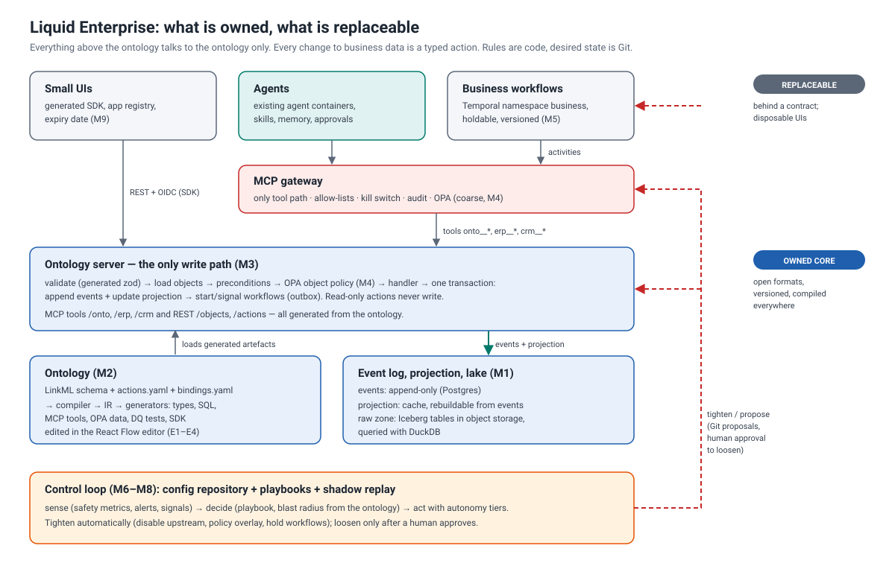
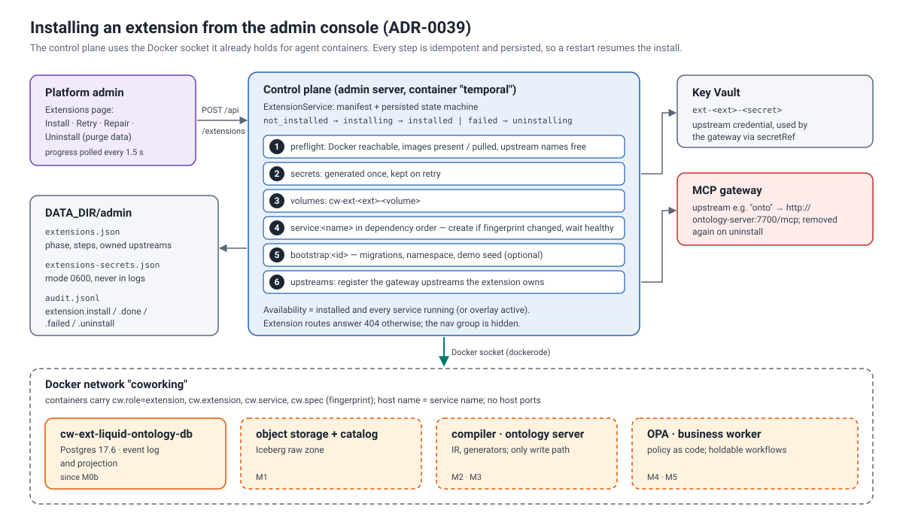

# Liquid Enterprise: an architecture that adapts within guardrails

*Business data in open formats you own, its meaning in a versioned ontology, rules as code — and everything above that
replaceable.*

Liquid Enterprise is an **optional extension** of the platform. It adds the data half to the agent half: an open lake
and an append-only event log, a LinkML ontology that is compiled into every layer, an ontology server as the only write
path, policy as code, holdable business workflows, a config repository with reviewed proposals, and playbooks that
tighten automatically and loosen only with a human decision.

- Decision record: [ADR-0038](adr/0038-liquid-enterprise-extension.md) (and ADR-0039 … ADR-0049, one per milestone).
- Implementation plan: [liquid-enterprise-extension.md](liquid-enterprise-extension.md).

> **Status:** under construction. Sections marked *(planned)* describe what the named milestone delivers; the
> [implementation log](#appendix-implementation-log) says what exists today.

## Contents

1. [Overview](#overview)
2. [Activation](#activation)
3. [Architecture](#architecture)
4. [Ontology and IR contract](#ontology-and-ir-contract)
5. [Ontology editor](#ontology-editor)
6. [Policies](#policies)
7. [Business workflows](#business-workflows)
8. [Config repository and proposals](#config-repository-and-proposals)
9. [Playbooks](#playbooks)
10. [Identity and apps](#identity-and-apps)
11. [Operations runbook](#operations-runbook)
12. [Results D1–D3](#results-d1d3)
13. [Appendix: implementation log](#appendix-implementation-log)

## Overview



| Layer | Role | Implemented by |
|---|---|---|
| Data lake and event log | raw, immutable data in open table formats; append-only events | MinIO + Apache Iceberg + Postgres event outbox; DuckDB for queries |
| Ontology and actions | object types, links, typed actions; the **only write path** | LinkML schema + `actions.yaml` + `bindings.yaml` → compiler → ontology server |
| Policy | who may run which action on which object | OPA at the MCP gateway and the ontology server |
| Orchestration | long-running business processes, playbook runs, replays | Temporal, namespace `business` |
| Agents | work on tasks with skills and memory | existing agent containers via the MCP gateway |
| UIs | many small, generated apps | generated TypeScript SDK + app registry |
| Control loop | sense → decide → act with autonomy tiers | config repository + playbooks + shadow replay |

The rules that hold everywhere (plan §1.3): nothing above the ontology binds to physical tables; actions are the only
write path; raw data is immutable and the projection can be rebuilt from events; one source compiled everywhere; fail
closed; tighten automatically, loosen only with approval; desired state in Git.

## Activation

Decision record: [ADR-0039](adr/0039-extension-manager.md).



**Install from the admin console** (Platform.Admin): **Extensions** → *Liquid Enterprise* → **Install**.

1. The control plane checks Docker and the images (public images are pulled, the extension's own images must be built
   once with `node scripts/stack.mjs build --liquid`; the card says when they are missing).
2. It generates the extension's secrets, creates its data volumes and starts its services in dependency order, waiting
   for each to be healthy.
3. It runs the bootstrap steps (with *Seed the sofa-company demo data*, also the demo seed) and registers the gateway
   upstreams the extension owns.

Every step is shown with its state; a failed step shows its error and **Retry install** continues from there. An install
interrupted by a restart of the control plane resumes by itself. While installed and healthy, the navigation shows a
**Liquid enterprise** group. **Repair** re-creates missing or changed containers and starts stopped ones (data and
secrets are kept). **Uninstall** removes the upstreams it registered and its containers; *also delete its data volumes
and secrets* removes everything.

What gets created:

| Resource | Name | Notes |
|---|---|---|
| containers | `cw-ext-liquid-<service>` | labels `cw.role=extension`, `cw.extension=liquid`; network `coworking`, host name = service name; no host ports |
| volumes | `cw-ext-liquid-<volume>` | label `cw.role=extension-data` |
| secrets | `DATA_DIR/admin/extensions-secrets.json` (0600) | upstream credentials also in Key Vault as `ext-liquid-<secret>` |
| state | `DATA_DIR/admin/extensions.json` | phase, steps of the last operation, owned upstreams |

Services so far: `ontology-db` (Postgres 17.6: event log and projection). The list grows with each milestone.

**Compose overlay** (development and CI): the same services under the same names, secrets from `.env`.

```bash
node scripts/stack.mjs liquid up      # = docker compose -f docker-compose.yml -f docker-compose.liquid.yml up -d
node scripts/stack.mjs liquid down    # removes the liquid services, restarts the control plane without the overlay
node scripts/stack.mjs liquid reset   # also deletes the overlay's volumes
```

In overlay mode the Extensions page shows Liquid read-only. Use one mode at a time: `liquid up` refuses to start while a
console install exists. `node scripts/stack.mjs reset` removes both.

## Architecture

*(planned, M1–M5)*

## Ontology and IR contract

*(planned, M2)* The ontology source, the annotations the compiler reads (`criticality`, `data_class`, `owner`,
`mcp_group`), the IR schema, the generator outputs and the versioning rules.

## Ontology editor

*(planned, E1–E4)* Admin console → Liquid enterprise → **Ontology**: classes as nodes, links as edges, enums and actions
in a side panel. Changes are made in a draft, validated by the compiler, submitted as a proposal and go live after the
owner approves.

## Policies

*(planned, M4)*

## Business workflows

*(planned, M5)*

## Config repository and proposals

*(planned, M6)*

## Playbooks

*(planned, M7)*

## Identity and apps

*(planned, M9)*

## Operations runbook

*(planned)* Rebuilding the projection, replaying a window, restoring after a playbook run, rotating the ontology DB
credentials, repairing a failed install.

## Results D1–D3

*(planned, M3 and M10)*

| # | Demonstration | Status |
|---|---|---|
| D1 | Backend swap: sofa scenarios against the ontology server | open |
| D2 | New security risk: automatic containment, human-gated recovery | open |
| D3 | New business requirement: ontology extension compiled into all layers | open |

## Appendix: implementation log

One entry per milestone. Template:

```
### Mx — <title> (<date>)
Done:        what was built
Verified:    tests, scripts, manual checks (with numbers)
Open:        what is left
Deviations:  from the plan, with the ADR that records them
```

### M0 — Baseline and conventions (2026-11-16)

Done
- Branch `liquid-enterprise` from `79ac9c6`. Plan updated to v1.1 (M0b extension manager, editor tracks E1–E4, this
  document, ADR numbering in creation order). [ADR-0038](adr/0038-liquid-enterprise-extension.md).
- `scripts/liquid/check.mjs` (build, typecheck, tests; `opa test` and the stale-generated check switch on once their
  inputs exist) and `scripts/liquid/baseline-summary.mjs` (KPI table + spread from scenario results).

Verified
- Build green; **31 test files, 214 tests, all passing** (the plan's "88 tests" was out of date). `check.mjs` green.
- The plan's command `corepack pnpm -r build` fails on machines where `pnpm` is only available through corepack:
  `-r` includes the root package, whose `build`/`test` scripts call bare `pnpm`. `check.mjs` runs the package scripts
  with `--filter !coworking-agents` instead.

KPI baseline, run 1 (existing results `scripts/sofa-company/results/s1…s5`, recorded before this branch):

| scenario | late before → after | sofas late after | customers not informed | spend € | tasks | decisions | write calls | guard halts |
|---|---|---|---|---|---|---|---|---|
| supplier-beams | 13 → 0 | 0 | 0 | 42 450 | 1 | 1 | 2 | 0 |
| machine-failure | 9 → 2 | 220 | 2 | 9 650 | 4 | 4 | 4 | 0 |
| demand-spike | 0 → 8 | 970 | 8 | 0 | 4 | 5 | 9 | 2 |
| sick-leave | 7 → 0 | 0 | 0 | 5 200 | 3 | 3 | 1 | 1 |
| storm | 8 → 0 | 0 | 0 | 87 720 | 3 | 3 | 6 | 0 |

(demand-spike: the incident snapshot is taken before the extra demand is planned, so "before" is 0.)

Open
- Runs 2 and 3 per scenario (real model, about 15 runs of up to 45 min) to get the spread. Needed before the D1 parity
  judgement in M3, not for M0b–M2. Store as `results/baseline-<n>-<scenario>.json`.

Deviations
- Exit criterion "baseline with spread" is only partly met (n = 1); see Open.

### M0b — Extension manager and install UI (2026-11-16)

Done
- `packages/extensions`: manifest schema with reference checks, dependency order, environment rendering and masking,
  install/uninstall steps, fingerprint, plan diff, API types.
- `apps/admin-server/src/extensions/`: Docker runtime for labelled extension containers, `ExtensionService` (persisted
  state machine, idempotent steps, resume on start, repair, owned upstreams, secrets 0600 + Key Vault refs, runtime
  availability), API router, `requireExtension` middleware, liquid manifest (`ontology-db`).
- Admin console: Extensions page (install / retry / repair / uninstall with purge option, step progress, services,
  logs; Signals read-only), Liquid overview page, nav groups in `AppShell` (`NavItem.group`).
- `docker-compose.liquid.yml`, `stack.mjs` (`build --liquid`, `liquid up|down|reset`, `reset` removes extension
  resources, `LIQUID_ONTOLOGY_DB_PASSWORD` in `.env`), Dockerfile includes the new package. [ADR-0039](adr/0039-extension-manager.md).

Verified
- `check.mjs` green: build, typecheck, tests. New tests: 16 in `packages/extensions` (validation table, order,
  rendering, masking, steps, fingerprint, diff), 22 in `admin-server` with a fake Docker (install order, demo-only steps,
  secrets not in state file, Key Vault reference vs. plain header, missing local image → build hint, third-party pull,
  upstream name collision, health wait and timeout, concurrent operation refused, retry from failed step without
  re-creating healthy services, resume after restart, repair, uninstall only touches own resources, purge, overlay mode,
  Docker status parsing, manifest ↔ overlay service parity).

Open
- **End-to-end exit check not run yet:** Docker Desktop was not running. To do: fresh stack → Install (with demo seed)
  → services healthy → Liquid nav visible → restart the control plane during an install → Uninstall → no `cw-ext-*`
  container, no owned upstream. Playwright screenshots of the Extensions page.

Deviations
- None from the plan. The pino logger already redacts any `env` field; the masked environment is logged anyway.

### Later

Ideas that are out of scope for now (plan §7, "scope creep").
