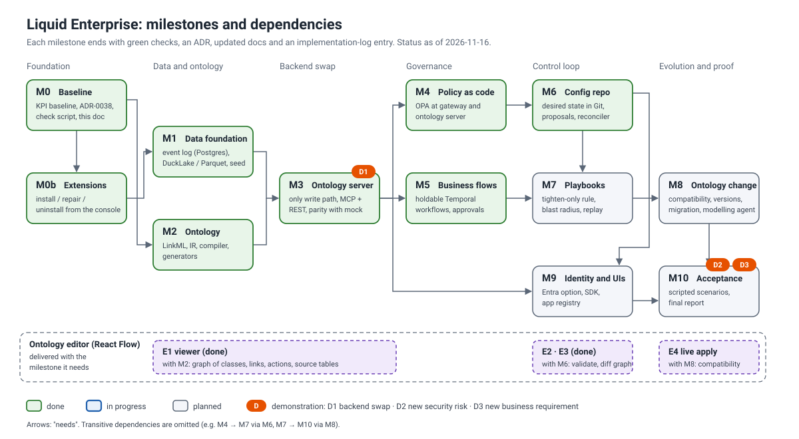
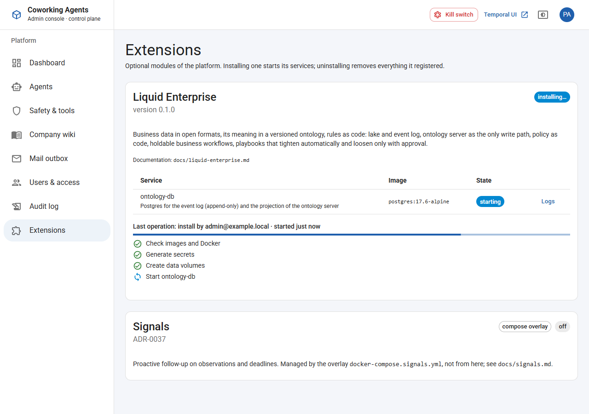
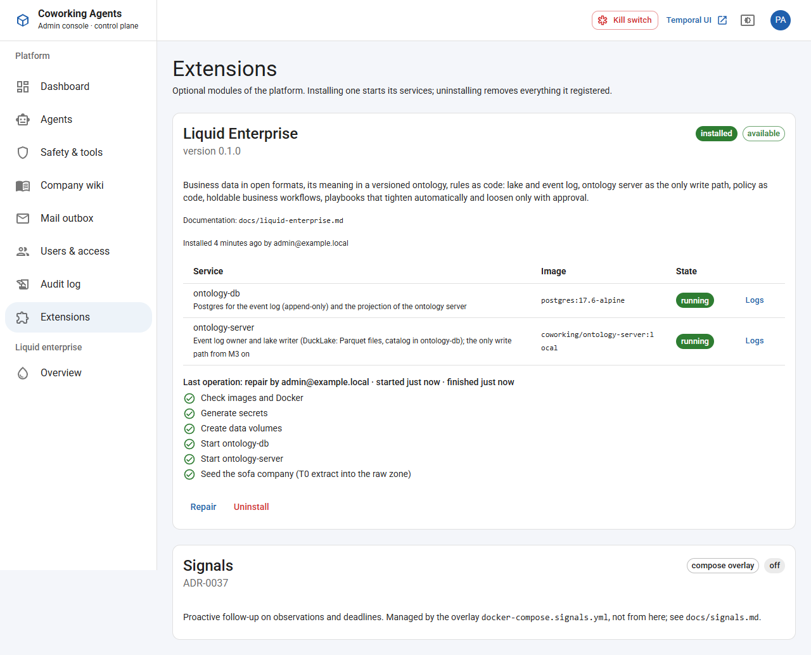
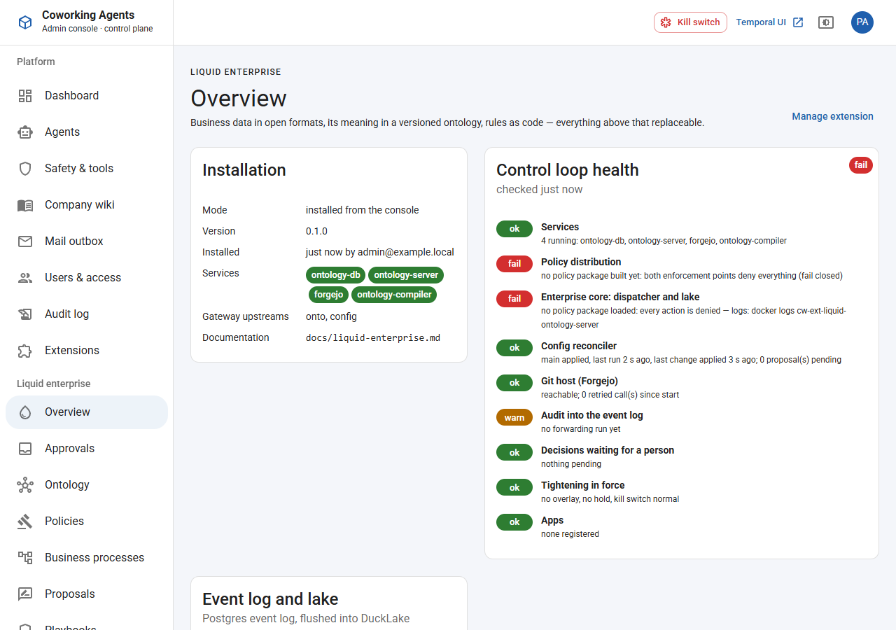
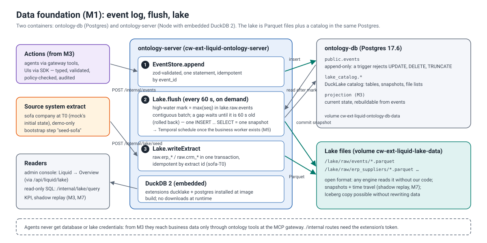

# Liquid Enterprise: an architecture that adapts within guardrails

*Business data in open formats you own, its meaning in a versioned ontology, rules as code — and everything above that
replaceable.*

Liquid Enterprise is an **optional extension** of the platform. It adds the data half to the agent half: an open lake
and an append-only event log, a LinkML ontology that is compiled into every layer, an ontology server as the only write
path, policy as code, holdable business workflows, a config repository with reviewed proposals, and playbooks that
tighten automatically and loosen only with a human decision.

- Decision record: [ADR-0038](adr/0038-liquid-enterprise-extension.md) (and ADR-0039 … ADR-0049, one per milestone).
- Implementation plan: [liquid-enterprise-extension.md](liquid-enterprise-extension.md).

> **Status:** under construction. Sections marked *(planned)* describe what the named milestone delivers; the
> [implementation log](#appendix-implementation-log) says what exists today.

## Contents

1. [Overview](#overview)
2. [Activation](#activation)
3. [Architecture](#architecture)
4. [Ontology and IR contract](#ontology-and-ir-contract)
5. [Ontology editor](#ontology-editor)
6. [Policies](#policies)
7. [Business workflows](#business-workflows)
8. [Config repository and proposals](#config-repository-and-proposals)
9. [Playbooks](#playbooks)
10. [Identity and apps](#identity-and-apps)
11. [Operations runbook](#operations-runbook)
12. [Results D1–D3](#results-d1d3)
13. [Appendix: implementation log](#appendix-implementation-log)

## Overview


| Layer | Role | Implemented by |
|---|---|---|
| Data lake and event log | raw, immutable data in open table formats; append-only events | Postgres event log + DuckLake (catalog in Postgres, Parquet files), written and queried with DuckDB 2 |
| Ontology and actions | object types, links, typed actions; the **only write path** | LinkML schema + `actions.yaml` + `bindings.yaml` → compiler → ontology server |
| Policy | who may run which action on which object | OPA at the MCP gateway and the ontology server |
| Orchestration | long-running business processes, playbook runs, replays | Temporal, namespace `business` |
| Agents | work on tasks with skills and memory | existing agent containers via the MCP gateway |
| UIs | many small, generated apps | generated TypeScript SDK + app registry |
| Control loop | sense → decide → act with autonomy tiers | config repository + playbooks + shadow replay |

The rules that hold everywhere (plan §1.3): nothing above the ontology binds to physical tables; actions are the only
write path; raw data is immutable and the projection can be rebuilt from events; one source compiled everywhere; fail
closed; tighten automatically, loosen only with approval; desired state in Git.

**Why DuckDB next to Postgres?** Postgres is the operational store: the event log is written in the same transaction as
an action, and the projection serves lookups. DuckDB (embedded in the ontology server, no container of its own) writes
the open-format copy (DuckLake: Parquet files that any engine can read without our code) and runs historical scans and
time travel without loading the operational database. The DuckLake catalog itself lives in the same Postgres.

### Roadmap



## Activation

Decision record: [ADR-0039](adr/0039-extension-manager.md).


**Install from the admin console** (Platform.Admin): **Extensions** → *Liquid Enterprise* → **Install**.

1. The control plane checks Docker and the images (public images are pulled, the extension's own images must be built
   once with `node scripts/stack.mjs build --liquid`; the card says when they are missing).
2. It generates the extension's secrets, creates its data volumes and starts its services in dependency order, waiting
   for each to be healthy.
3. It runs the bootstrap steps (with *Seed the sofa-company demo data*, also the demo seed) and registers the gateway
   upstreams the extension owns.

| Installing | Installed |
|---|---|
|  |  |

Every step is shown with its state; a failed step shows its error and **Retry install** continues from there. An install
interrupted by a restart of the control plane resumes by itself. While installed and healthy, the navigation shows a
**Liquid enterprise** group. **Repair** re-creates missing or changed containers and starts stopped ones (data and
secrets are kept). **Uninstall** removes the upstreams it registered and its containers; *also delete its data volumes
and secrets* removes everything.

What gets created:

| Resource | Name | Notes |
|---|---|---|
| containers | `cw-ext-liquid-<service>` | labels `cw.role=extension`, `cw.extension=liquid`; network `coworking`, host name = service name; no host ports |
| volumes | `cw-ext-liquid-<volume>` | label `cw.role=extension-data` |
| secrets | `DATA_DIR/admin/extensions-secrets.json` (0600) | upstream credentials also in Key Vault as `ext-liquid-<secret>` |
| state | `DATA_DIR/admin/extensions.json` | phase, steps of the last operation, owned upstreams |

Services so far: `ontology-db` (Postgres 17.6: event log, lake catalog, later the projection) and `ontology-server`
(event log owner and lake writer, from M3 the only write path). The list grows with each milestone.

**Compose overlay** (development and CI): the same services under the same names, secrets from `.env`.

```bash
node scripts/stack.mjs liquid up      # = docker compose -f docker-compose.yml -f docker-compose.liquid.yml up -d
node scripts/stack.mjs liquid down    # removes the liquid services, restarts the control plane without the overlay
node scripts/stack.mjs liquid reset   # also deletes the overlay's volumes
```

The **Overview** page (Liquid enterprise → Overview) shows the installation and which layers are live:



In overlay mode the Extensions page shows Liquid read-only. Use one mode at a time: `liquid up` refuses to start while a
console install exists. `node scripts/stack.mjs reset` removes both.

## Architecture

Decision record: [ADR-0040](adr/0040-lake-ducklake-event-log.md).



### Event log

Table `events` in `ontology-db` (Postgres 17.6). Every change to business data is an event; from M3 only the action
pipeline writes them. Appends are zod-validated, written in one statement and idempotent by `event_id`. A trigger
rejects `UPDATE`, `DELETE` and `TRUNCATE` for every role: corrections are new events.

| Column | Meaning |
|---|---|
| `seq` | position in the log (bigserial); the lake's high-water mark |
| `event_id` | uuid, unique; a repeated append returns the existing `seq` |
| `type`, `object_type`, `object_id` | e.g. `SupplierNoticeIssued`, `Supplier`, `S-NORDHOLZ` |
| `action`, `actor_agent`, `actor_user`, `task_id`, `workflow_id` | who and what caused it (filled by the action pipeline, M3) |
| `payload` | jsonb |
| `occurred_at`, `recorded_at`, `ontology_version` | when it happened, when it was stored, under which ontology version |

### Lake (raw zone)

A DuckLake database: catalog in Postgres schema `lake_catalog`, data as Parquet files in the volume
`cw-ext-liquid-lake-data` (`/lake`), written and read by DuckDB 2 inside the ontology server. Data inlining is off,
so every table is real Parquet files.

| Table | Content |
|---|---|
| `raw.events` | the flushed event log (same columns) |
| `raw.erp_*` | factories, machines, workers, absences, materials, bom, suppliers, inventory, purchase_orders, production_orders, maintenance_tickets |
| `raw.crm_*` | customers, orders, campaigns, demand |
| `raw._extracts` | one row per source system extract (`sofa-T0`: the sofa company's initial state) |

Each extract row carries `_extract_id` and `_extracted_at`. Raw tables are never updated.

**Flush:** every 60 s (and on demand) the ontology server appends the events after the lake's high-water mark
(`max(seq)` in `lake.raw.events`) as one snapshot. A gap in `seq` stops the batch until it is 60 s old (the missing
number then belonged to a rolled-back insert), so a slow transaction is never skipped. Running the flush twice adds
nothing.

**Seed:** with *Seed the sofa-company demo data*, the install step `seed-sofa` writes the extract `sofa-T0` from
`packages/sofa-domain` (a port of the mock's initial state, checked against the mock by a test).

The Overview page shows the event log, the flush state and every raw table:


## Ontology and IR contract

*(planned, M2)* The ontology source, the annotations the compiler reads (`criticality`, `data_class`, `owner`,
`mcp_group`), the IR schema, the generator outputs and the versioning rules.

## Ontology editor

*(planned, E1–E4)* Admin console → Liquid enterprise → **Ontology**: classes as nodes, links as edges, enums and actions
in a side panel. Changes are made in a draft, validated by the compiler, submitted as a proposal and go live after the
owner approves.

## Policies

*(planned, M4)*

## Business workflows

*(planned, M5)*

## Config repository and proposals

*(planned, M6)*

## Playbooks

*(planned, M7)*

## Identity and apps

*(planned, M9)*

## Operations runbook

All `/internal` routes of the ontology server need its token; from the host, run them inside the container:

```bash
# flush now / lake status
docker exec cw-ext-liquid-ontology-server node -e "fetch('http://127.0.0.1:7710/internal/lake/flush',{method:'POST',headers:{authorization:'Bearer '+process.env.INTERNAL_TOKEN}}).then(r=>r.text()).then(console.log)"
docker exec cw-ext-liquid-ontology-server node -e "fetch('http://127.0.0.1:7710/internal/lake/status',{headers:{authorization:'Bearer '+process.env.INTERNAL_TOKEN}}).then(r=>r.text()).then(console.log)"

# read-only SQL over the lake (single SELECT)
docker exec cw-ext-liquid-ontology-server node -e "fetch('http://127.0.0.1:7710/internal/lake/query',{method:'POST',headers:{authorization:'Bearer '+process.env.INTERNAL_TOKEN,'content-type':'application/json'},body:JSON.stringify({sql:process.argv[1]})}).then(r=>r.text()).then(console.log)" "SELECT id, name, rating FROM lake.raw.erp_suppliers"

# the event log directly (read only!)
docker exec -it cw-ext-liquid-ontology-db psql -U onto -d onto -c "SELECT seq, type, object_id, occurred_at FROM events ORDER BY seq DESC LIMIT 20"
```

- **Re-seed:** the seed is idempotent by extract id; it only writes again after *Uninstall* with *delete data*.
- **Lake files outside the platform:** the Parquet files are in the volume `cw-ext-liquid-lake-data` under
  `raw/<table>/`; any Parquet reader can open them, and DuckDB with the `ducklake` extension can attach the catalog.
- **Failed install:** the Extensions page shows the failed step and its error; *Retry install* continues there,
  *Repair* re-runs all steps and re-creates containers whose image was rebuilt.
- *(planned)* Rebuilding the projection, replaying a window, restoring after a playbook run, rotating the ontology DB
  credentials.

## Results D1–D3

*(planned, M3 and M10)*

| # | Demonstration | Status |
|---|---|---|
| D1 | Backend swap: sofa scenarios against the ontology server | open |
| D2 | New security risk: automatic containment, human-gated recovery | open |
| D3 | New business requirement: ontology extension compiled into all layers | open |

## Appendix: implementation log

One entry per milestone. Template:

```
### Mx — <title> (<date>)
Done:        what was built
Verified:    tests, scripts, manual checks (with numbers)
Open:        what is left
Deviations:  from the plan, with the ADR that records them
```

### M0 — Baseline and conventions (2026-11-16)

Done
- Branch `liquid-enterprise` from `79ac9c6`. Plan updated to v1.1 (M0b extension manager, editor tracks E1–E4, this
  document, ADR numbering in creation order). [ADR-0038](adr/0038-liquid-enterprise-extension.md).
- `scripts/liquid/check.mjs` (build, typecheck, tests; `opa test` and the stale-generated check switch on once their
  inputs exist) and `scripts/liquid/baseline-summary.mjs` (KPI table + spread from scenario results).

Verified
- Build green; **31 test files, 214 tests, all passing** (the plan's "88 tests" was out of date). `check.mjs` green.
- The plan's command `corepack pnpm -r build` fails on machines where `pnpm` is only available through corepack:
  `-r` includes the root package, whose `build`/`test` scripts call bare `pnpm`. `check.mjs` runs the package scripts
  with `--filter !coworking-agents` instead.

KPI baseline, run 1 (existing results `scripts/sofa-company/results/s1…s5`, recorded before this branch):

| scenario | late before → after | sofas late after | customers not informed | spend € | tasks | decisions | write calls | guard halts |
|---|---|---|---|---|---|---|---|---|
| supplier-beams | 13 → 0 | 0 | 0 | 42 450 | 1 | 1 | 2 | 0 |
| machine-failure | 9 → 2 | 220 | 2 | 9 650 | 4 | 4 | 4 | 0 |
| demand-spike | 0 → 8 | 970 | 8 | 0 | 4 | 5 | 9 | 2 |
| sick-leave | 7 → 0 | 0 | 0 | 5 200 | 3 | 3 | 1 | 1 |
| storm | 8 → 0 | 0 | 0 | 87 720 | 3 | 3 | 6 | 0 |

(demand-spike: the incident snapshot is taken before the extra demand is planned, so "before" is 0.)

Open
- Runs 2 and 3 per scenario (real model, about 15 runs of up to 45 min) to get the spread. Needed before the D1 parity
  judgement in M3, not for M0b–M2. Store as `results/baseline-<n>-<scenario>.json`.

Deviations
- Exit criterion "baseline with spread" is only partly met (n = 1); see Open.

### M0b — Extension manager and install UI (2026-11-16)

Done
- `packages/extensions`: manifest schema with reference checks, dependency order, environment rendering and masking,
  install/uninstall steps, fingerprint, plan diff, API types.
- `apps/admin-server/src/extensions/`: Docker runtime for labelled extension containers, `ExtensionService` (persisted
  state machine, idempotent steps, resume on start, repair, owned upstreams, secrets 0600 + Key Vault refs, runtime
  availability), API router, `requireExtension` middleware, liquid manifest (`ontology-db`).
- Admin console: Extensions page (install / retry / repair / uninstall with purge option, step progress, services,
  logs; Signals read-only), Liquid overview page, nav groups in `AppShell` (`NavItem.group`).
- `docker-compose.liquid.yml`, `stack.mjs` (`build --liquid`, `liquid up|down|reset`, `reset` removes extension
  resources, `LIQUID_ONTOLOGY_DB_PASSWORD` in `.env`), Dockerfile includes the new package. [ADR-0039](adr/0039-extension-manager.md).

Verified
- `check.mjs` green: build, typecheck, tests. New tests: 16 in `packages/extensions` (validation table, order,
  rendering, masking, steps, fingerprint, diff), 22 in `admin-server` with a fake Docker (install order, demo-only steps,
  secrets not in state file, Key Vault reference vs. plain header, missing local image → build hint, third-party pull,
  upstream name collision, health wait and timeout, concurrent operation refused, retry from failed step without
  re-creating healthy services, resume after restart, repair, uninstall only touches own resources, purge, overlay mode,
  Docker status parsing, manifest ↔ overlay service parity).

- **End to end** (`node scripts/liquid/e2e-extension.mjs`, result `scripts/liquid/results/m0b-extension-e2e.json`):
  15/15 checks on the running stack. The control plane was restarted while `service:ontology-db` was running; the
  install resumed and finished by itself. Container labelled and healthy, volume created, `psql` answers, install
  audited, nav route offered, repair keeps the healthy container, uninstall with purge leaves no container, volume or
  owned upstream. Screenshots in `docs/images/liquid/`.

Open
- Nothing for M0b.

Deviations
- None from the plan. The pino logger already redacts any `env` field; the masked environment is logged anyway.
- Found and fixed on the way: `infra/docker/Dockerfile` (from commit `79ac9c6`, Signals) had a literal `
` instead of a
  line continuation in the `pnpm deploy` step, so no image could be built from that commit (`/bin/sh: n: not found`).
- The control plane was rebuilt with `docker compose build temporal` + `up -d --no-deps temporal`, not `stack.mjs up`,
  because `up --remove-orphans` would remove services of other overlays (e.g. the running `mcp-sofa`).

### M1 — Data foundation: event log and lake (2026-11-16)

Done
- Spike: MinIO no longer viable (no community images since October 2025); SeaweedFS + Iceberg REST catalog dropped as
  too many moving parts. **DuckLake** on DuckDB 2 (2.0.0) works on Windows and in the Linux image: Postgres catalog in
  its own schema, Parquet data files, snapshots, time travel, extensions installed at build. [ADR-0040](adr/0040-lake-ducklake-event-log.md).
- `packages/lake`: event store (validated, idempotent, append-only trigger), gap-safe flush, DuckLake writer/reader
  (extracts in one transaction, read-only query, status, Parquet file counts).
- `packages/sofa-domain`: the mock's initial world in TypeScript plus the raw extract (15 tables). The mock exports
  `freshWorld` and its constants and only starts its server when run directly.
- `apps/ontology-server` (M1 part): internal API, flush loop, image with DuckDB extensions preinstalled.
- Liquid manifest + overlay: `ontology-server` with volume `lake-data`, internal token, demo-only bootstrap step
  `seed-sofa`. Admin API `GET /api/liquid/lake`, "Event log and lake" card on the Overview page.
- Extension manager: the image id is now part of the service fingerprint, so *Repair* re-creates a container whose
  `:local` image was rebuilt.
- Diagrams: milestones (`22-liquid-milestones.svg`), data flow (`23-liquid-data-flow.svg`).

Verified
- `check.mjs` green. New tests: sofa-domain 5 (world and constants identical to the mock, extract shape), lake 15
  (idempotent append, invalid input writes nothing, UPDATE/DELETE/TRUNCATE rejected, gap table, 1,000 events flushed
  twice = 1,000 rows, continuation, field round trip, query guard, seed round trip, every table as Parquet, time
  travel), ontology-server 5 (health, auth, append + flush + status, seed once with counts equal to the extract,
  validation), admin-server +1 (rebuilt image re-created on repair).
- **End to end** on the stack (`node scripts/liquid/e2e-lake.mjs`, result `scripts/liquid/results/m1-lake-e2e.json`):
  10/10 — install with seed; raw-zone counts equal to the **mock's** initial state (not only our port); a DuckDB query
  over the raw zone matches the mock (18 orders, 1,800 sofas, 3 beam suppliers); 1,000 events flushed twice = exactly
  1,000 rows; UPDATE on `events` rejected; every non-empty raw table stored as Parquet; catalog in `lake_catalog`.
- **Overlay path:** `stack.mjs liquid up` started both services healthy, the console switched to overlay mode and read
  the lake with the `.env` secrets, the seed worked; `liquid down` removed them and restarted the control plane
  without the overlay; `mcp-sofa` of the sofa overlay kept running. Reinstall from the console kept the data of the
  earlier install (uninstall without purge).

Deviations
- Plan said MinIO + Iceberg (later SeaweedFS); built DuckLake on Postgres with no extra containers (ADR-0040, decided
  with the user). DuckDB 2.0.0 instead of the 1.5 line (user's choice).
- The flush is a loop in the ontology server, not a Temporal schedule; it moves to one in M5.
- Found on the way: DuckLake inlines small inserts into the catalog by default — switched off
  (`DATA_INLINING_ROW_LIMIT 0`); already inlined data is moved to Parquet at startup. `stack.mjs liquid down` passed
  volume names as services — fixed.

Open
- Baseline runs 2 and 3 (before M3).

### Later

Ideas that are out of scope for now (plan §7, "scope creep").
