# Liquid Enterprise tutorial: the core values, hands-on

This tutorial walks you through what makes Liquid Enterprise different, on the live platform. It takes about
45 minutes. You need no model and no API key. Each of the seven chapters shows one core value:

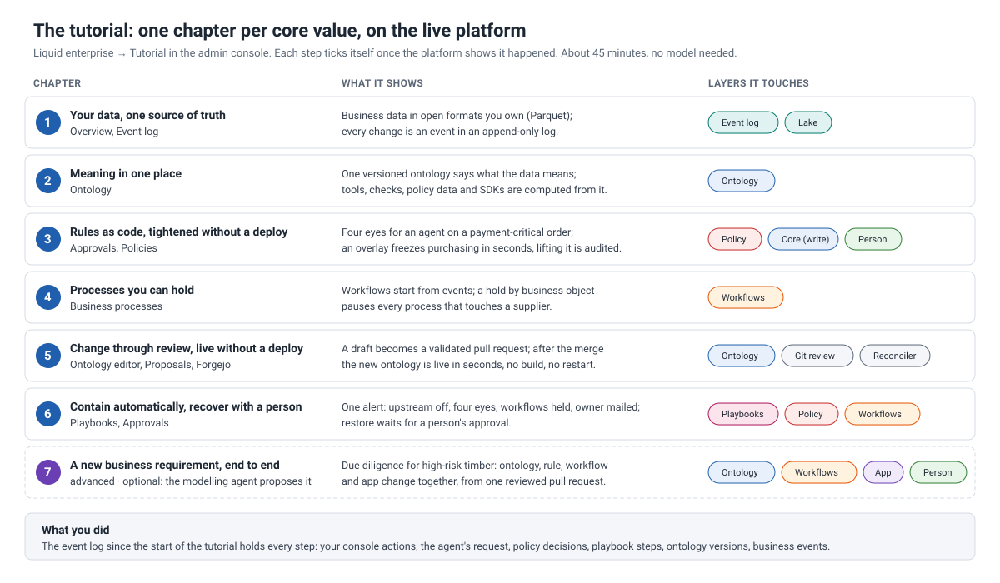

The same tour is built into the admin console as **Liquid enterprise → Tutorial**. There, each step links to the page
where you do it, and the step **ticks itself** once the platform shows that it happened. This document is the same tour
with screenshots, for reading ahead or afterwards. The reference is [liquid-enterprise.md](liquid-enterprise.md).

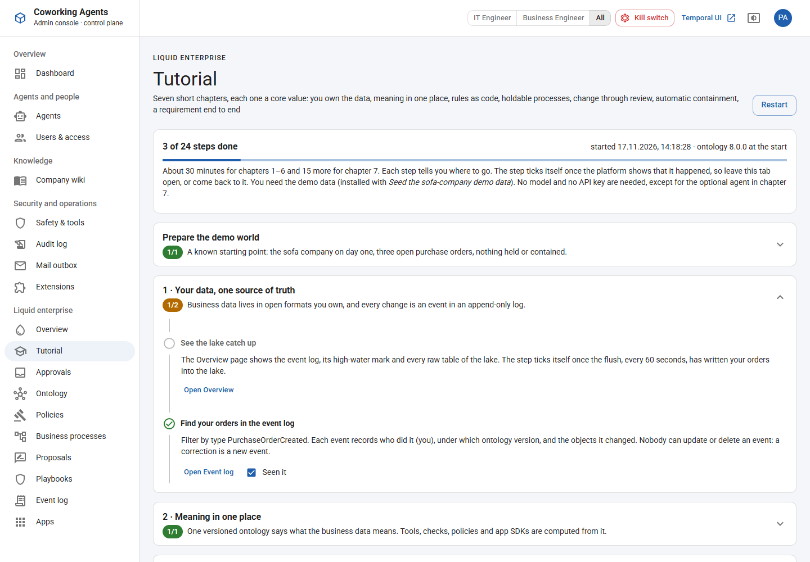

## Before you start

| What | How |
|---|---|
| The stack | `node scripts/stack.mjs up` (see [getting-started.md](getting-started.md)); it prints the admin login |
| The sofa company | `docker compose -f docker-compose.yml -f docker-compose.sofa.yml up -d --no-deps mcp-sofa`, then `node scripts/sofa-company/setup.mjs` (upstreams `erp`/`crm`, agents, people) |
| Liquid Enterprise | Admin console → **Extensions → Liquid Enterprise → Install**, with *Seed the sofa-company demo data* |
| A check | `node scripts/liquid/doctor.mjs` prints *ok* |

You act as the platform administrator throughout. In two places you also act as someone else:

- on **Forgejo**, the Git host, you are the reviewer. The tutorial page shows the login.
- in the **sample app**, you are a buyer. Administrators may use every app. The demo buyer is Stefan Lang
  (`stefan.lang@sofaworks.example`, the demo password that `stack up` printed).

**Prepare the demo world** (the first step on the Tutorial page) resets the simulated sofa company and places three
purchase orders for pine beams from the supplier Nordholz, in your name. It also undoes what an earlier run left
behind: playbook runs, holds, tutorial overlays and a disabled upstream. Each of these is an audited console action.
From this point on, everything you do counts towards the tutorial.

---

## 1 · Your data, one source of truth

> Business data lives in open formats you own, and every change is an event in an append-only log.

1. Open **Overview**. It shows the event log, the lake's high-water mark and every raw table. Within a minute, the
   flush writes your three orders into the lake as Parquet files.
2. Open **Event log** and filter by type `PurchaseOrderCreated`. Each event records who did it (you), under which
   ontology version, and which objects it changed.

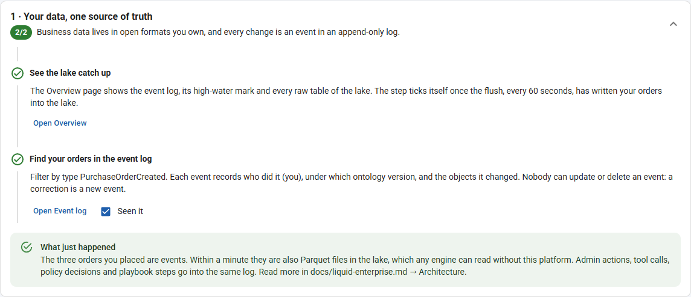

**What just happened.** The orders are events. Nobody can update or delete an event: a correction is a new event. The
lake is DuckLake, so any engine that reads Parquet can open it without this platform. Admin actions, tool calls, policy
decisions and playbook steps go into the same log. → [Architecture](liquid-enterprise.md#architecture)

## 2 · Meaning in one place

> One versioned ontology says what the business data means. Tools, checks, policies and app SDKs are computed from it.

1. Open **Ontology** and select the class **PurchaseOrder**.
2. The panel shows its criticality (*payment critical*), its links to Supplier and Material, the actions that write it
   with their preconditions, and the raw table it is bound to.

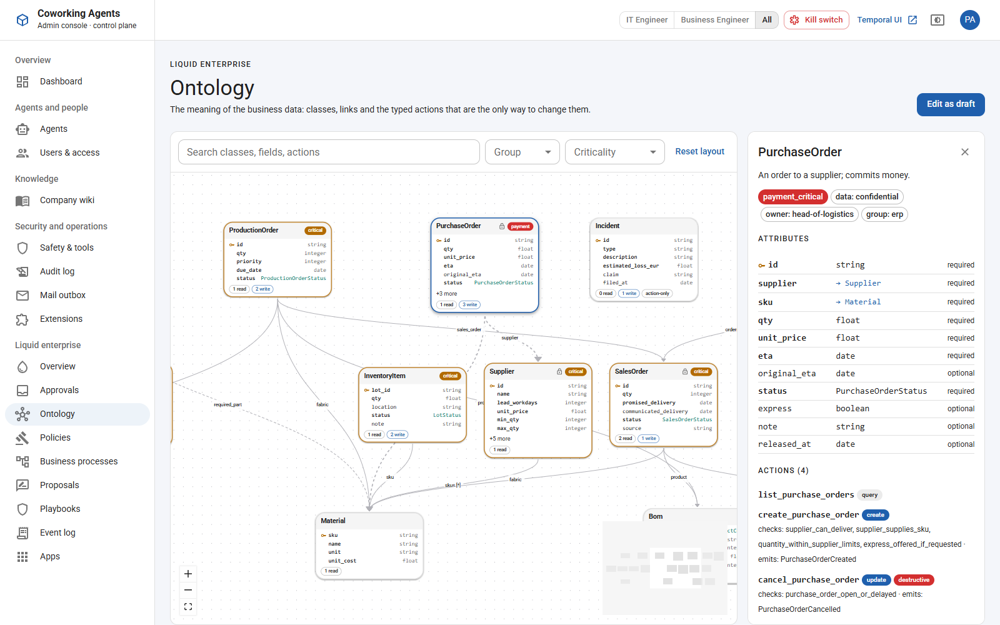

**What just happened.** That single annotation, *payment critical*, is why the next chapter asks for a second pair of
eyes. The agents' MCP tools, the input validation, the policy data and the app SDK are all computed from the same
compiled ontology (the IR). → [Ontology and IR contract](liquid-enterprise.md#ontology-and-ir-contract)

## 3 · Rules as code, tightened without a deploy

> Who may do what is code that is tested and versioned. Anyone may tighten it at once. Loosening it takes a person and
> leaves a trace.

1. **Let agent Lara cancel an order.** The button plays Lara's tool call, without a model. A payment-critical order
   outside an approved task needs a second pair of eyes, so nothing happens yet. The answer says: *Pending approval
   (four eyes) … Nothing was changed yet.*
2. **Approve it.** In **Approvals**, open Lara's request and approve it. The order is cancelled, and the event records
   you as `approvedBy`.
3. **Freeze purchasing.** **Policies → Add overlay**: effect *deny*, action `create_purchase_order`, a reason starting
   with "Tutorial" (for example *Tutorial: purchasing frozen*).
4. **Try to place an order** yourself. The overlay denies it, for people and agents alike: *Denied by policy: overlay
   ov-1: Tutorial: purchasing frozen.*
5. **Lift the freeze** by removing the overlay. Place the order again: now it goes through.

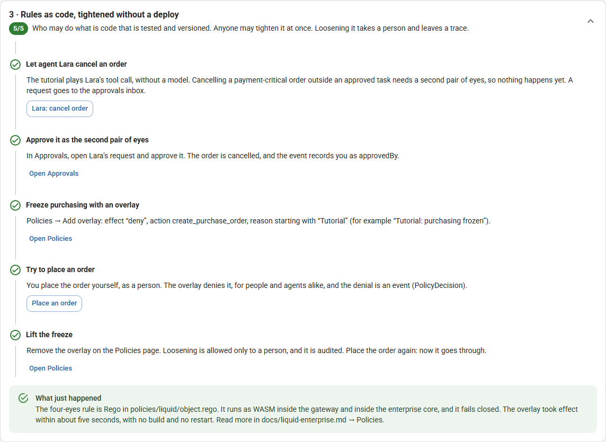

**What just happened.** The four-eyes rule is Rego (`policies/liquid/object.rego`). It is compiled to WebAssembly and
embedded in two places, the MCP gateway and the enterprise core, and both fail closed. The overlay took effect within
about five seconds, with no build and no restart. Removing it was a loosening, so only a person could do it, and it was
audited. → [Policies](liquid-enterprise.md#policies)

## 4 · Processes you can hold

> Long-running business processes start from events, not from code calling code, and you can pause them by business
> object.

1. **Business processes → Hold by object** → `Supplier:S-NORDHOLZ`. The release workflows of your orders show *held*.
2. **Release** the hold. The workflows continue where they stopped.

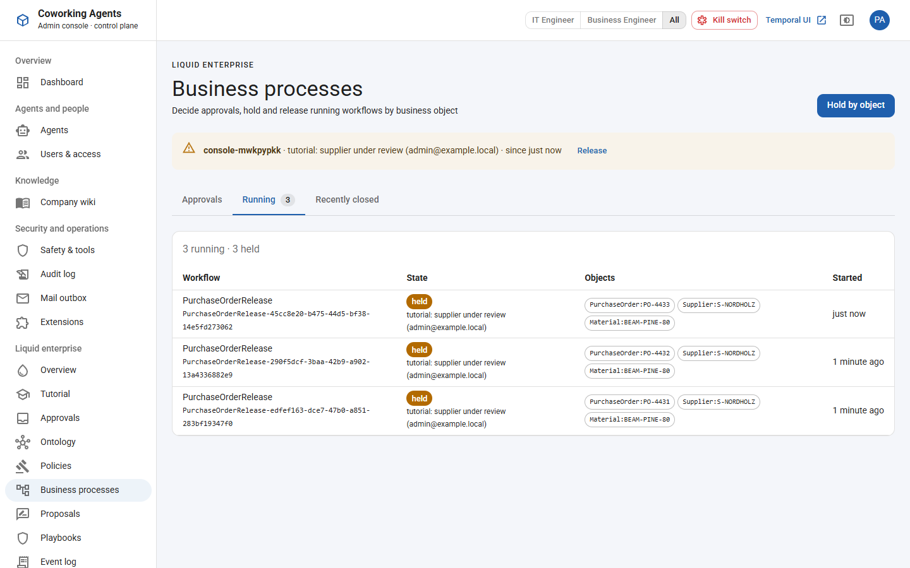

**What just happened.** Each order started a `PurchaseOrderRelease` workflow, because the ontology declares that
`create_purchase_order` starts it. The hold reached every workflow that touches Nordholz. Holding tightens, so it needs
no approval, and it never skips or runs a step. Several holds can stack, and *Release* lifts only its own.
→ [Business workflows](liquid-enterprise.md#business-workflows)

## 5 · Change through review, live without a deploy

> The desired state lives in Git. Every change is a proposal that is validated and reviewed, and the ontology goes live
> at runtime.

1. **Draft a new class.** **Ontology → Edit as draft**. Add the class that the Tutorial page suggests (for example
   *Carrier*) with an attribute `name`, then drag a link from PurchaseOrder to it. The panel compiles every change and
   shows the compatibility class, *minor*. Click **Set version**.

   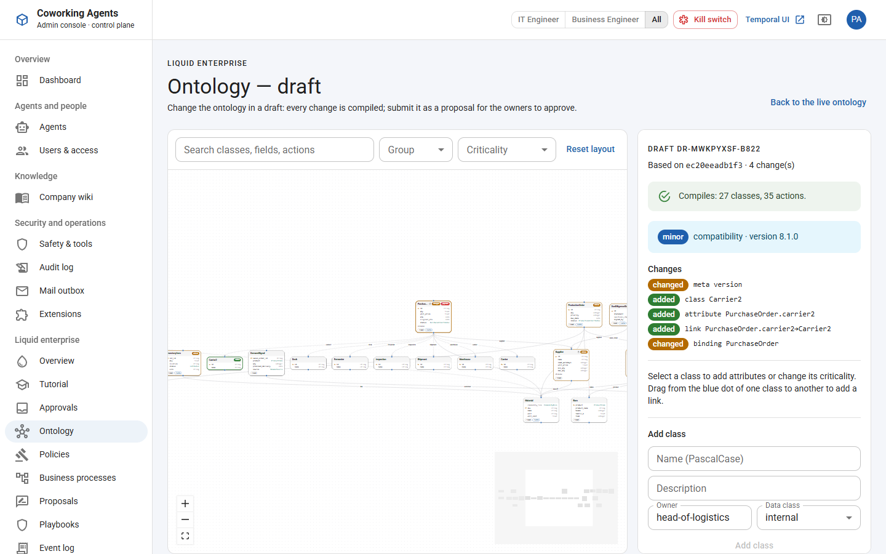

2. **Submit** it. The proposal becomes a branch and a pull request with the required check `liquid/validate`. The
   proposal page shows the validation, the owners who must approve, and the change as a diff graph.

   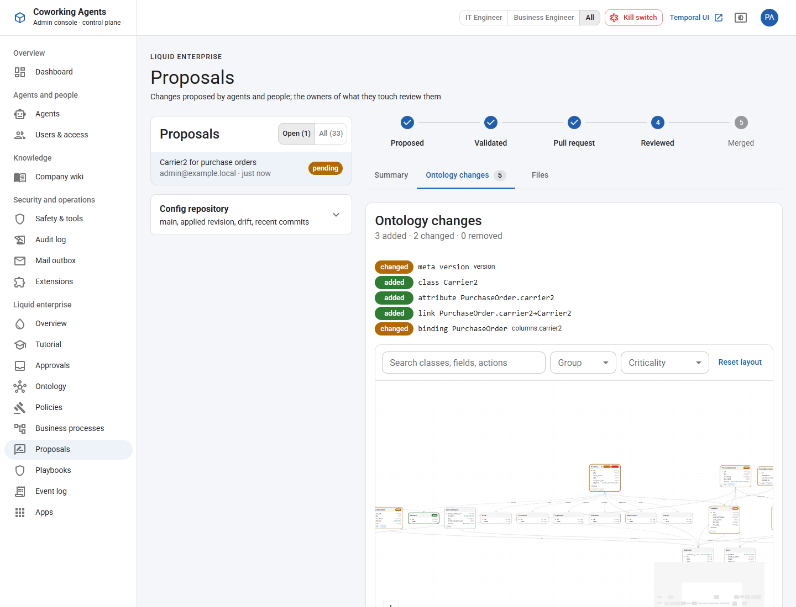

3. **Review and merge on the Git host.** Click *Show the reviewer login* on the Tutorial page, sign in to Forgejo, then
   approve and merge the pull request. The console never decides a proposal itself.

   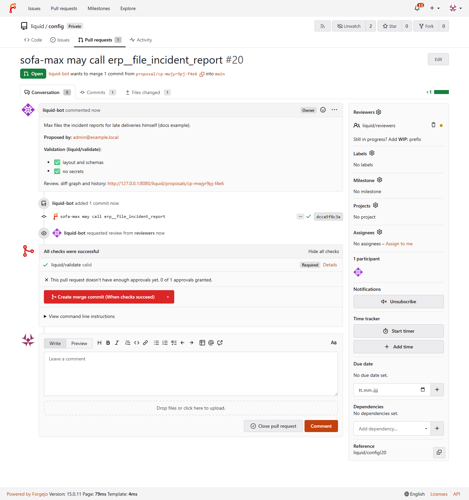

4. **See it live.** Within a few seconds the Ontology page shows the new version with your class (3–4 s in our runs).

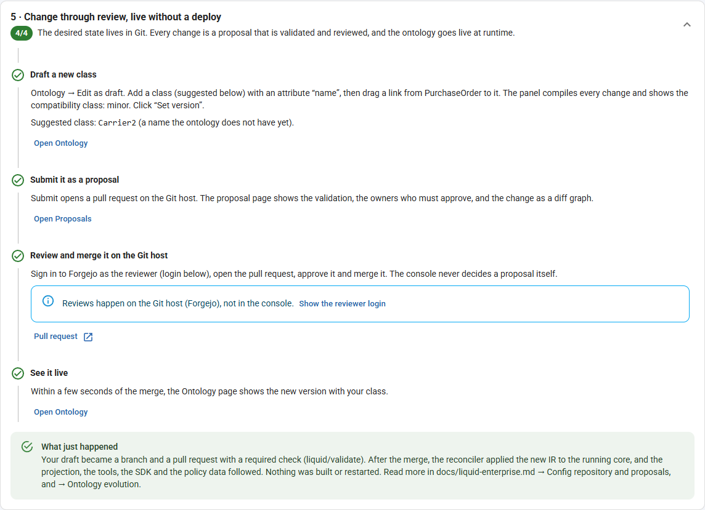

**What just happened.** After the merge, the reconciler compiled `main` and applied the new IR to the running enterprise
core. The projection gained a table, the agents' tools and the app SDK were recomputed, and the policy engines received
the new ontology data. Nothing was built or restarted.
→ [Config repository and proposals](liquid-enterprise.md#config-repository-and-proposals),
[Ontology evolution](liquid-enterprise.md#ontology-evolution)

## 6 · Contain automatically, recover with a person

> When something is sensed, the platform tightens at once by itself. Loosening again always waits for a person.

1. **Playbooks → Send test alert** with the defaults: a critical vulnerability in the ERP connector (upstream `erp`).
2. **Watch the containment.** Within seconds:
   - `erp` is disabled (Safety & tools);
   - an overlay requires four eyes on the write actions behind it (Policies);
   - the release workflows are held (Business processes);
   - a mail went to the security owner (Mail outbox);
   - a shadow replay of the last week is attached.

   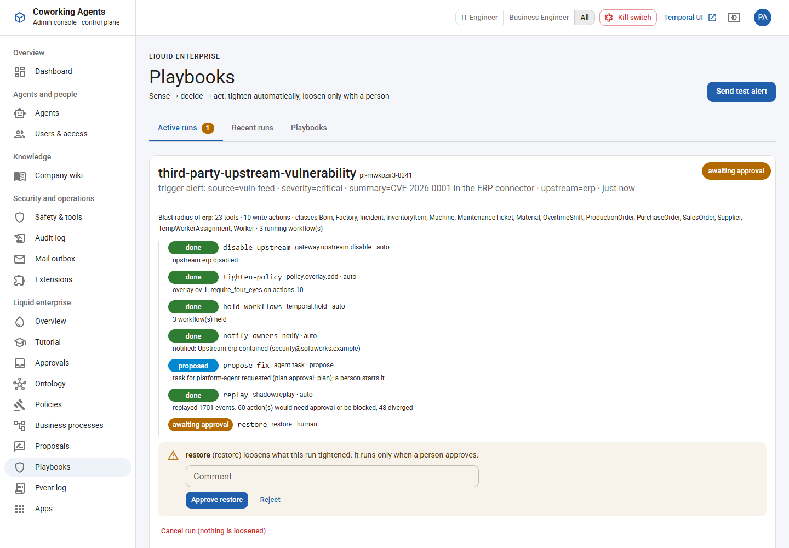

3. **Approve the recovery.** The *restore* step waits in **Approvals**. Approve it: the upstream comes back, the
   overlay goes, and the workflows continue.

   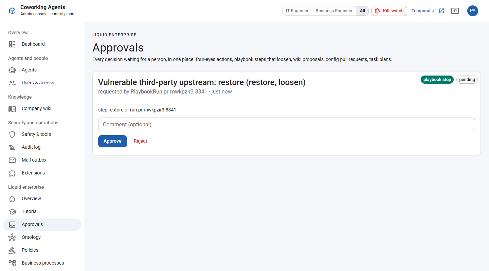

**What just happened.** One alert started a durable playbook run. The blast radius came from the ontology: upstream →
its tools → the actions behind them → their classes → the workflows touching those classes. The tightening steps ran
by themselves, and the loosening step waited for you. A playbook that loosens by itself is invalid: validation refuses
it when it is proposed, and the control plane checks again before every step. → [Playbooks](liquid-enterprise.md#playbooks)

## 7 · A new business requirement, end to end (advanced)

> One reviewed change carries a requirement through ontology, rule, workflow and app.

The requirement: *"Purchase orders for high-risk commodities need a valid supplier due-diligence statement before
release."*

1. **Propose the rule.** The button proposes the prepared change in your name:
   - a risk class on Material;
   - the action `set_commodity_risk`;
   - the rule on `release_purchase_order` as a declarative check;
   - the role that may write the new action.

   It attaches a shadow replay of last week as evidence: how many releases would have waited.

   > **Or let an agent propose it** (this uses model tokens). Create the modelling agent once with
   > `node scripts/liquid/modelling-agent.mjs`, open its UI from Agents, and give it the requirement (the Tutorial page
   > has the task text to copy). It has only the config tools: it reads, drafts, validates and proposes. It cannot
   > merge anything.

   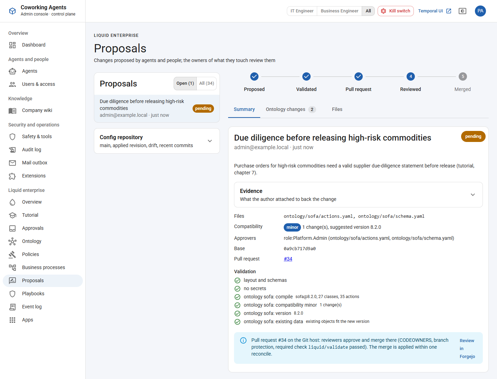

2. **Merge it on Forgejo.** Seconds later, the release action carries the rule.
3. **The app owner rebuilds the app on the new SDK.** The ontology changed, so the sample app's SDK is stale and its
   check fails (*Apps → Check again*). Its owner downloads the new SDK, rebuilds and registers again. That is one
   command in the repository, which the Tutorial page offers to copy:

   ```bash
   node scripts/liquid/app-register.mjs apps/liquid-app-due-diligence --id supplier-due-diligence --name "Supplier due diligence" --owner stefan.lang@sofaworks.example --actions submit_due_diligence_statement --reads Supplier,DueDiligenceStatement --activate
   ```

4. **Classify timber as high-risk.** This runs the new action, which no code implements: it runs generically from
   the IR.
5. **Place an order and watch it wait.** You order the material from a supplier that has no statement yet (Nordholz
   on a first run). After its release window (about 30 s), the order waits in state `awaiting_due_diligence` instead of
   being released.

   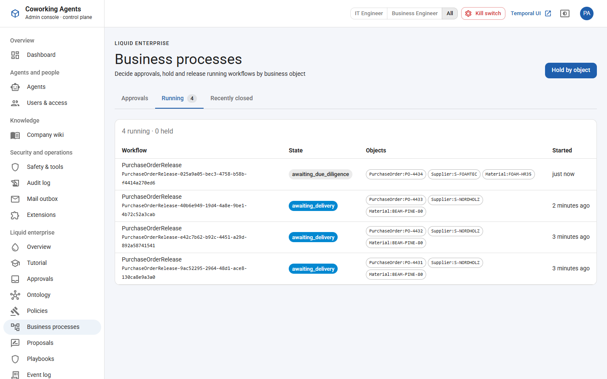

6. **Submit the statement in the app**, for the supplier of your order, with *Screened against the sanctions lists*
   ticked. The order is released moments later.

   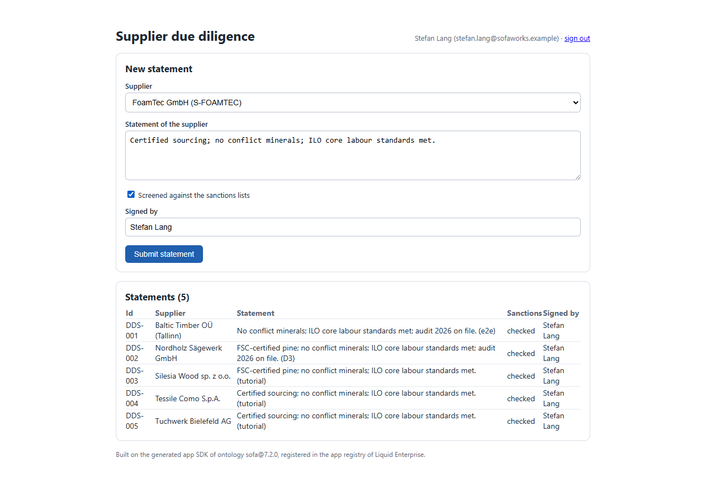

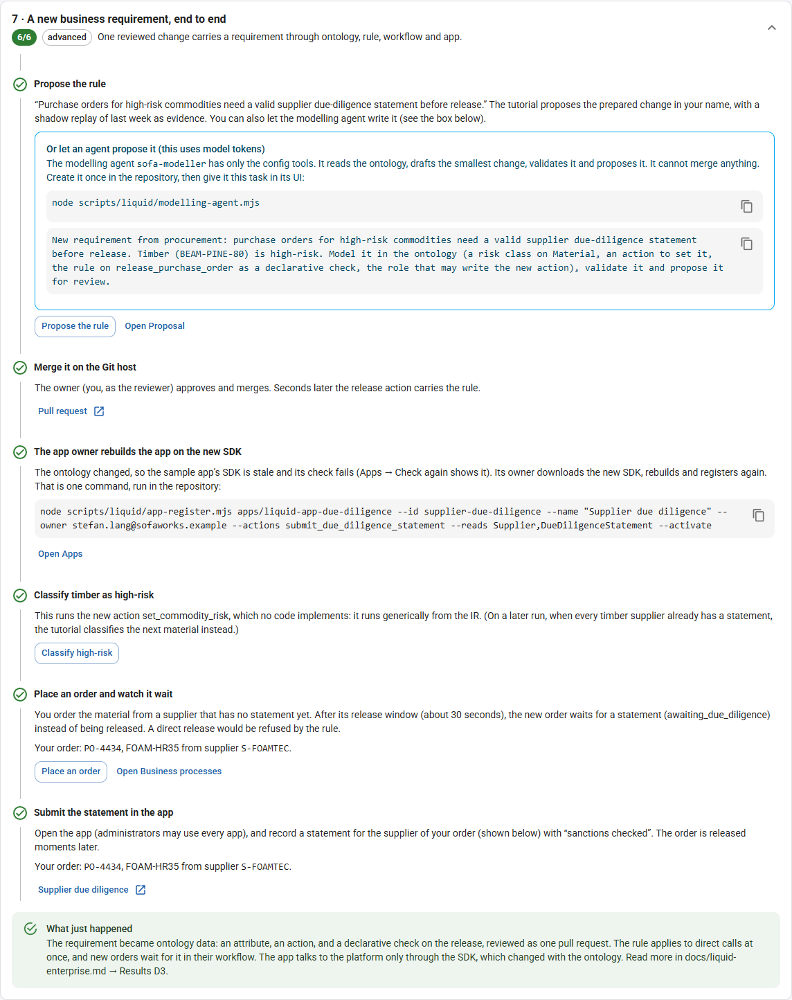

**What just happened.** The requirement became ontology data, reviewed as one pull request: an attribute, an action and
a declarative check on the release. The rule applied to direct calls at once, and new orders waited for it in their
workflow. Orders already past that step finished as before. The app talks to the platform only through the SDK, so it
had to follow the ontology. It is served on its own origin and may run only the actions it registered.
→ [Results D3](liquid-enterprise.md#d3--new-business-requirement)

---

## What you did

The **event log since the start of the tutorial** holds every step:

- your console actions;
- Lara's request and your approval;
- the policy decisions;
- the playbook's steps;
- the ontology versions;
- the business events.

None of it was first written somewhere else. The button at the end of the Tutorial page opens this view.

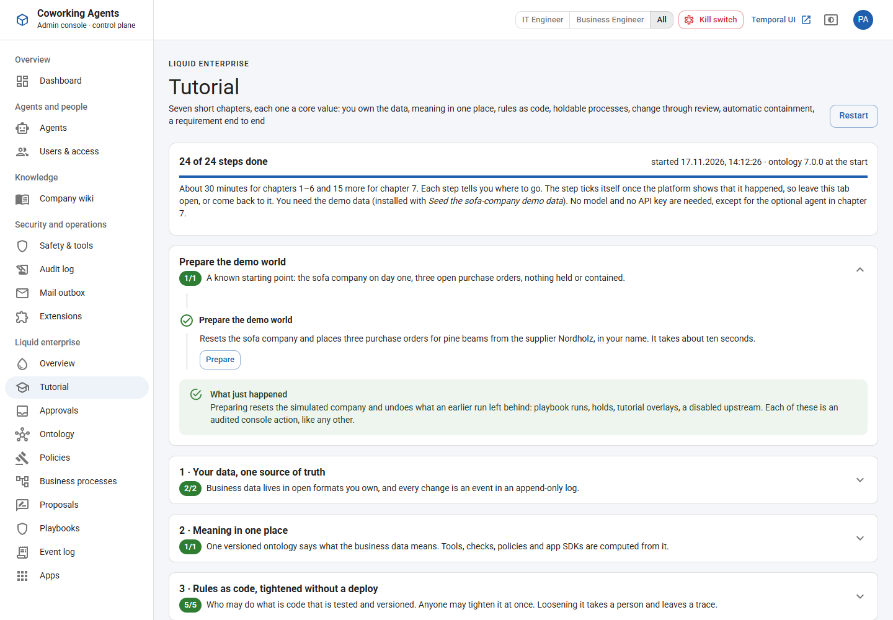

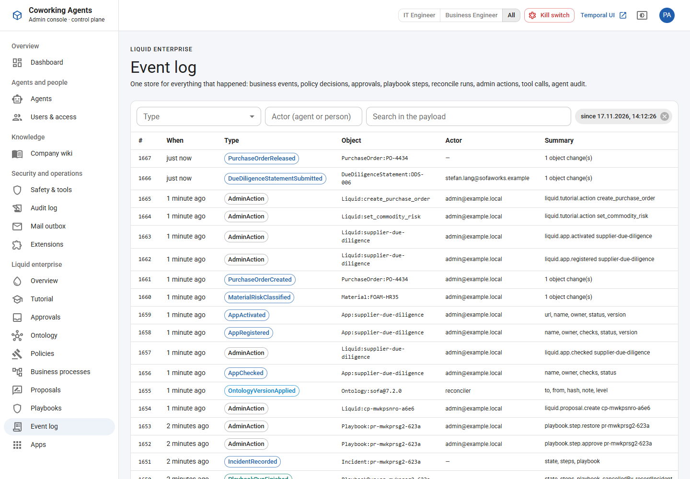

## Notes

- **Running it again.** Use *Restart* on the Tutorial page, then *Prepare* again. Merged ontology changes stay, because
  they are history. Each run adds a class from a short list and raises the version. Due-diligence statements also stay
  (they are events), so chapter 7 picks the next material and supplier without one: timber from Nordholz, Silesia and
  Baltic, then fabrics and foam. That is six runs per install. After that a new order is released at once, but the rule
  still refuses direct releases.
- **What the tutorial adds to the platform** ([ADR-0054](adr/0054-liquid-tutorial.md)): the demo world, three
  whitelisted business actions that have no page of their own, the prepared due-diligence proposal, and the reviewer
  login while the Git host runs on this machine. Everything else happens on the regular pages through the regular
  APIs.
- **Automated check.** `node scripts/liquid/e2e-tutorial.mjs [--shots]` runs every chapter with the same API calls and
  checks that every step ticks on the page. It is part of `node scripts/liquid/e2e-all.mjs`.
