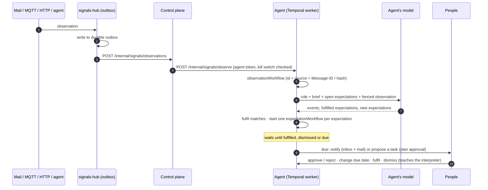

# Signals: agents that notice there is something to do

*A good agent completes a task. Signals notices that there is a task.*

Signals is an **optional** module. It lets an agent interpret incoming information (mails, machine messages, posts from
other systems, things it noticed itself), work out what should follow from it, and keep track of these **open loops**.
When something expected does not happen in time, Signals tells people or proposes a follow-up task. A person approves
that task's plan before anything happens.

Decision record: [ADR-0037](adr/0037-optional-signals.md).

## What it is for

Things that stay unfinished today, because nobody owns the loop:

| Observation | Expectation | Signal |
|---|---|---|
| 🏨 A hotel booking confirmation arrives | After the stay an invoice should arrive | The invoice is still missing: Signals proposes an inquiry |
| 📦 An order was sent to a supplier | An order confirmation should follow | No answer yet: the open order is shown |
| 🤝 A customer promises an answer by Friday | The answer should arrive by then | Friday has passed: Signals proposes to follow up |
| 🍜 A newsletter | *(nothing)* | Zero events is a correct result |

Signals is **not** a list of if-then automations. Each agent has a role (its AGENTS.md) and a short **brief** that says
what it is for and what it may not do. From that context it decides what a message means.

## The flow



1. **Context.** Role (AGENTS.md), the Signals brief, the agent's tools and permissions. No process rules.
2. **Observation.** A mail (IMAP), a message (MQTT), a post (HTTP), or an agent calling `signals__observe`.
3. **Event interpretation.** Zero, one or several business events. The observation is untrusted data inside nonce
   fences.
4. **Expectation reasoning.** What should follow, by when, how to recognise it, and what to do if it does not happen.
5. **Persistent memory.** Each expectation is its own Temporal workflow with a durable timer, so nothing is forgotten
   across restarts.
6. **Action and learning.**
   - **Overdue:** notify people, or propose a follow-up task with `approval: plan`.
   - **Late fulfilment:** a matching observation, a person or the agent closes the loop.
   - **Corrections:** dismissals and edits are shown to the interpreter as examples.

## Set-up

### 1. Start the module

```bash
node scripts/stack.mjs env    # adds SIGNALS_HUB_TOKEN and MCP_SIGNALS_TOKEN to .env if they are missing
docker compose -f docker-compose.yml -f docker-compose.signals.yml up -d --build
```

The overlay does three things:

- adds `signals-hub` (port 7800 on localhost for HTTP ingest);
- sets `SIGNALS_HUB_URL`, `SIGNALS_HUB_TOKEN` and `MCP_SIGNALS_TOKEN` on the control plane, which registers the gateway
  upstream `signals` and seeds its Key Vault secret;
- starts a local test mail server (**GreenMail**: SMTP 3025, IMAP 3143) and an MQTT broker (**Mosquitto**: 1883). Remove
  both from the file when you use real mailboxes and brokers.

### 2. Admin console

- **Agent → Signals tab:**
  - switch Signals on;
  - write the **brief** (role, goals, limits);
  - choose the person follow-up tasks are requested for (the **owner**), the **default action**, and the thresholds.
  - A **test observation** box sends a text through the same path.
- **Signals page:**
  - **HTTP sources:** the token is shown once and only its SHA-256 is stored.
  - **IMAP accounts and MQTT brokers:** passwords are Key Vault secret names, set under *Safety & tools → Secrets*.
  - Connector status and the hub's outbox.
- **Safety tab** of an agent: allow `signals__*` if the agent should report observations or resolve its expectations
  itself.

### 3. Try it

```bash
node scripts/signals-demo/setup.mjs            # agent Ada, person Anna, mailbox, MQTT topic, HTTP source, Signals on
node scripts/signals-demo/run.mjs [--approve]  # hotel booking → overdue invoice → follow-up → late invoice, newsletter, MQTT, HTTP
```

In the agent UI, **Signals** has three tabs:

- **Open loops:** due dates and states. Change the due date or the action, mark as fulfilled, or dismiss with a reason.
- **Observations:** what came in and what came of it.
- **Playground:** scenarios Hotel / Invoice / Customer / Newsletter. Interpret, edit the events and expectations, then
  commit.

## Safety properties

- **Untrusted input, bounded output.**
  - The model only *describes* events and expectations.
  - The only effects are an inbox notice or mail, or a task whose plan a person must approve. The approval policy is
    forced server-side.
  - The follow-up task runs with the agent's normal allow-list and is checked by the exfiltration guard.
- **Per-agent scope.**
  - Observations reach only the agent their connector names.
  - The MCP tools take the agent and task from the gateway, so an agent cannot read or resolve another agent's
    expectations.
- **Kill switch.**
  - The control plane refuses observations for a paused or stopped agent, and the hub keeps them in its outbox.
  - Raising a signal waits while the agent is paused.
  - Deleting an agent with purge terminates its expectations.
- **Credentials.** IMAP and MQTT passwords live in Key Vault. The hub reads them; agents never see them. HTTP tokens are
  stored only as hashes.
- **Limits.**

  | Limit | Value |
  |---|---|
  | Observations per hour | per agent, default 60 |
  | Expectations per observation | 5 |
  | Open expectations per agent | 200 |
  | Due date | at most 1 year ahead |
  | Body size | 20,000 characters |
  | MQTT | debounce, hourly cap and payload cap per subscription |

## Operations

- **Where things are:**

  | What | Where |
  |---|---|
  | Expectations | `expectationWorkflow` executions in Temporal (search `SignalState`, `SignalDue`) |
  | Observation log and corrections | `ARTIFACTS_DIR/signals/*.jsonl` of the agent |
  | Settings and connectors | `DATA_DIR/admin/signals.json` in the control plane |
  | Outbox | `/data/outbox.json` in the hub |

- **Audit entries:** `signals.observe`, `signals.expectation.{edit,dismiss,fulfill}` and `signals.interpret` (agent);
  `signals.agent`, `signals.connectors` and `signals.http.*` (control plane); `mail.signal` for mails.
- **Switching off:**
  - Per agent: turn off the Signals tab. Observations are then refused, and existing expectations still notify but start
    no tasks.
  - The whole module: start the stack without the overlay. The admin console then hides Signals; delete the `signals`
    upstream.
- **Failed deliveries** (unknown agent, invalid observation, older than 7 days) show up as `failed` in the hub status.

## Limits you should know

- The interpretation is probabilistic. A good brief and a few corrections help; the playground shows what the agent
  makes of a text before it is tracked.
- Every observation costs one model call on the agent's key (the small model unless set otherwise).
- Mail attachments are not forwarded; only their names are. There is no Microsoft Graph or calendar connector yet.
- Due dates are judged by the model from the text. Moving one in the UI is quicker than explaining.

## Configuration reference

| Variable | Where | Meaning |
|---|---|---|
| `SIGNALS_HUB_URL` | control plane | base URL of the hub; unset = module off and hidden |
| `SIGNALS_HUB_TOKEN` | control plane, hub | shared secret between hub and control plane (both directions) |
| `MCP_SIGNALS_TOKEN` | control plane, hub | bearer of the hub's MCP endpoint; seeded into Key Vault as `mcp-signals-authorization` |
| `CONTROL_PLANE_URL` | hub | default `http://temporal:8080` |
| `KEYVAULT_URL` | hub | Key Vault for connector passwords |
| `DATA_DIR` | hub | outbox location, default `/data` |

| Code | |
|---|---|
| `packages/shared/src/signals.ts` | contracts, limits, default brief |
| `packages/signals` | `observationWorkflow`, `expectationWorkflow`, messages, activity contracts |
| `apps/agent-server/src/signals` | interpreter, activities, routes, settings client |
| `apps/admin-server/src/signals.ts`, `signalsApi.ts` | settings, connectors, forwarding |
| `apps/signals-hub` | HTTP / IMAP / MQTT connectors, outbox, MCP tools |
| `apps/admin-web` (Signals page, agent tab), `apps/agent-web` (Signals page) | UIs |
| `docker-compose.signals.yml`, `scripts/signals-demo` | overlay and demo |
