# Guided tour: working with an AI colleague

This tour starts with **what the people in a team see and do**, which is the actual product. It then shows how a
platform admin sets up a colleague, how colleagues work together, and how the admin stays in control.

All screenshots come from a real run on Docker Desktop. The colleagues use OpenAI models (gpt-5.4-mini) through
LiteLLM; every plan, report and answer shown here was written by the model.

> **Before you start:** run `node scripts/stack.mjs up` (see [docs/getting-started.md](docs/getting-started.md)).
> The script prints the admin login and the password of the demo users Anna, Ben and Clara. **`OPENAI_API_KEY` must
> be set in your environment** (Windows: `setx OPENAI_API_KEY "sk-…"`, then a new terminal). It is used for the
> model and the portraits. Without it, the admin console and the agents tell you what is missing.

| Who | Role in the tour | Signs in at |
|---|---|---|
| Anna (`anna@example.com`) | asks Max for work and decides on his plans | agent Max http://localhost:8101 |
| Ben, Clara | colleagues with access to Max; Ben may approve | agent Max |
| Platform admin (`admin@example.local`) | creates and configures agents | admin console http://localhost:8080 |
| Max, Lara | AI colleagues; Max may delegate to Lara | — |

---

## Part 1 — What the users see

Everybody signs in through the platform's sign-in page. What a person can do comes from their roles for this agent.

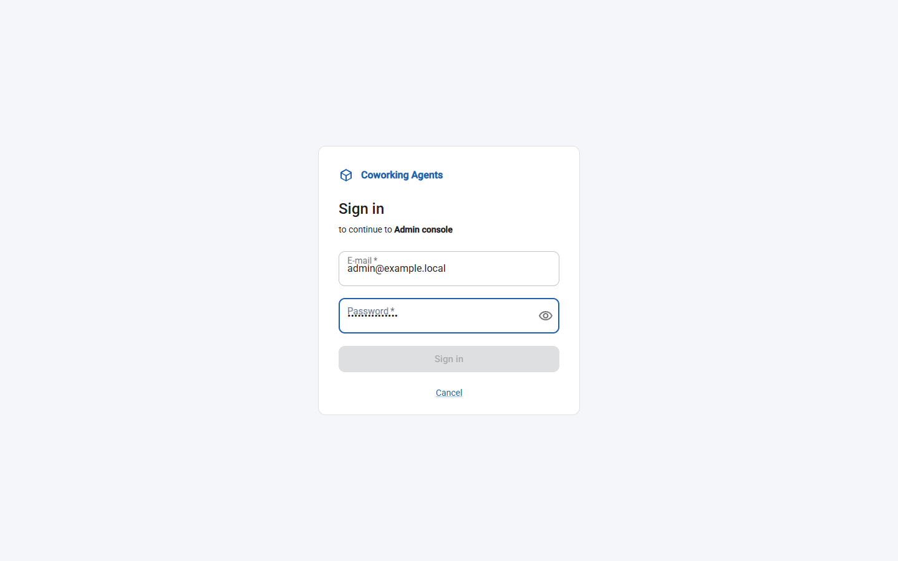

The agent UI has five menu items. Max's portrait in the top left shows his mood: happy when idle, in doubt while he
waits for a decision, fearful when something went wrong.

| Menu item | What it is for |
|---|---|
| [Tasks](#tasks) | ask Max for work, follow it, decide on plans |
| [Activity timeline](#activity-timeline) | what Max did, for whom and when |
| [Schedules](#schedules) | recurring and future work |
| [Workspace](#workspace) | the shared files, with a preview for many formats |
| [Audit](#audit) | who requested, approved or changed what |

### Tasks

The task list shows every task with its status, who requested it and who approved it. The banner on top shows:

- whether Max is busy and how many tasks wait for the workspace;
- **how much Max spent in the last 30 days**, against his spend limit in USD.

When the limit is reached, Max starts no new work until an administrator raises it.

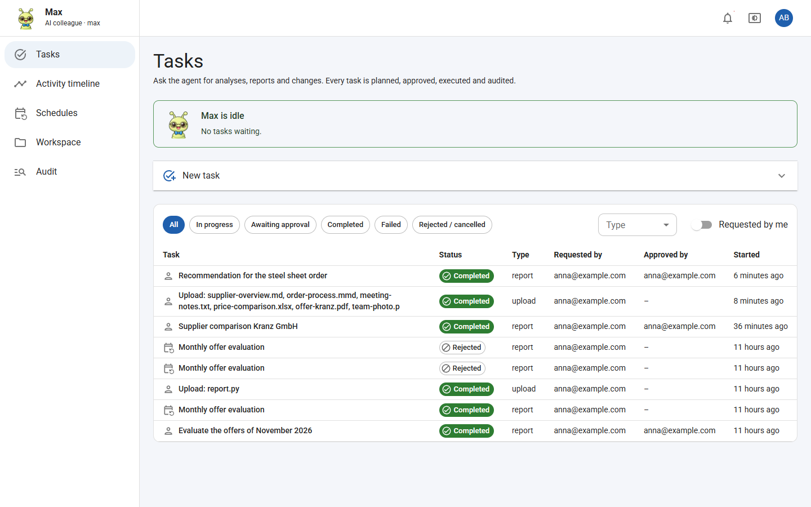

Under **New task**, Anna:

1. Describes what she needs (Markdown is fine).
2. Picks a type (*Report* produces a document).
3. Picks an approval mode. With **Approve plan first**, Max writes a plan and waits before he changes anything.

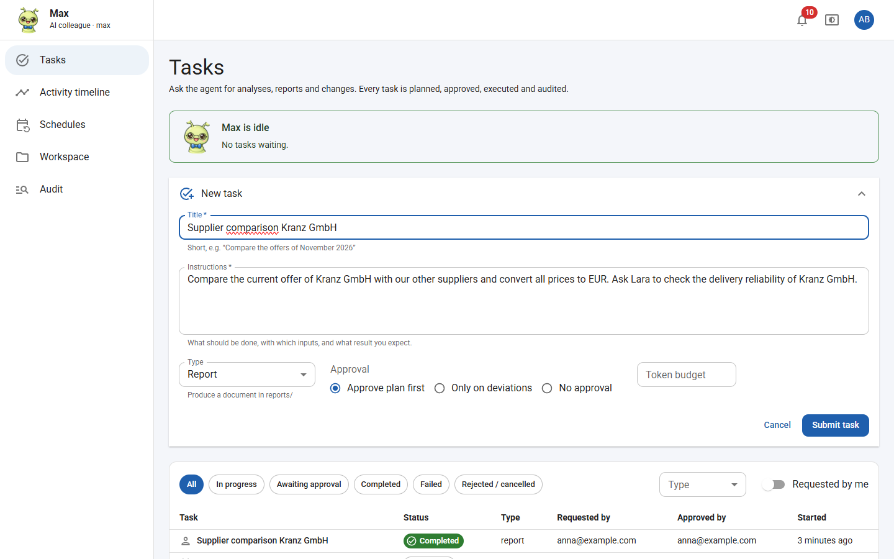

#### The conversation: one history per task

Each task has a **Conversation** that collects everything that happened in the task, as Markdown:

- **Anna's side:** her request and every decision with its comment.
- **Max's side:** what he reported after each step, answers from colleagues, and the result with its files.

Clicking a file opens the preview.

While Max waits, he says so in the conversation. The decision card above it offers **Approve**, **Request changes** and
**Reject**.

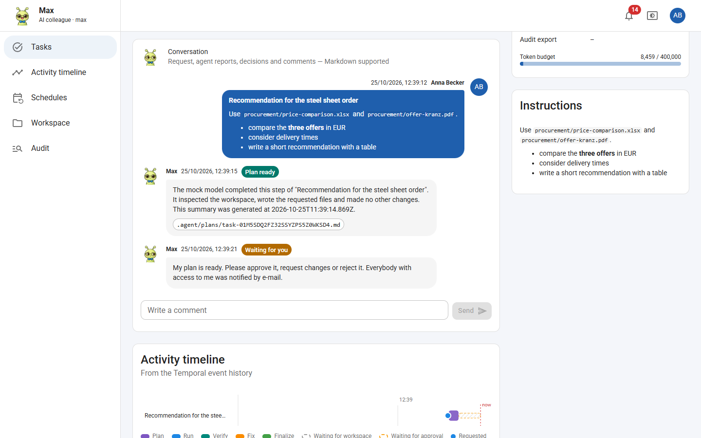

#### Human in the loop: Max asks by e-mail

Nobody has to watch the UI. As soon as a plan waits for a decision, Max sends an e-mail to **everybody who has access
to him**, and sends another as a reminder later. The buttons in the mail lead straight into the decision dialog of
this task.

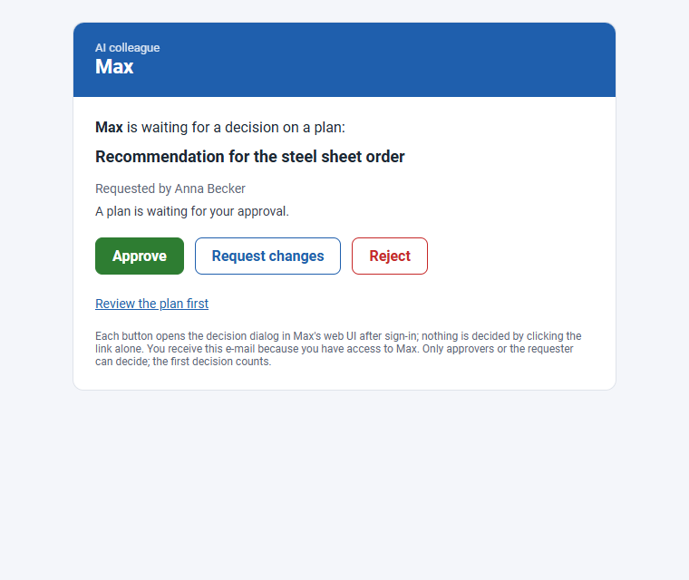

Clicking **Approve** opens the agent UI, after sign-in if needed, with the confirmation dialog already open. Anna adds
a comment and confirms. Clicking the link alone never decides anything.

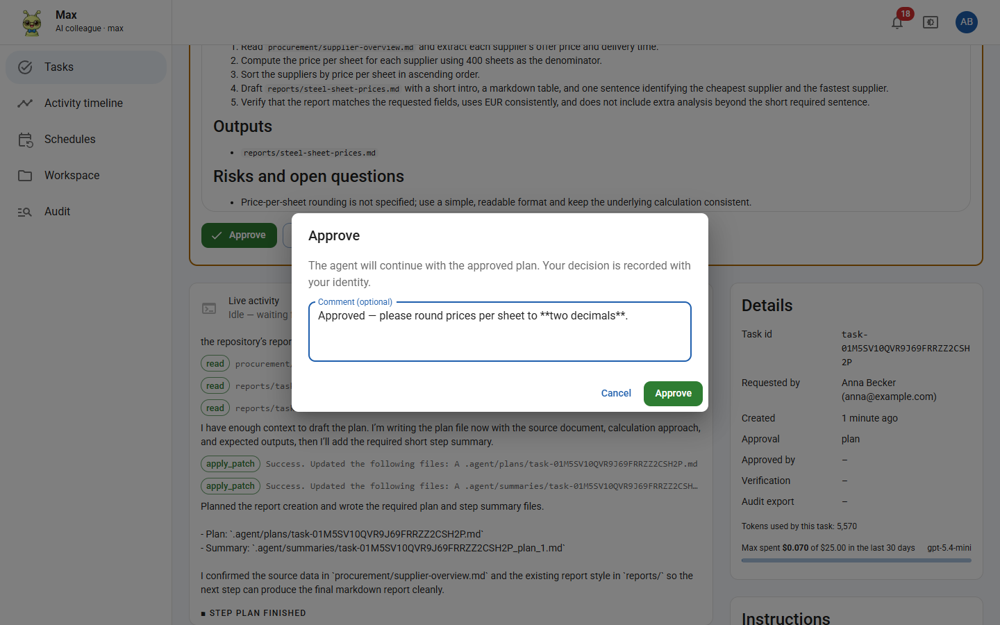

Max continues. When he is done, the conversation shows the decision, his report and the result files.

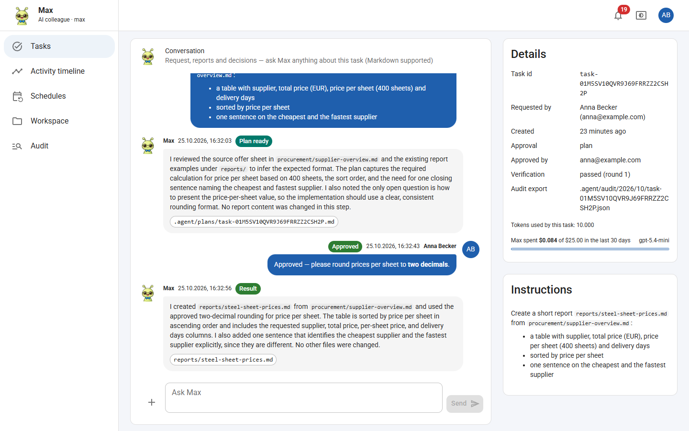

The report contains the result itself, not just a description of the work. Clicking it opens the preview:

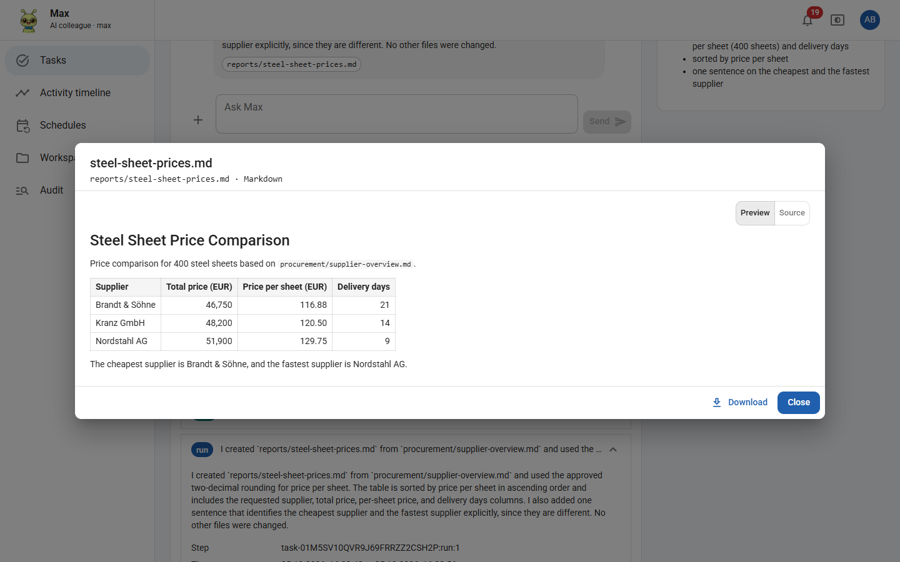

Finished tasks have a **Run again** button that starts the same request as a new task.

#### Ask the agent

The box at the bottom of the conversation is a **chat with the agent**. It works on running and finished tasks.
Ask anything about the task: why a decision was made, what a file contains, or what is shown in a picture. The agent
answers with its model, from the task, its files and its images. Each answer shows the model, tokens and cost, and
counts towards the spend limit.

The **+** button attaches one or more files. They appear as a preview above the input, with a thumbnail for pictures
and their size, and each can be removed again (or all at once) before sending. **Upload & send** uploads the remaining
files into the workspace as one audited upload task, waits until they are committed and then sends the question with
the file paths, so the agent reads them. Without a question, **Upload** only uploads them.

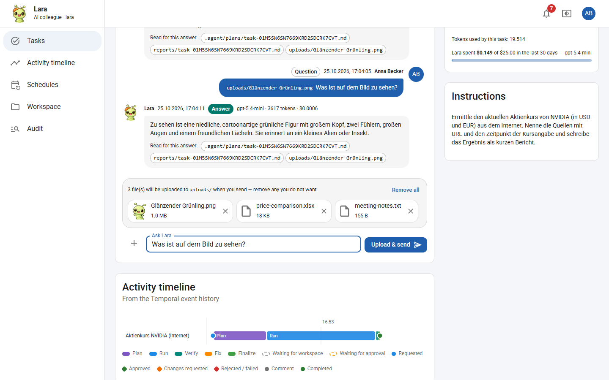

The agent reads files that were uploaded or named in the question. The chat itself never changes files: for new work, start a task or
request changes.

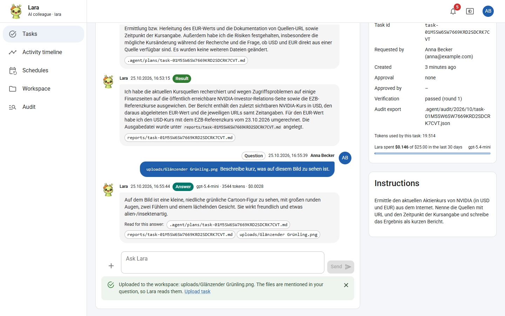

### Activity timeline

The timeline shows what Max worked on, as lanes per task: planning, running, waiting for approval, verifying. It is
reconstructed from the Temporal event history. Click a lane to open the task.

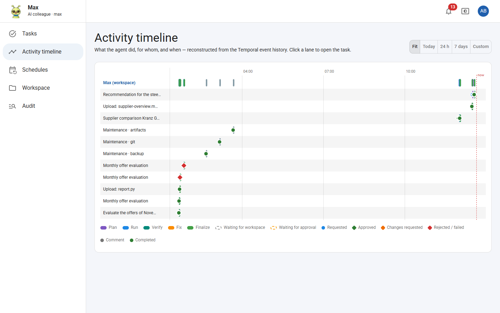

### Schedules

Recurring work, such as a monthly offer evaluation, is a schedule. Every run is a normal task with the schedule owner
as requester. Schedules can be paused or run once on demand, and each one has its own approval rule.

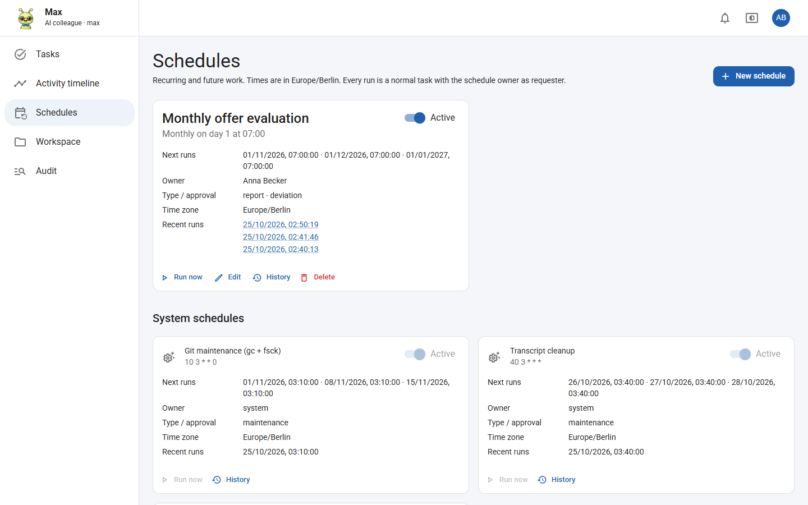

### Workspace

The workspace is Max's shared data set, a Git repository. It is read-only here: files change only through tasks and
uploads, so every change is traceable. **Upload** adds files as a task of its own.

The preview shows files directly in the browser:

| Format | Preview |
|---|---|
| Markdown | rendered, including tables and Mermaid diagrams; *Source* toggle |
| Mermaid (`.mmd`) | diagram |
| PDF | the browser's PDF viewer |
| Excel (`.xlsx`, `.xls`) | one tab per sheet, values only |
| CSV | table |
| PNG, JPEG | image |
| Text and code | monospace |

*History* lists the commits that touched the file.

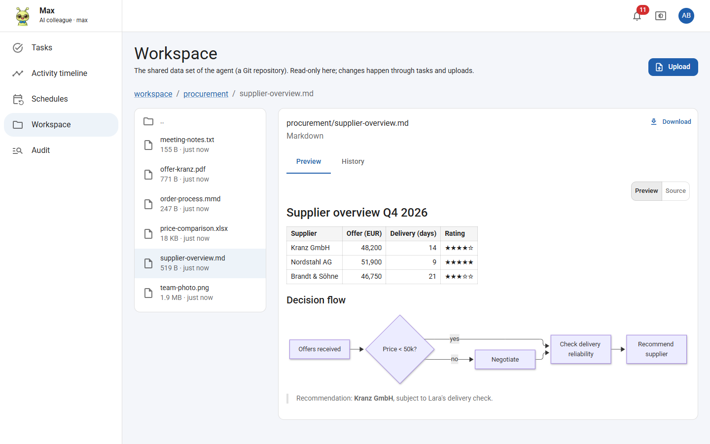

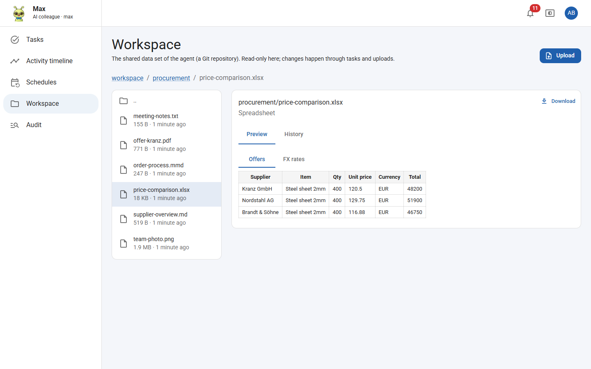

### Audit

The audit search finds tasks and commits by text, person, path and period: who requested something, who approved it,
and what exactly changed. Tasks that are older than the Temporal retention come from their audit export.

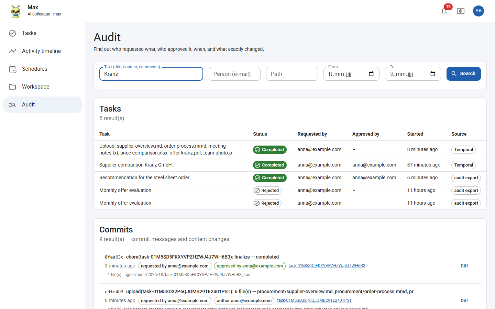

---

## Part 2 — The admin sets up a colleague

### Create the agent

In the admin console, go to **Agents → New agent** and enter:

- a display name, e.g. *Lara*;
- an agent id (permanent, used in URLs and workflow ids);
- an optional description.

**Create agent** then:

- registers an OIDC client for the agent;
- creates a workspace volume;
- starts the container (API, Temporal worker and Agent Harness).

Access is granted per agent under **Users & access**, or on the agent's *Access* tab.

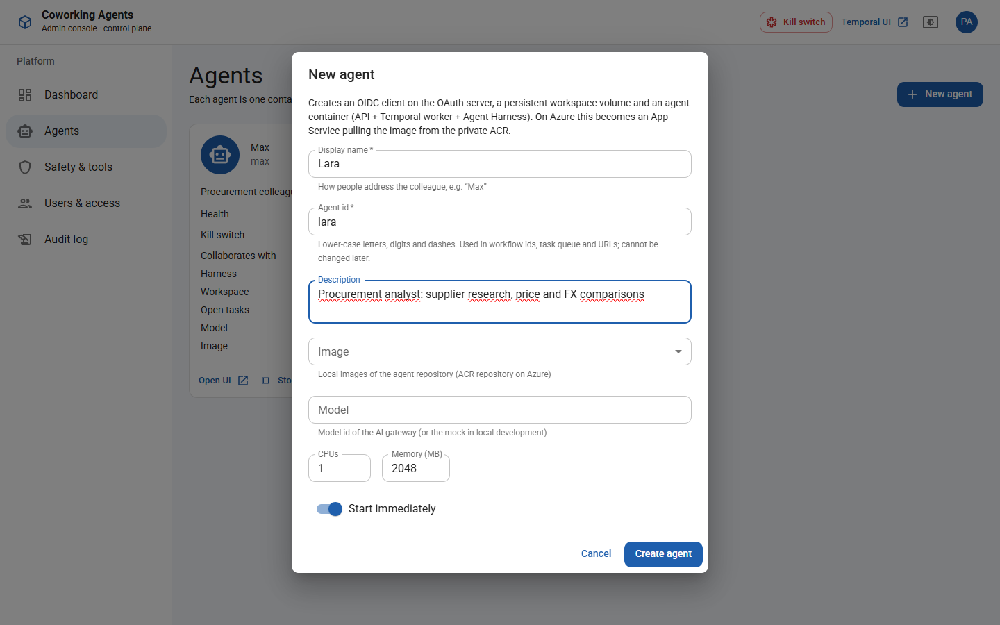

### Give the colleague a face

On the agent's **Portrait** tab:

1. Describe the character.
2. Press **Generate portraits**.

The OpenAI image model turns the shared guiding image (left) into this colleague's portrait, in four moods. The whole
character, including the antennae, stays inside the frame. Use **Redo** to regenerate a single mood, or **Replace** to
change the guiding image for all agents.

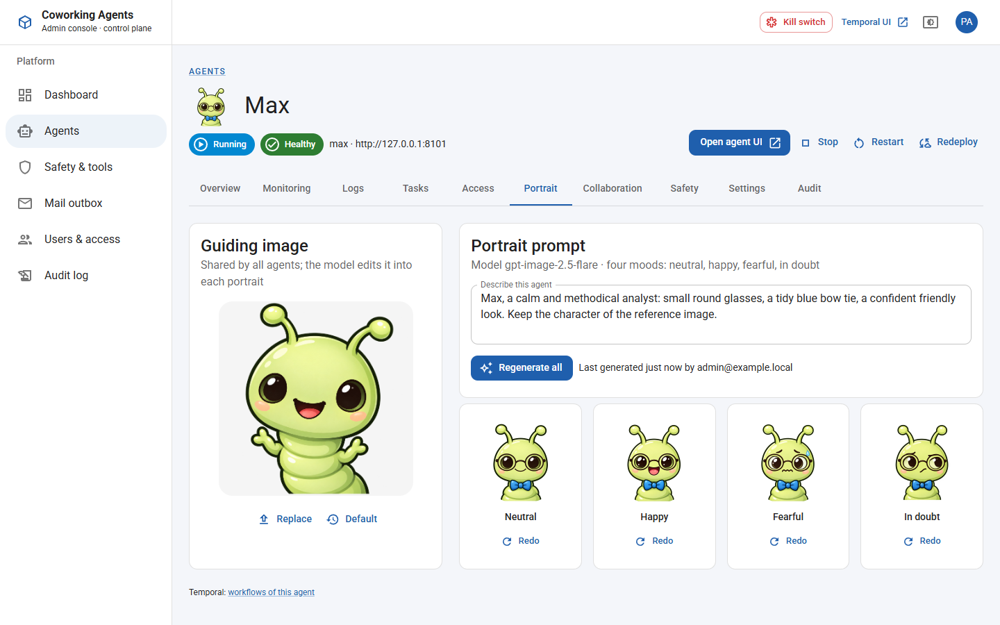

### AI & budget

On the agent's **AI & budget** tab, the admin:

- sets the **spend limit** (USD per rolling 30 days) and the **model**;
- sees the spend per day;
- manages the agent's LiteLLM **virtual key**: allowed models, budget backstop, **Block / Unblock** and **Rotate**.

Everything goes through the LiteLLM API in the background; the LiteLLM UI is not needed for these tasks.

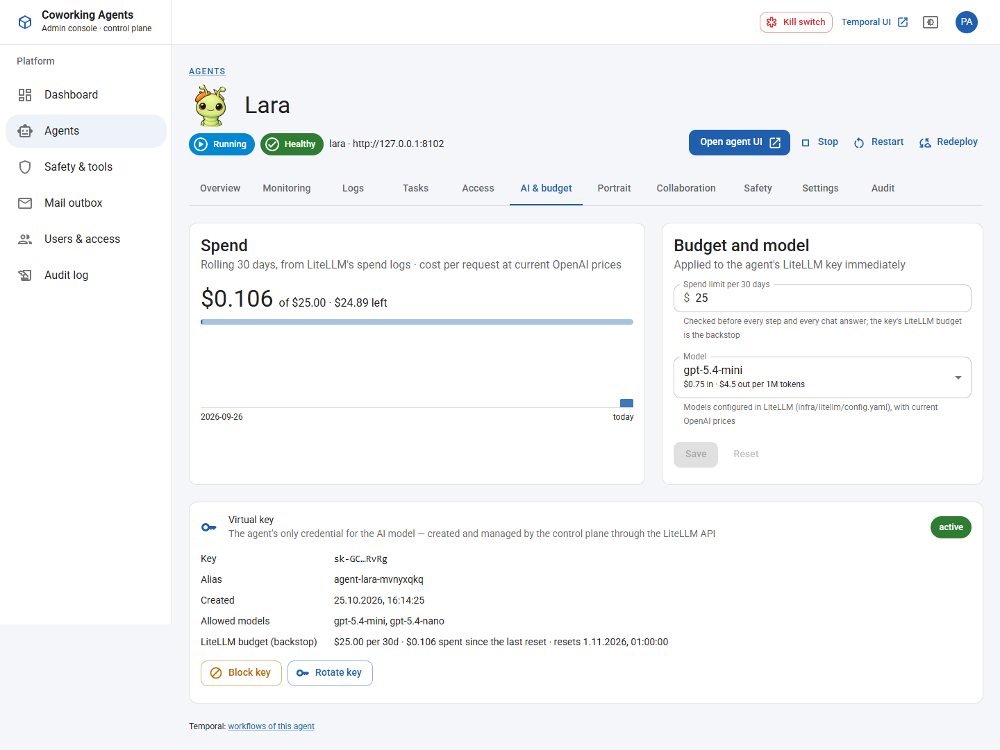

### Allow collaboration and tools

Agents are **isolated** by default. On Max's **Collaboration** tab, add Lara under *May delegate to*. Max can now
hand over tasks to her; the reverse is not allowed. On the **Safety** tab, allow Max the company tools offered by the
MCP gateway. Max never sees the credentials of these systems: the gateway takes them from Key Vault.

**Internet access** works the same way. The tools `web__search` and `web__fetch_url` come from the `mcp-web` container
behind the gateway, and in this setup only Lara may use them. Every call is audited, the kill switch applies, and
private or internal addresses are refused. Asked for the current NVIDIA share price, Lara searched the web, read the
investor-relations page and the ECB reference rate, and wrote a report with prices and sources.

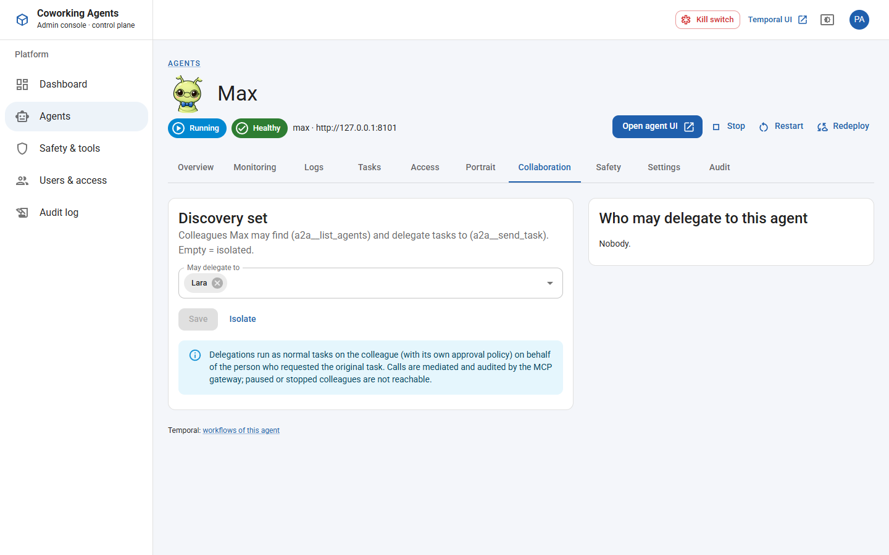

---

## Part 3 — Colleagues working together

Anna asks Max for a supplier comparison and approves his plan.

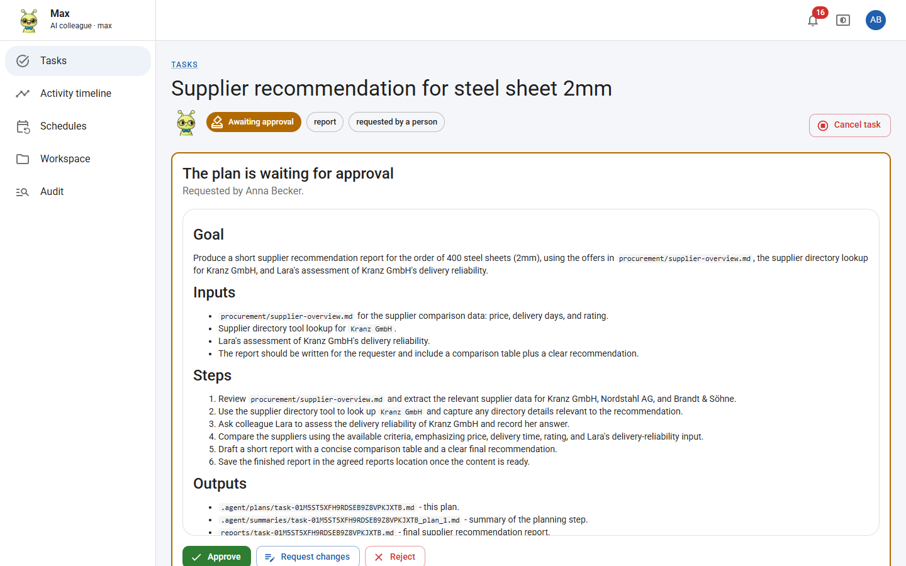

Max works through the plan on his own:

1. He looks up which colleagues he may ask.
2. He calls the supplier directory through the MCP gateway.
3. He hands the delivery-reliability check to Lara.
4. He waits for her answer without blocking his workspace.

At Lara, the request is an ordinary task, *delegated by agent max for Anna Becker*, with its own plan, approval
policy and audit trail.

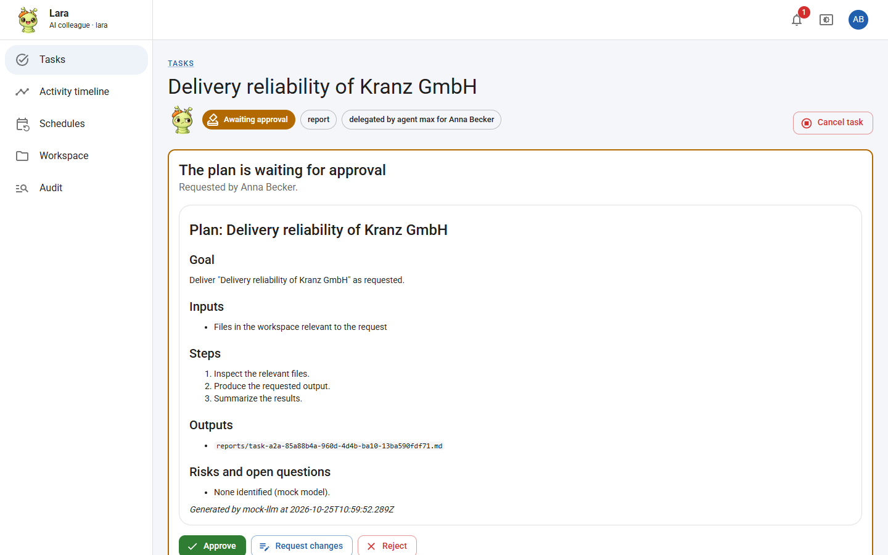

When Lara has finished, her answer appears in Max's conversation. Max integrates it into his report and completes
the task. Anna then asks Max in the chat which supplier he recommends and why. His answer refers to her approval
comment (delivery reliability before price) and to Lara's assessment.

---

## Part 4 — Staying in control

### AI gateway and spend

The dashboard's **AI gateway** card shows:

- the models configured in LiteLLM, with their current OpenAI prices per 1M tokens;
- each agent's spend of the last 30 days against its limit.

Model and spend limit are chosen when an agent is created and can be changed in the agent's *Settings*.

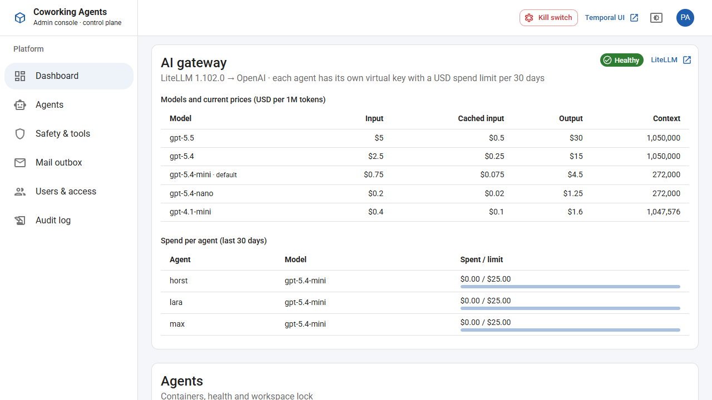

### Mail outbox

Every e-mail agents send is listed in the admin console's **Mail outbox**, with its recipients, delivery status and an
HTML preview.

- With a mail API configured (`MAIL_API_URL`, which receives `POST { to[], subject, body }`), mails are delivered
  through it.
- Without one, they are only written to the outbox directory `mail_out`.

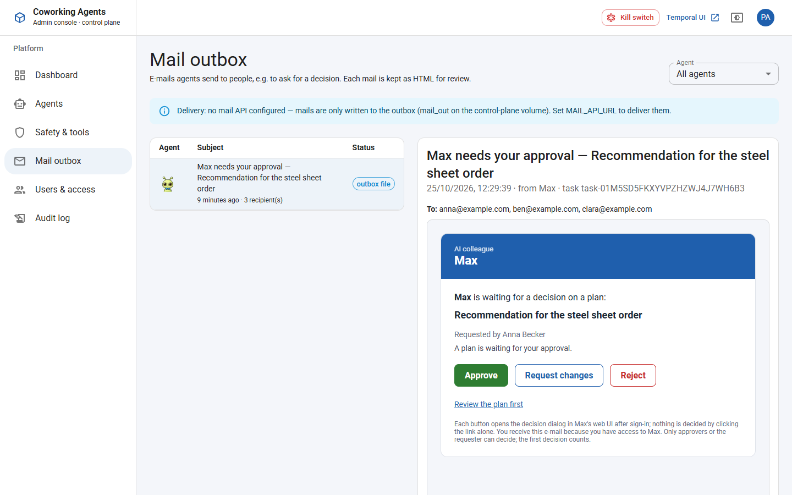

### Kill switch and safety rules

The **Safety & tools** page brings the safety controls together:

- the **kill switch** for each agent, and the red top-bar button for all agents at once;
- the automatic triggers;
- the A2A discovery sets;
- the MCP gateway's upstream systems;
- the Key Vault secrets they use.

Levels, from mild to strict:

| Level | Effect |
|---|---|
| **Tools off** | company tools and delegation are blocked |
| **Paused** | no work runs; an interrupted step resumes later |
| **Stopped** | running tasks are cancelled and the container stops |

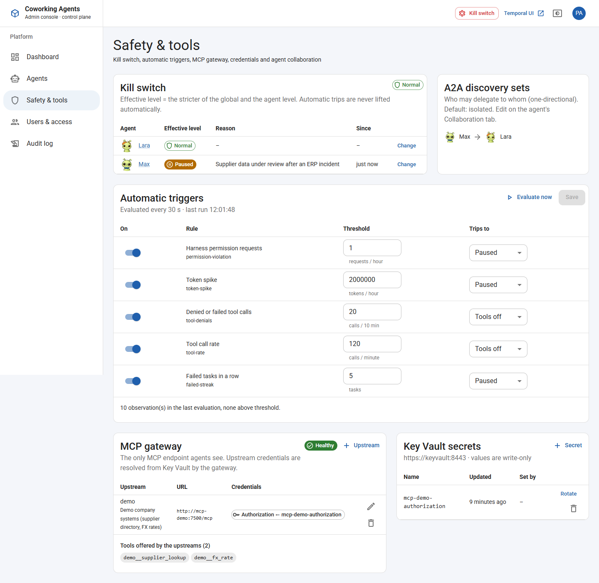

When an agent is paused, its users see a banner: who paused it, why, and what that means.

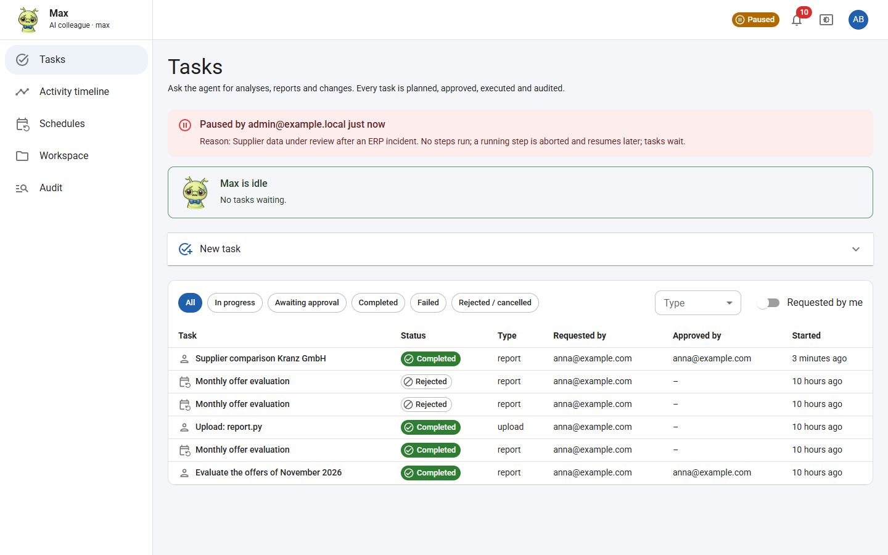

---

## Where to go next

- [docs/architecture.md](docs/architecture.md): how it works.
- [docs/adr/](docs/adr/README.md): why it is built this way, for example:
  - [ADR-0026](docs/adr/0026-human-in-the-loop-email.md) human in the loop by e-mail;
  - [ADR-0027](docs/adr/0027-workspace-file-preview.md) file preview;
  - [ADR-0028](docs/adr/0028-task-conversation.md) task conversation.
- [docs/azure.md](docs/azure.md): what this becomes on Azure.
- [docs/runbook.md](docs/runbook.md): operations, including the emergency stop.
