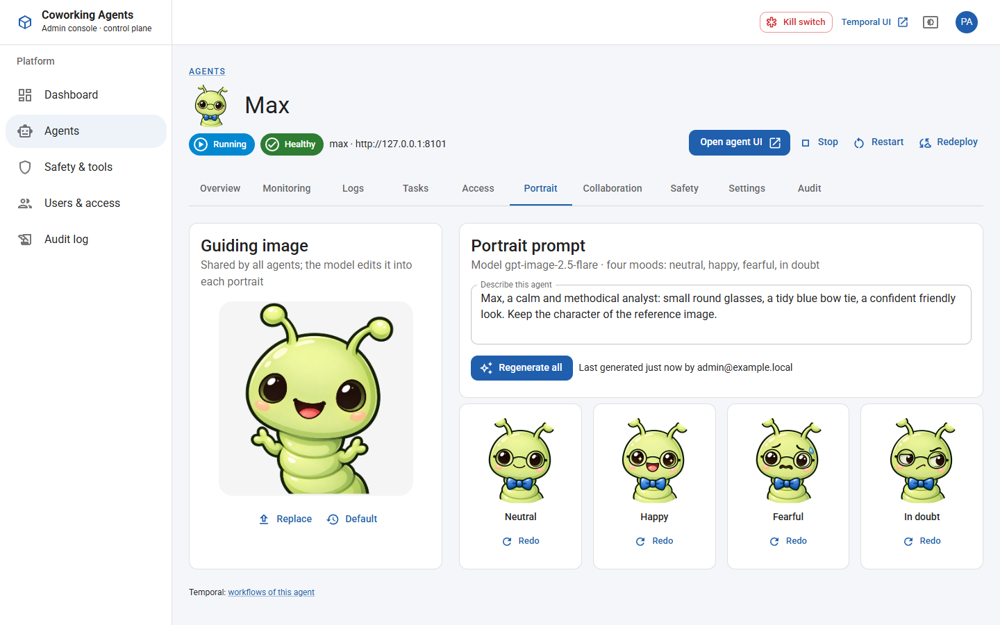
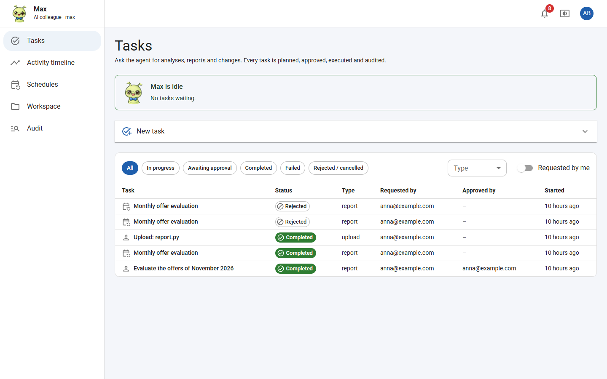
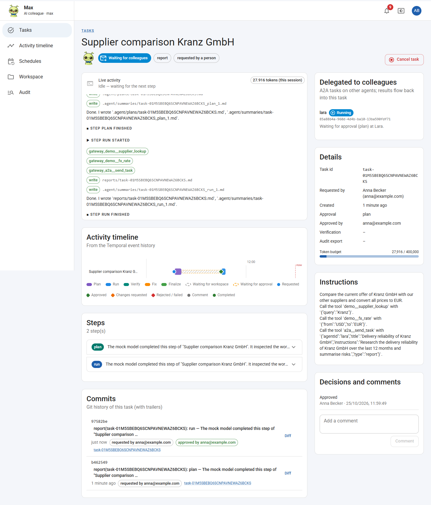

# Guided tour: from a new agent to a finished, delegated task

This tour walks through the local stack in the order a team would use it:

1. A platform admin sets up an AI colleague.
2. A person works with the colleague.
3. The colleague asks another colleague for help.
4. The admin keeps everything under control with the kill switch.

All screenshots come from a real run on Docker Desktop. The run uses the scripted mock model, so the texts the
colleague writes are placeholders.

> **Before you start:** run `node scripts/stack.mjs up` (see [docs/getting-started.md](docs/getting-started.md)).
> The script prints the admin login and the password of the demo users Anna, Ben and Clara. For portraits, set
> `OPENAI_API_KEY` in your environment before starting the stack.

| Who | Role in the tour | Signs in at |
|---|---|---|
| Platform admin (`admin@example.local`) | creates and configures agents | admin console http://localhost:8080 |
| Anna (`anna@example.com`) | asks Max for a supplier comparison | agent Max http://localhost:8101 |
| Max, Lara | AI colleagues; Max may delegate to Lara | — |

---

## Part 1 — The admin sets up a colleague

### 1. Sign in

Every user interface signs in through the platform's own OpenID Connect server. Admins and users use the same sign-in
page; what each person can do comes from their roles.

### 2. Create the agent

Go to **Agents → New agent** and enter:

- a display name, e.g. *Lara*;
- an agent id (permanent, used in URLs and workflow ids);
- an optional description.

Leave image and model at their defaults. **Create agent** then:

- registers an OIDC client for the agent;
- creates a workspace volume;
- starts the container (API, Temporal worker and Agent Harness).

The agent is healthy within a few seconds.

### 3. Give the colleague a face

On the agent's **Portrait** tab:

1. Describe the character.
2. Press **Generate portraits**.

The admin console asks the OpenAI image model to turn the shared guiding image (left) into this colleague's portrait,
in four moods. The colleague's mood then follows its work:

| Mood | When |
|---|---|
| Happy | idle or task completed |
| In doubt | waiting for an approval |
| Fearful | something failed or the kill switch is active |

Use **Redo** to regenerate a single mood, or **Replace** to change the guiding image for all agents.

### 4. Allow collaboration

Agents are **isolated** by default. On Max's **Collaboration** tab, add Lara under *May delegate to*. Max can now find
Lara and hand over tasks to her. The direction matters: this does not allow Lara to delegate to Max.

On the **Safety** tab, also allow Max the company tools offered by the MCP gateway; for the demo these are
`demo__supplier_lookup` and `demo__fx_rate`. Max never sees the credentials of these systems: the gateway takes them
from Key Vault.

---

## Part 2 — Working with the colleague

### 5. Meet Max

Anna opens Max's address and signs in. The status banner shows whether Max is busy and how many tasks are waiting.
Max's portrait shows his mood.

### 6. Ask for something

Under **New task**, Anna:

1. Writes a title and what she needs.
2. Picks a type (*Report* produces a document).
3. Picks an approval mode.

With **Approve plan first**, Max writes a plan before he changes anything.

> **With the mock model:** the mock only calls tools when the instructions say so explicitly. For the run in these
> screenshots, the instructions contained lines such as
> ``Call the tool `demo__fx_rate` with `{"from":"USD","to":"EUR"}`.`` and
> ``Call the tool `a2a__send_task` with `{"agentId":"lara","title":"…","instructions":"…"}`.``
> A real model decides on its own which tools and colleagues to use.

### 7. Approve the plan

Max plans and stops. Anna, or an approver such as Ben, reads the plan and chooses one of:

- **Approve**;
- **Request changes**, with a comment;
- **Reject**.

Max's portrait is *in doubt* while he waits.

### 8. Max works and asks Lara for help

After the approval, Max executes the plan. *Live activity* shows each action:

- the company tools he calls through the gateway (`gateway_demo__supplier_lookup`, `gateway_demo__fx_rate`);
- the files he writes;
- the hand-over to Lara (`gateway_a2a__send_task`).

The task then shows **Waiting for colleagues**. Max releases his workspace, so he can work on other tasks meanwhile.
The *Delegated to colleagues* card shows where Lara stands.

### 9. Lara's side: a normal task, on behalf of Anna

On Lara's side, the delegation is an ordinary task:

- It is labelled *delegated by agent max for Anna Becker*.
- It has its own plan, its own approval and its own audit trail.

Anna (or an approver of Lara) approves Lara's plan the same way.

### 10. The result comes back

When Lara has finished, Max takes over again:

1. He picks up her result.
2. He works it into his report in an extra step.
3. He verifies the result and completes the task.

The card shows Lara's task as completed, the result links the report, and Max is happy. The activity timeline,
steps, commits (with `Requested-By` / `Approved-By` trailers) and the audit page make every step traceable.

---

## Part 3 — Staying in control

### 11. Safety & tools

The admin console's **Safety & tools** page brings the safety controls together:

- the **kill switch** for each agent, with its reason and since when it applies;
- the **A2A discovery sets** (who may delegate to whom);
- the **automatic triggers**, which raise the kill switch level on token spikes, permission requests, tool-error
  storms or failure streaks;
- the upstream systems of the **MCP gateway**;
- the **Key Vault** secrets they use (write-only).

The red **Kill switch** button in the top bar acts on *all* agents at once.

Levels, from mild to strict:

| Level | Effect |
|---|---|
| **Tools off** | company tools and delegation are blocked |
| **Paused** | no work runs; an interrupted step resumes later; tasks keep their place |
| **Stopped** | running tasks are cancelled and the container is stopped |

A reason is always required.

### 12. What the users see

When an agent is paused, everyone using it sees a banner: who paused it, why, and what that means. Max looks
worried. New tasks can still be submitted and plans approved; they simply wait until the admin lifts the pause.

---

## Where to go next

- [docs/architecture.md](docs/architecture.md): how it works (Temporal workflows, workspace lock, harness, gateway).
- [docs/adr/](docs/adr/README.md): why it is built this way (e.g. [ADR-0021](docs/adr/0021-mcp-gateway.md) MCP gateway,
  [ADR-0022](docs/adr/0022-kill-switch.md) kill switch, [ADR-0023](docs/adr/0023-a2a-between-agents.md) A2A).
- [docs/azure.md](docs/azure.md): what this becomes on Azure.
- [docs/runbook.md](docs/runbook.md): operations, including the emergency stop.
